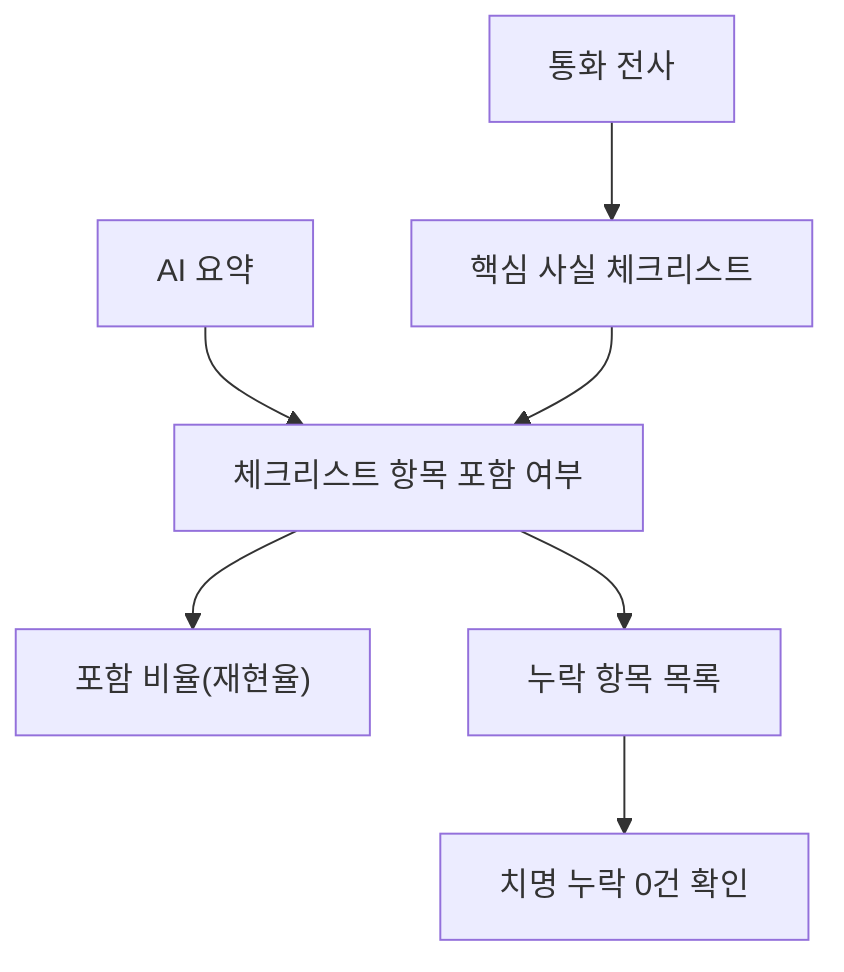

# 요약 누락 (Summary Omission)

> 요약에 적힌 내용은 모두 사실인데 **꼭 들어가야 할 정보가 빠진 문제**. 틀린 문장이 없어서 충실도 점검을 통과하기 쉽고, 검수자도 "없는 것"은 눈치채기 어렵다.

## 쉽게 말하면
의사 소견서에 적힌 말은 전부 맞는데 "페니실린 알레르기가 있음"이라는 한 줄이 빠졌다면 위험하다. 틀린 글은 찾기 쉬워도 빠진 글은 찾기 어렵다.

## 자세히
출처: UCLA Health 보도자료(AI 기록 도구 무작위 시험, 본문 확인, 2026-11-18). 아래 측정 방법은 제안이다.
- **실제 보고 사례(UCLA)**: 의사들이 AI가 쓴 노트에 임상적으로 의미 있는 부정확성이 "가끔" 있었다고 보고했고 **주로 누락과 대명사 오류**였다. 가벼운 환자 안전 사건 1건이 보고됐고 저자들은 의사가 AI 초안을 적극적으로 검토해야 한다고 강조했다. 의료 기록이며 상담 요약에 같은 빈도가 적용되는 것은 아니다.
- **왜 놓치기 쉬운가(해석)**: 검수자는 초안에 있는 문장을 읽고 맞는지 본다. 빠진 정보는 원문(통화)과 대조해야만 알 수 있어 시간이 더 든다([요약 검수 시간](#summary-review-time)).
- **누락의 유형(제안)**: 고객 요청 누락, 고객이 말한 제약·마감일 누락, 상담사의 약속·후속 조치 누락, 알레르기·취약 고객 표시 같은 위험 정보 누락, 부정어("환불 원하지 않음")나 조건의 누락.
- **측정 방법(제안)**: ①통화당 **핵심 사실 체크리스트**(요청·결정·약속·숫자·위험 정보)를 사람이 작성 ②요약이 체크리스트 항목을 포함하는 비율 = 재현율형 지표 ③누락 항목을 유형·심각도별로 집계 ④치명 항목(약속·위험 정보) 누락은 따로 0건을 목표로.
- **ROUGE의 한계**: 단어 겹침 지표는 짧은 요약이 기준 요약과 겹치는 비율에 치우쳐 누락을 제대로 벌주지 못한다(해석, [ROUGE·BLEU의 한계](#rouge-bleu-limits)).
- **개선(제안)**: 요약 템플릿에 필수 칸(요청, 결정, 약속, 후속 조치, 위험 표시)을 두어 비어 있으면 "없음"이라고 쓰게 한다. 비어 있는 칸은 검수자에게 강조한다.
- **한계**: 무엇이 핵심인지는 업무마다 다르다. 체크리스트를 만드는 데 도메인 전문가가 필요하다([도메인 전문가 검토](#domain-expert-review)).

## 그림으로 보기

## 예시
- 통화에서 요청 3건, 약속 1건, 위험 정보 1건(총 5개)이 있었는데 요약이 3개만 담았다면 포함 비율 60%. 빠진 것이 "상담사가 내일 전화하기로 약속"이면 치명 누락.
- 교육 활용: 같은 통화 요약 10건에서 "틀린 문장"과 "빠진 정보"를 각각 찾아보고 어느 쪽이 더 오래 걸리는지 비교.

## 헷갈리는 것과 비교
| 개념 | 차이 |
|---|---|
| 요약 누락 | 있어야 할 정보가 빠짐 |
| 환각 | 없는 정보를 지어냄 |
| [요약 충실도 점수](#summary-faithfulness-score) | 쓰인 내용이 근거 있는지 |
| [요약 완전성](#summary-completeness) | 핵심 요소를 얼마나 덮었는지 |

## 더 읽을거리
- [UCLA Health: AI 스크라이브 시험](https://www.uclahealth.org/news/release/ucla-study-finds-ai-scribes-may-reduce-documentation-time) — 누락이 주된 부정확성이라는 의사 보고
