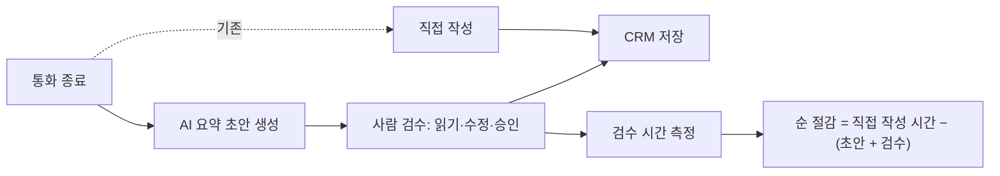

# 요약 검수 시간 (Summary Review Time)

> AI가 만든 통화·진료 요약을 **사람이 읽고 고치고 승인하는 데 드는 시간**. AI 요약 도입의 순효과는 "작성 시간 감소"에서 "검수 시간"을 뺀 값이므로, 후처리 시간(ACW)을 줄였다고 보고할 때 이 시간이 빠져 있으면 효과가 과대평가된다.

## 쉽게 말하면
비서가 회의록 초안을 대신 써 줘도, 내가 초안을 읽고 틀린 곳을 고치는 시간이 든다. 초안이 많이 틀리면 직접 쓰는 것과 시간이 비슷해질 수 있다. 줄어든 시간은 "초안 작성"이 아니라 "초안을 쓰는 시간 − 고치는 시간"으로 따져야 한다.

## 자세히
출처: UCLA Health 보도자료(NEJM AI 무작위 시험 소개, 본문 확인, 2026-11-18)와 검색 요약. PubMed 초록은 열지 못했고 논문 원문 수치는 직접 확인하지 못했다. 이 시험은 의사의 진료 기록(의료)이며 콜센터 상담이 아니다. 의료와 상담의 결과를 같은 크기로 적용할 수 없다.
- **시험 설계(UCLA)**: 의사 238명(14개 전문 분야), 약 72,000건 진료, 2024-11~2025-01, 무작위 배정(DAX, Nabla, 통상 기록). 스크라이브가 진료를 녹음해 노트 초안을 쓰고 **의사가 검토·수정**한다.
- **기록 시간**: Nabla 군 평균 노트 작성 시간 4:30 → 3:49(약 41초 감소), 대조군 4:22 → 4:04(약 18초 감소). Nabla의 감소는 대조군보다 9.5% 더 크고 통계적으로 유의. DAX는 감소했으나 유의하지 않았다. 보도자료는 정확한 p값을 적지 않았고, 검색 요약은 Nabla −9.5%(95% 구간 −17.2~−1.8, P=0.02), DAX −1.7%(P=0.66)를 전한다.
- **계산 확인(직접)**: Nabla 군 감소 41초는 기준 4:30(270초)의 약 15%이고 대조군의 감소 18초(262초 중 약 7%)를 빼면 순효과가 9.5%에 근접한다. 즉 대조군에서도 시간이 줄었다는 점이 중요하다 — 도입 전후 단순 비교는 효과를 과대평가한다.
- **정확성 우려**: 의사들이 AI 노트에 임상적으로 의미 있는 부정확성이 "가끔" 있었다고 보고했다(주로 누락과 대명사 오류). 가벼운 환자 안전 사건 1건 보고. 저자들은 의사가 AI 초안을 적극적으로 검토해야 한다고 강조한다.
- **번아웃·기타**: 두 도구 모두 번아웃 점수가 대조군 대비 약 7% 개선(추가 연구 필요). 환자 거부 10% 미만. 단일 의료기관·짧은 기간이라 일반화에 한계.
- **이 시험이 재지 않은 것**: 검토·수정에 쓴 시간을 따로 보고한 수치는 찾지 못했다(검색 요약도 같은 한계 언급). 전체 노트 시간에는 검수가 포함되지만 분리되지 않는다.
- **상담에의 시사점(제안)**: ①ACW를 줄였다는 주장은 요약 작성과 검수 시간을 합친 총 시간으로 ②검수 시간을 따로 측정(요약 열람~승인 이벤트) ③정확성 오류(누락·대명사)는 검수 시간과 품질 사이의 균형 ④검수를 생략하는 압력이 [형식적 승인](#blind-approval-signal)을 낳는다.

## 그림으로 보기

## 예시
- 직접 작성 198초 → AI 요약 후 검수 95초라면 순 절감 103초(가상). 검수에 150초가 든다면 순 절감은 48초로 줄어든다.
- 교육 활용: 벤더의 "후처리 50% 감소" 주장에서 검수 시간이 포함됐는지, 대조군이 있었는지 묻는 체크리스트.

## 헷갈리는 것과 비교
| 개념 | 차이 |
|---|---|
| 요약 검수 시간 | 초안을 읽고 고치는 시간 |
| [후처리 시간 ACW](#after-call-work) | 통화 후 작업 전체 시간 |
| [ACW 측정법](#acw-measurement) | 전후·대조군으로 효과를 재는 설계 |
| 작성 시간(time-in-note) | 검수까지 포함한 총 노트 시간 |

## 더 읽을거리
- [UCLA Health: AI 스크라이브 시험 보도자료](https://www.uclahealth.org/news/release/ucla-study-finds-ai-scribes-may-reduce-documentation-time) — 설계·시간 변화·정확성 우려
- [NEJM AI 시험 초록(PubMed 41497288)](https://pubmed.ncbi.nlm.nih.gov/41497288/) — 원 논문(이번에는 열지 못함)
