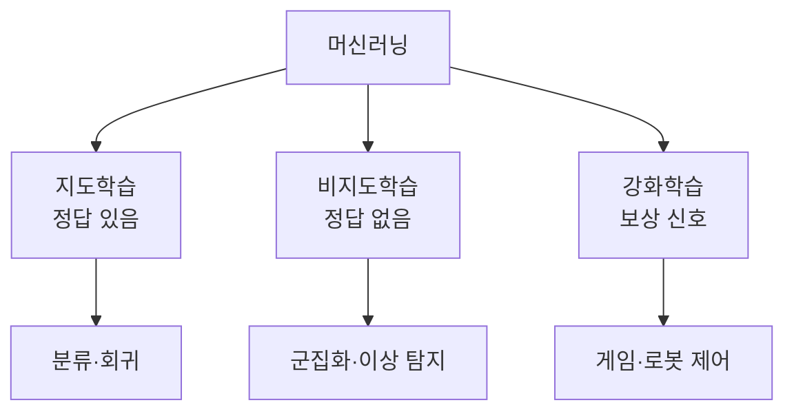
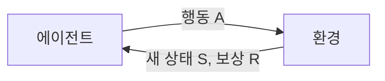

# 지도·비지도·강화학습

> 머신러닝의 세 갈래. 정답(레이블)을 보고 배우면 지도, 정답 없이 구조를 찾으면 비지도, 보상을 보고 시행착오로 배우면 강화학습이다.

## 쉽게 말하면
지도학습은 정답지가 있는 문제집, 비지도학습은 정답 없이 "비슷한 것끼리 묶어 보세요"라는 분류 놀이, 강화학습은 게임을 하며 점수로 배우는 것이다.

## 자세히
- **지도학습**(Google ML 입문 기준): 입력 특성과 정답(label) 쌍으로 학습한다. 모델이 예측 → 실제 값과 비교 → 차이를 줄이도록 조정. 시험은 정답을 숨긴 데이터로 한다. 예: 스팸 판별, 집값 예측, 고양이 사진 인식, 강수량 예측.
- **비지도학습**: 정답 없이 데이터 자체의 패턴을 찾는다. 대표는 군집화(비슷한 고객끼리 묶기), 차원 축소, 이상 탐지. (이 항목은 일반 개념 설명이며 이번에 해당 공식 페이지를 열어 확인하지 못했다.)
- **강화학습**(Hugging Face Deep RL Course 기준): 에이전트가 환경에서 상태를 받고 행동하면 환경이 새 상태와 보상을 돌려준다. 목표는 누적 보상의 기대값(return) 최대화. 미래 보상은 할인율 γ(0~1)로 깎는다.
- **자기지도학습**: 데이터 일부를 가려 맞히게 하는 방식(다음 단어 맞히기). [LLM](#llm-basics) 사전학습의 기반이며 레이블을 사람이 달 필요가 없다.
- 현업 감각: 레이블 만들기가 비싸서 자기지도로 크게 배운 뒤 지도·강화로 다듬는 순서가 흔하다.

## 그림으로 보기

## 예시
- 지도: 메일 1만 통에 스팸/정상 표시 → 새 메일 판별.
- 비지도: 쇼핑몰 구매 기록으로 고객 군집 3~5개 발견.
- 강화: 시뮬레이터 속 로봇이 넘어지지 않고 걸을수록 보상([피지컬 AI](#physical-ai)).

## 헷갈리는 것과 비교
| 개념 | 차이 |
| --- | --- |
| 지도 | 정답 레이블로 학습 |
| 비지도 | 레이블 없이 구조 발견 |
| [강화학습](#reinforcement-learning) | 보상으로 행동 정책 학습 |
| 자기지도 | 데이터 안에서 정답을 만들어 냄 |

## 더 읽을거리
- [Google ML: Supervised learning](https://developers.google.com/machine-learning/intro-to-ml/supervised) — 지도학습 정의·예
- [Hugging Face Deep RL Course](https://huggingface.co/learn/deep-rl-course/unit1/rl-framework) — 강화학습 틀
