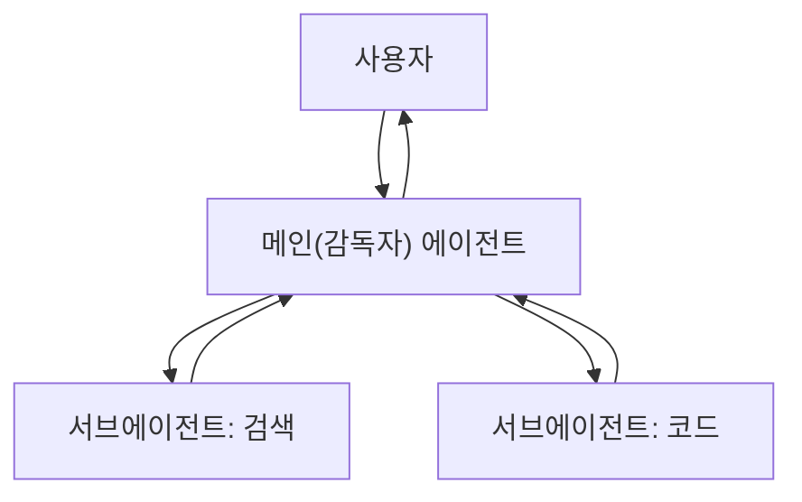
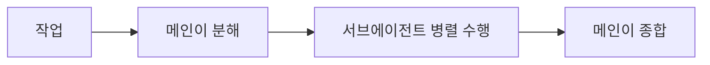

# 감독자(서브에이전트) 패턴

> 중앙의 **메인 에이전트**가 전문 **서브에이전트를 도구처럼 호출**해 일을 맡기고 모든 경로를 직접 통제하는 방식이다. LangChain 최신 문서는 이를 "서브에이전트(subagents)" 패턴으로 부른다.

## 쉽게 말하면
프로젝트 매니저가 디자이너·개발자·법무에게 각각 일을 맡기고, 결과를 모아 최종 보고서를 만든다. 담당자들은 고객과 직접 이야기하지 않고 매니저에게 보고한다.

## 자세히
(LangChain 멀티에이전트 문서 확인 — 문서에 "supervisor"라는 이름은 없고 가장 가까운 패턴이 Subagents)
- **작동**: 메인 에이전트가 전문 서브에이전트를 **도구로 호출**하며, **모든 라우팅이 메인을 거친다.**
- **적합**: 분산 개발, 병렬 작업, 다단계 작업에서 **중앙 통제**가 필요할 때.
- **제한**: 서브에이전트는 **사용자와 직접 상호작용이 약하다.**
- **효율**(문서 표): 단발 4회 호출(결과가 메인을 거쳐 1회 추가), 반복 요청(2턴) 8회, 다중 도메인 5회·약 9K 토큰. **상태가 없어** 반복 요청에서 전체를 다시 실행한다. 다중 도메인에서는 병렬로 돌아 가장 효율적이다.
- Anthropic 연구 시스템(리드 에이전트+서브에이전트)도 같은 구조이며 토큰 약 15배가 든다([멀티에이전트 토큰 비용](#multi-agent-token-cost)).
- 이름 혼동 주의: LangGraph 용어의 supervisor와 동일한 구조로 쓰이는 경우가 많지만, 이 문서만으로 세부 구현 차이는 확인하지 않았다.

## 그림으로 보기

## 예시
- 리서치 에이전트: 메인이 질문을 쪼개 서브에이전트 3개에 병렬 조사를 맡기고 요약을 합쳐 답변.

## 헷갈리는 것과 비교
| 개념 | 차이 |
|---|---|
| 서브에이전트(감독자) | 중앙 통제, 도구처럼 호출 |
| [핸드오프](#handoff-pattern) | 제어권이 에이전트 사이로 이동 |
| [라우터](#router-pattern) | 분류 후 분배, 결과 합침 |
| [작업 분해](#task-decomposition) | 감독자가 하는 첫 단계 |

## 더 읽을거리
- [LangChain 멀티에이전트 문서](https://docs.langchain.com/oss/python/langchain/multi-agent)
- [How we built our multi-agent research system](https://www.anthropic.com/engineering/multi-agent-research-system)
