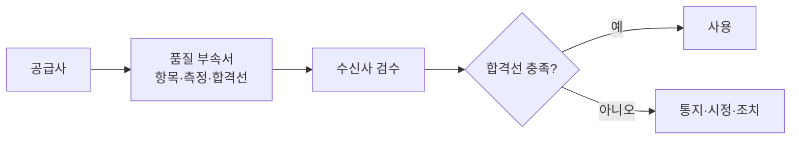
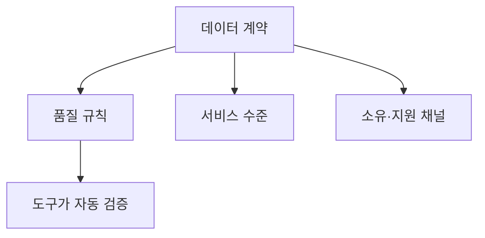

# 공급사 계약 품질 부속서

> 외부 업체가 데이터를 공급할 때 **계약서에 품질 점검표를 부속서로 붙여**, 어떤 항목을 어떤 기준으로 지키고 어긴 때 어떻게 하는지 합의해 두는 방법이다. 데이터 계약(data contract)의 사람-법률 버전에 가깝다.

## 쉽게 말하면
식자재 납품 계약서에 "납품 시 온도 5도 이하, 유통기한 7일 이상, 어기면 반품·감액" 같은 검수 기준표를 붙이는 것과 같다. 기준이 계약에 있으면 문제 발생 시 말다툼이 아니라 표를 보고 처리한다.

## 자세히
(Martin Fowler 사이트의 data contracts 글을 직접 읽었다. 이 노드의 "계약 부속서"라는 표현은 지도의 제안 형식이며 표준 용어가 아니다. 글은 조직 내 팀 간 계약 중심이라 외부 공급사 법률 계약과는 다르다.)
- **데이터 계약이란(글)**: 데이터셋의 내용과 공급자가 보장하는 사항을 **기계가 읽을 수 있고 버전이 있는 형태**로 기술한 문서. API 설계 관행을 데이터에 적용한 것이며 YAML 형식의 **Open Data Contract Standard(ODCS)** 를 사실상 표준으로 소개한다. 공급자가 발행하고 카탈로그·문서·AI 에이전트의 권위 있는 출처가 된다.
- **담는 것(글)**: 식별자·이름·버전·수명주기 상태 / 스키마·의미(표·열·타입·설명·비즈니스 이름·분류·관계) / **품질 규칙**(행 수 임계값, 허용 값, 사용자 정의 SQL)과 **서비스 수준**(최신성·보존) / **소유**(소유 팀·구성원 역할·지원 채널) / 이용 약관·제한, 위치, 역할·접근, AI 맥락, 가격 등.
- **검증(글)**: 약속을 **테스트 가능한 단언**으로 쓴다. Data Contract CLI 같은 도구가 계약을 점검하고 이전 버전 대비 **깨지는 변경**을 찾고 CI/CD에서 데이터를 시험하며, 예약 작업으로 운영 데이터를 시험해 약속이 깨지면 소유자·소비자에게 경보할 수 있다. 버전은 SemVer이고 열 삭제·이름 변경 같은 깨지는 변경은 메이저 버전을 올려 옛 버전과 함께 한동안 공개한다.
- **주의(글이 밝힌 한계)**: 계약을 쓰고 유지하는 데 시간이 든다. 모든 데이터셋에 쓸 가치는 없고 팀 간 공유 인터페이스에 집중해 점진적으로 도입한다. 소유를 명시하면 조직에 소유자가 없다는 사실이 드러난다. 설명·약관 같은 문장 필드가 방치되면 낡은 계약을 믿은 에이전트가 자신 있게 틀릴 수 있다. 발행된 계약은 일방적이며 특정 소비자의 접근은 별도 쌍방 합의가 다룬다. ODCS는 선언적 명세라 스스로 아무것도 실행하지 않는다는 지적은 검색 요약에서 본 것이다.
- **점검표를 부속서로 붙이는 방법(제안)**: ① 점검표 행(특성·항목·측정·합격선)을 계약 부속서로 첨부 ② 측정 방법을 공급자·수신자가 동의한 도구와 쿼리로 명시 ③ 위반 시 통지 기한·시정·감액 등 조치 ④ 담당자 열(공급 측·수신 측) ⑤ 변경 시 사전 통지 기간. 법적 효력은 법무 검토가 필요하다.

## 그림으로 보기

## 예시
- 외부 시장 조사 업체가 매주 CSV를 납품: 부속서에 열 목록·형식, 결측률 ≤ 2%, 납품 시각 월요일 09시, 위반 시 24시간 내 재납품을 명시하고 수신 측이 자동 검수.
- 교육 소재: "외주 데이터가 엉망일 때 계약서에 무엇이 적혀 있어야 했을까?"

## 헷갈리는 것과 비교
| 개념 | 차이 |
|---|---|
| 공급사 계약 품질 부속서 | 외부 공급자와의 품질 합의 첨부 |
| 데이터 계약(data contract) | 기계 판독 가능한 공급자 보장 명세 |
| [점검표 담당자 열](#dq-checklist-owner-column) | 조치 책임자 칸 |
| [데이터 품질 점검표](#data-quality-checklist-template) | 부속서의 본문이 되는 표 |

## 더 읽을거리
- [Data Contracts (Martin Fowler 사이트)](https://martinfowler.com/articles/data-contracts.html) — 계약 구성·검증·한계(직접 읽음).
- [Open Data Contract Standard](https://bitol-io.github.io/open-data-contract-standard/latest/home) — ODCS 공식 사이트(검색 결과로만 확인, 본문 미열람).
