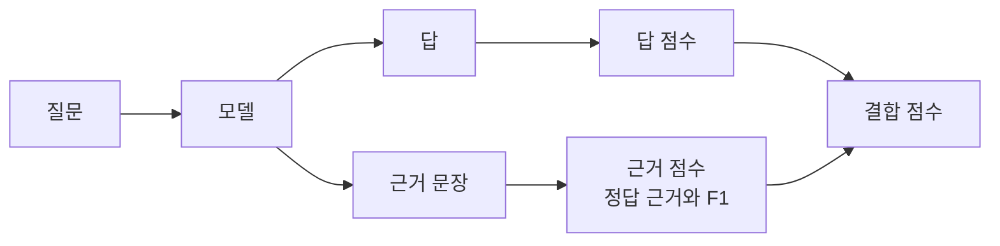
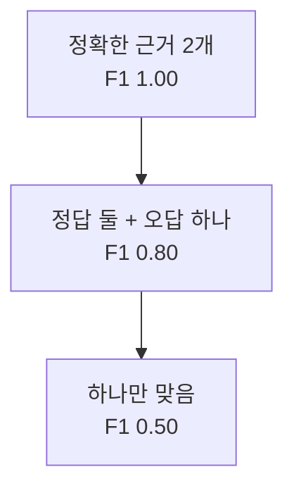

# 근거 문장 주석

> 근거 문장 주석은 질문의 답을 이끌어 낸 문장을 사람이 표시해 두는 주석 방식이다. 모델이 답만 맞혔는지, 올바른 근거에서 답을 끌어냈는지를 따로 채점할 수 있게 해 준다.

## 쉽게 말하면
수학 시험에서 답만 쓰라고 하면 찍어서 맞힌 학생과 풀이해서 맞힌 학생이 구분되지 않는다. 풀이 과정(근거)도 쓰게 하면 구분된다. 근거 문장 주석은 QA 데이터에 이 "풀이 과정"의 정답을 달아 둔 것이다.

## 자세히
- **실제 사례(HotpotQA 논문 초록·공식 페이지, 열람)**: HotpotQA는 문장 단위의 근거(supporting facts)를 제공해 시스템이 강한 지도로 학습하고 어떤 근거로 답했는지 설명하게 한다. 평가는 답(Ans), 근거(Sup), 결합(Joint)을 각각 정확 일치(EM)와 F1로 보고한다. 결합 지표의 정확한 계산식은 공식 페이지에 없어 이 글에서 확인하지 못했다.
- **근거 F1의 계산(직접 해 본 장난감 계산)**: 정답 근거를 (문서 제목, 문장 번호) 쌍 2개로 두고 정밀도·재현율·F1을 계산했다. 근거를 정확히 내면 1.00, 하나는 맞고 하나는 틀린 근거를 내면 정밀도·재현율 0.50으로 F1 0.50, 정답 둘에 엉뚱한 하나를 더 붙이면 정밀도 0.67·재현율 1.00으로 F1 0.80, 하나도 못 맞히면 0이었다. 근거를 많이 내놓는다고 점수가 오르지 않고 틀린 근거를 붙이면 정밀도가 깎인다.
- **주석을 만드는 법(해석)**: ① 질문과 답을 보고 답에 필요한 문장만 표시(필요 최소) ② 여러 주석자의 일치도를 확인 ③ 같은 답을 내는 대체 근거가 있으면 허용 목록에 포함할지 정한다. 최소 근거만 정답으로 두면 타당한 다른 근거를 낸 모델이 감점된다.
- **쓰임(해석)**: 검색 증강 시스템의 검색 단계 평가(근거를 찾았나), 환각 점검(답의 근거가 문서에 있나), 교육용 설명(왜 이 답인가). 답만 맞고 근거가 틀린 경우는 우연이나 지름길을 의심한다([멀티홉 질문 응답](#multi-hop-qa)).
- **비용**: 문장 단위 주석은 사람이 직접 해야 해서 비싸고 주석자 간 불일치가 생긴다.

## 그림으로 보기

## 예시
- 사내 문서 QA 평가셋에 "답 + 근거 문서 ID·문장 번호"를 함께 적어 두고, 시스템이 낸 근거와 비교한다.
- 교육 활용: 같은 질문에 답은 같고 근거가 다른 두 시스템을 비교해 어느 쪽이 믿을 만한지 토론한다.

## 헷갈리는 것과 비교
| 개념 | 차이 |
| --- | --- |
| 답 정확도 | 최종 답만 채점 |
| 근거 문장 주석 | 답의 근거까지 채점 |
| [HotpotQA](#hotpotqa) | 근거 주석을 제공하는 대표 데이터셋 |
| [MuSiQue](#musique) | 지름길 억제에 초점 |

## 더 읽을거리
- [HotpotQA 논문 (arXiv 1809.09600)](https://arxiv.org/abs/1809.09600) — 문장 단위 근거 제공의 취지
- [HotpotQA 공식 페이지](https://hotpotqa.github.io/) — Ans·Sup·Joint 지표
