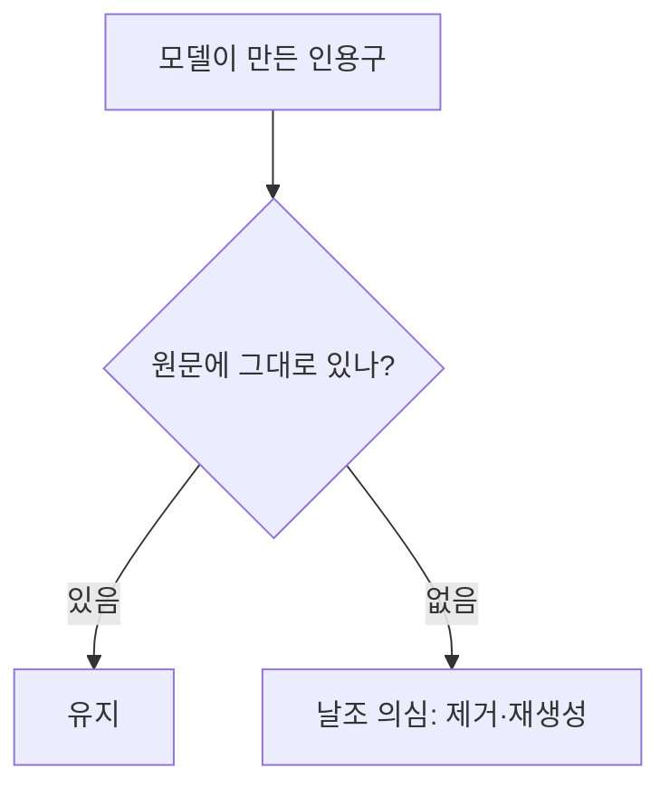

# 근거 인용구 접지

> 근거 인용구 접지(supporting-quote grounding)는 답을 쓰기 전에 원문에서 뒷받침하는 구절을 먼저 뽑고, 그 구절에 맞춰서만 답을 쓰게 하는 방식이다. 모델이 지어낸 말이 답에 섞이는 것을 줄이고, 사용자가 원문에서 바로 확인할 수 있다.

## 쉽게 말하면
리포트를 쓸 때 "참고 자료에서 해당 문장을 먼저 형광펜으로 표시하고, 표시한 문장만 보고 쓰라"고 하는 것과 같다. 표시한 문장이 없으면 쓰지 못하고, 검토자는 형광펜 자국을 따라가 사실을 확인한다.

## 자세히
- **학습 방식 — FRONT(ACL 2024 Findings, arXiv 2408.04568, 초록 열람)**: 두 단계로 학습한다. ① 접지 단계: 모델이 근거 인용구를 먼저 생성 ② 일관성 단계: 그 인용구와 어긋나지 않게 답을 생성. 저자 보고로 LLaMA-2-7B가 ALCE에서 모든 기준선을 앞서 인용 품질을 평균 14.21% 개선했고 ChatGPT를 넘었다.
- **API 방식 — Anthropic Citations(2025-01 출시, 블로그 열람)**: 문서(PDF·텍스트)를 문장 단위로 나눠 모델에 전달하고, 답에 사용한 구절을 인용으로 돌려준다. 개발자가 직접 청크를 줄 수도 있다. 인용된 원문 텍스트는 출력 토큰 비용에 포함되지 않는다. Anthropic 내부 평가는 자체 구현 대비 재현 정확도가 최대 15% 높다고 주장한다. 고객 Endex는 출처 환각·서식 문제가 10%→0%로 줄었다고 밝혔다(모두 업체 보고, 독립 검증은 못 찾음). 출시 때 지원 모델은 Claude 3.5 Sonnet·Haiku였다.
- **프롬프트 방식(Anthropic 문서의 환각 줄이기 안내)**: 직접 인용을 요구하고, 인용 문자열이 원문에 실제로 있는지 대조해 날조를 걸러 낸다(검색 요약 기준, 문서 본문은 열지 않음).
- **한계**: 인용구가 있어도 답이 그 구절을 잘못 해석할 수 있다. 접지는 "출처가 있다"를 보장할 뿐 "해석이 맞다"를 보장하지 않으므로 [주장 단위 출처 연결](#claim-level-attribution) 평가와 함께 본다.
- 인용을 요구하는 것 자체가 가짜 참고문헌을 만든다는 감사 연구(arXiv 2603.03299)도 있다(검색 요약, 본문 미확인). 학술 참고문헌 형태의 인용과 주어진 문서 안의 인용구 접지는 다른 문제다.

## 그림으로 보기

## 예시
- 계약서 Q&A: "해지 조항"을 물으면 해당 조항 문장을 인용으로 붙여 답하게 하고, 인용 문자열을 코드로 원문과 대조한다.
- 프롬프트 예: "먼저 문서에서 근거 문장을 정확히 복사해 <quotes>에 넣고, 그 문장만 근거로 답해라. 근거가 없으면 모른다고 해라."

## 헷갈리는 것과 비교
| 개념 | 차이 |
| --- | --- |
| [주장 단위 출처 연결](#claim-level-attribution) | 상위 주제. 접지는 그 근거 구절을 만드는 방법 |
| 문서 단위 인용 | 문서 ID만 표시. 확인 부담이 큼 |
| RAG | 자료를 찾아 오는 단계. 접지는 가져온 자료에서 답을 묶는 단계 |

## 더 읽을거리
- [FRONT (arXiv 2408.04568)](https://arxiv.org/abs/2408.04568) — 두 단계 학습 틀
- [Anthropic: Introducing Citations on the API](https://claude.com/blog/introducing-citations-api) — 문장 단위 인용 기능과 업체 보고 수치
