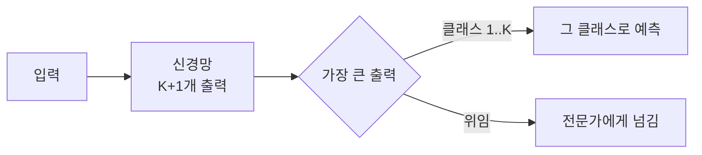
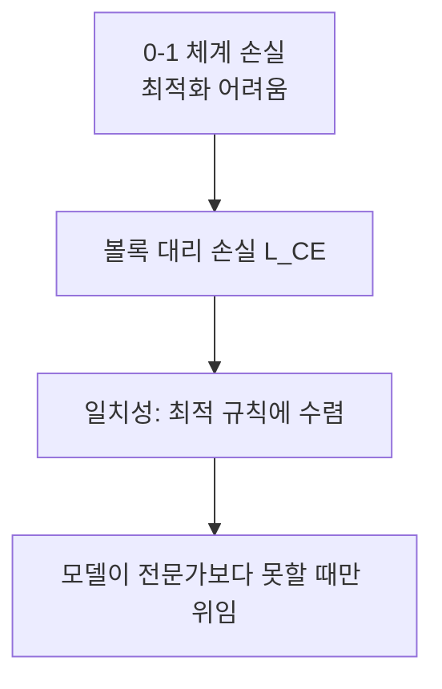

# 위임용 대리 손실

> 위임 학습에서 "예측할지, 사람에게 넘길지"를 한 번에 학습하려면 그대로는 최적화하기 어려운 0-1 손실 대신 미분 가능한 대리 손실(surrogate loss)을 쓴다. 좋은 대리 손실은 일치성(consistency)이 있어야, 즉 충분히 학습하면 이론상 최적 결정으로 수렴해야 한다.

## 쉽게 말하면
"맞았나 틀렸나"는 계단식 점수라서 조금씩 고쳐 가기 어렵다. 그래서 부드러운 경사면 모양의 점수로 대신 연습하게 한다. 이때 경사면을 따라 내려가면 결국 원래 점수가 최적인 곳에 도달하도록 설계해야 한다. 그 보증이 일치성이다.

## 자세히
Mozannar·Sontag의 ICML 2020 논문(arXiv 2006.01862, PDF 본문 열람)의 내용이다.
- **설정**: K개 클래스를 예측하는 분류기 h와, 예측 대신 전문가에게 넘길지 정하는 위임기(rejector) r을 함께 학습한다. 체계 손실은 "예측하면 분류 손실, 넘기면 전문가의 손실"이다. 이 방법은 전문가의 과거 판단 표본만 있으면 되고 기반 과제의 라벨은 필요 없다고 초록은 밝힌다.
- **K+1 출력으로 환원**: 클래스 K개에 "위임" 클래스 하나를 더한 K+1개 출력 g를 두고 가장 큰 출력을 선택한다. 위임이 가장 크면 사람에게 넘긴다. 비용 민감 학습으로 환원해 위임 비용을 하나의 항목으로 둔다.
- **제안 손실 L_CE**: 교차 엔트로피를 일반화한 형태로, 각 선택지의 로그 소프트맥스에 (최대 비용 − 그 선택지 비용)을 곱해 합친다. 논문은 이 손실이 볼록하고 일치성이 있다고 증명한다(명제 1). 비용이 일반 오분류 비용이면 보통 교차 엔트로피와 같아진다.
- **0-1 체계 손실의 최적 규칙(명제 2)**: 분류기는 가장 가능성 높은 클래스를 고르고, 위임기는 "모델이 가장 확신하는 클래스의 확률 ≤ 전문가가 맞출 확률"일 때만 넘긴다. 즉 모델이 전문가보다 못할 때만 넘긴다.
- **기존 방법의 한계**: 전문가를 무시하고 학습한 분류기의 확신만 쓰는 방식, 일치성 없는 손실을 쓰는 이전 방법은 일치성 관점에서 한계가 있다고 논문이 분석한다. 이 손실은 다중 클래스 reject 학습의 일치 손실에 대한 열린 문제를 푼다고 주장한다.
- **실험(저자 보고)**: CIFAR-10·CIFAR-100(CIFAR-10H 기반 사람 전문가 포함), 혐오 발언 데이터, 의료 영상 등에서 비교했다. 한 설정에서 학습 데이터 2,000개일 때 확신 점수 기반 위임 62.33%, 제안 방법 70.12%(7.89%p↑)를 보고한다. 설정과 전문가 모델에 따라 차이가 작은 경우도 있었다. 나머지 표는 열람하지 못했다.
- **한계(해석)**: 전문가를 일정한 비용으로 단순화하며, 전문가가 넘겨받은 뒤 AI 표시에 영향받는 행동 변화는 다루지 않는다. 학습에 쓸 전문가 이력 품질에 의존한다.

## 그림으로 보기

## 예시
- 영상 판독 보조: 전문의가 과거에 판독한 결과만 있으면 위임용 분류기를 학습해, 흔한 질환은 모델이, 애매한 영상은 전문의 큐로 보낸다.
- 교육 활용: "AI 확신이 낮으면 넘긴다"와 "전문가가 더 잘할 때 넘긴다"의 차이를 토론한다.

## 헷갈리는 것과 비교
| 개념 | 차이 |
| --- | --- |
| [위임 학습](#learning-to-defer) | 상위 주제. 대리 손실은 그 학습의 수학적 도구 |
| 확신 점수 임계값 | 전문가를 고려하지 않고 모델 확신만 사용 |
| [전문가 판단 이력](#expert-decision-history) | 이 손실이 학습에 쓰는 데이터 |

## 더 읽을거리
- [Consistent Estimators for Learning to Defer to an Expert (arXiv 2006.01862)](https://arxiv.org/abs/2006.01862) — ICML 2020 원논문
