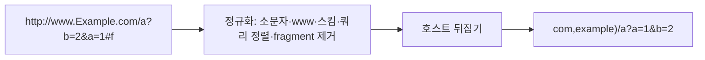
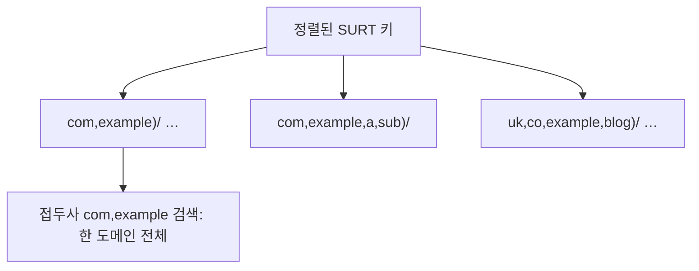

# SURT 키

> SURT(Sort-friendly URI Reordering Transform)는 URL을 **호스트 이름을 뒤집고 표기를 정규화해 사전순 정렬이 곧 "같은 도메인끼리 모이는 정렬"이 되게 만든 키**다. Common Crawl의 CDX 색인이 이 키로 정렬돼 있어 도메인·경로 범위 조회가 빠르다.

## 쉽게 말하면
주소를 `큰 단위 → 작은 단위`로 거꾸로 적는 것이다. 한국 주소를 "대한민국, 서울, 강남구, …" 순으로 쓰면 같은 구의 주소가 정렬했을 때 나란히 붙는 것과 같다.

## 자세히
(파이썬 `surt` 0.3.1을 설치해 직접 실행)
- 변환 예:

| 입력 URL | SURT 키 |
|---|---|
| `http://www.Example.com/Path/page.html?b=2&a=1#frag` | `com,example)/path/page.html?a=1&b=2` |
| `https://example.com/path/page.html?a=1&b=2` | `com,example)/path/page.html?a=1&b=2` |
| `http://blog.example.co.uk/post/1` | `uk,co,example,blog)/post/1` |
| `http://example.com:8080/x/` | `com,example:8080)/x` |
| `http://sub.a.example.com/` | `com,example,a,sub)/` |
- 정규화 효과(실험으로 확인): 대소문자를 소문자로, `www.` 제거, **스킴(http/https) 차이 제거**, 쿼리 파라미터를 **알파벳순 정렬**, `#fragment` 제거, 끝 슬래시 제거. 그래서 1번과 2번은 서로 다른 URL인데 **같은 키**가 된다(같은 페이지로 취급).
- 호스트 부분: 점으로 나뉜 도메인을 **뒤에서 앞으로** 쉼표로 이어 쓰고 `)`로 호스트와 경로를 구분한다. 5개 키를 정렬하면 `com,example)/…`, `com,example,a,sub)/…`, `com,example:8080)/…`가 연속으로 붙고 `uk,…`는 따로 모인다. 한 도메인과 그 하위 도메인이 정렬상 가까이 있어 **접두사 검색 하나로 도메인 전체를 조회**할 수 있다.
- 한계: `www`·스킴 제거는 서로 다른 사이트를 같은 키로 합칠 수 있고(드물지만), `co.uk` 같은 공개 접미사는 별도 처리 없이 단순히 뒤집는다. 정규화 규칙은 구현에 따라 다르다.
- 쓰임: [URL 색인(CDX)](#url-index-cdx)에서 `url=example.com/*` 같은 조회를 `com,example)/` 접두사 범위 검색으로 바꿔 처리.

## 그림으로 보기



## 예시
```python
from surt import surt
surt("http://www.Example.com/Path/page.html?b=2&a=1#frag")
# 'com,example)/path/page.html?a=1&b=2'
```
- 도메인 특화 코퍼스 구성 시 `com,example)/` 범위 조회([도메인 특화 코퍼스](#domain-specific-corpus-cc)).
- 교육: 정렬 가능한 키를 설계하면 검색이 쉬워진다는 데이터 구조 사례.

## 헷갈리는 것과 비교
| 개념 | 차이 |
|---|---|
| URL | 원래 주소 |
| SURT 키 | 정규화·호스트 역순, 정렬·조회용 |
| 정규화 URL | 비슷하나 호스트를 뒤집지 않음 |

## 더 읽을거리
- [surt (PyPI)](https://pypi.org/project/surt/) — 변환 라이브러리(0.3.1 설치해 실행).
