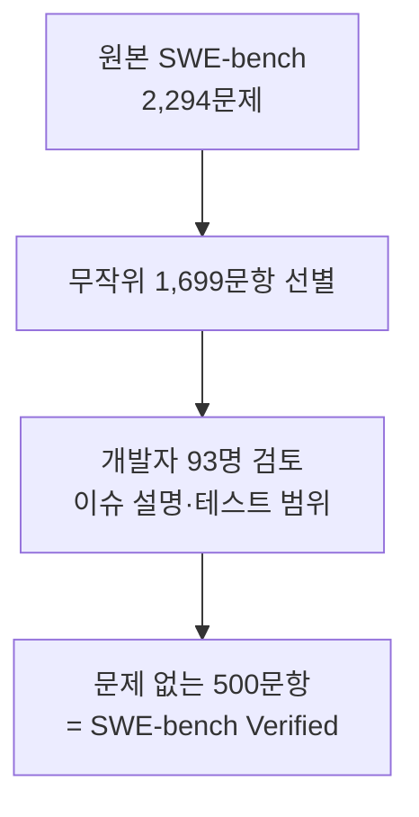
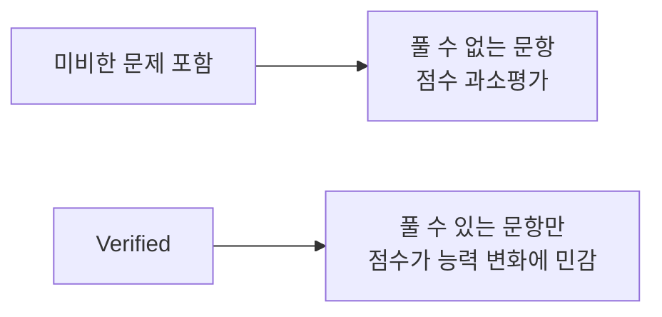

# SWE-bench Verified

> SWE-bench에서 사람이 문제 품질을 검증해 추린 500문항 부분집합. 문제 설명이 불충분하거나 테스트가 부당해 "풀 수 없는 문제"가 섞여 점수를 왜곡하는 것을 줄이려고 만들어졌다.

## 쉽게 말하면
수학 시험에서 문제 자체에 오류가 있거나 조건이 빠져 있으면 우수한 학생도 못 푼다. 그래서 출제위원회가 문항을 하나하나 점검해 "정말 풀 수 있는 문제"만 남긴 시험지를 따로 만든 것이다. 이 시험지의 점수는 학생의 실력을 더 정직하게 반영한다.

## 자세히
- **원본 SWE-bench**(Jimenez 외, arXiv 2310.06770, 2023년 10월, ICLR 2024): 12개 인기 파이썬 저장소의 실제 GitHub 이슈와 풀 리퀘스트에서 만든 2,294문제. 코드베이스와 이슈 설명을 받아 코드를 고쳐 이슈를 해결해야 한다. 논문 시점 최고 성능(Claude 2)은 1.96%만 해결했다.
- **Verified 공개**: OpenAI가 **2024년 8월 13일** 500문항 부분집합을 SWE-bench Verified로 발표했다. 원 테스트 세트에서 무작위로 뽑은 **1,699개**를 파이썬 경험이 있는 개발자 **93명**이 직접 검토해, 단위 테스트의 범위가 적절한지와 이슈 설명이 충분히 명확한지를 기준으로 문제가 없는 문항 500개를 확정했다(OpenAI 게시물 요약 기준). 공식 사이트(swebench.com)도 Verified를 "엔지니어가 풀 수 있음을 확인한 500문제"로 설명하며 2024년 8월 공개로 적는다.
- **왜 필요했나**: 풀 수 없는 문항(이슈에 정보가 부족하거나 테스트가 해결 방식을 지나치게 한정)이 섞여 있으면 에이전트의 진짜 능력이 과소평가된다. 문항을 걸러내면 점수가 모델 능력 변화를 더 잘 반영한다.
- **한계**: 
  1. 여전히 **파이썬 12개 저장소**에서 나온 문제라 일반 소프트웨어 업무를 대표하지 않는다.
  2. 문제가 공개돼 있어 [데이터 오염](#data-contamination) 위험이 있다.
  3. 상위 모델 점수가 높아질수록 [벤치마크 포화](#benchmark-saturation) 문제가 생긴다.
  4. 점수는 모델만이 아니라 **에이전트 하네스**(도구·프롬프트·재시도 횟수)에 좌우된다 → 비교할 때 같은 조건인지 확인한다([평가 하네스](#eval-harness)).
- **읽는 법**: 리더보드의 점수를 볼 때 ①Verified인지 Full·Lite인지 ②어떤 하네스·시도 횟수인지 ③제출 날짜 ④자체 보고인지 독립 재현인지를 함께 본다. 확인되지 않은 수치(예: 특정 모델의 몇 %)는 공식 리더보드에서 직접 확인한다.

## 그림으로 보기

## 예시
- 코딩 에이전트 도입 비교: 두 제품의 광고 점수가 "SWE-bench 70%"와 "Verified 60%"라면 서로 다른 시험이다. 같은 부분집합·같은 하네스 조건의 결과만 비교한다.
- 교육 활용: 수강생에게 리더보드 항목을 주고 "이 점수에서 확인해야 할 조건 4가지"를 찾게 한다.

## 헷갈리는 것과 비교
| 개념 | 차이 |
|---|---|
| [SWE-bench](#swe-bench) | 원본 2,294문제 |
| SWE-bench Verified | 사람이 검증한 500문항 |
| [벤치마크 포화](#benchmark-saturation) | 만점 근처 몰림으로 변별력 상실 |
| [데이터 오염](#data-contamination) | 학습 데이터에 시험 문제가 섞임 |
| [에이전트 하네스](#eval-harness) | 모델을 감싼 도구·프롬프트 구성 |

## 더 읽을거리
- [SWE-bench (swebench.com)](https://www.swebench.com/SWE-bench/) — 데이터셋 종류와 Verified 개요
- [SWE-bench: Can Language Models Resolve Real-World GitHub Issues? (arXiv 2310.06770)](https://arxiv.org/abs/2310.06770) — 원 논문
- [Introducing SWE-bench Verified (OpenAI)](https://openai.com/index/introducing-swe-bench-verified/) — Verified 발표(이 세션에선 직접 열지 못해 검색 요약으로 확인)
