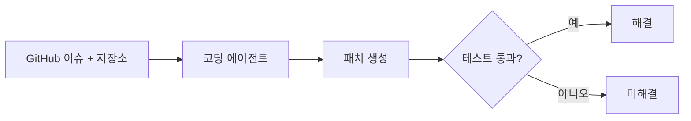
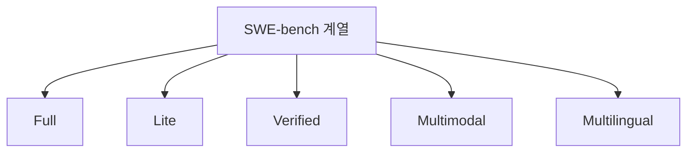

# SWE-bench

> 실제 GitHub 저장소의 이슈를 주고, AI 에이전트가 코드를 고쳐 테스트를 통과시키는지로 소프트웨어 엔지니어링 능력을 재는 벤치마크.

## 쉽게 말하면
"문제집"이 아니라 "실제 업무 티켓"으로 보는 입사 시험이다. 이슈 설명과 저장소를 주고 고치게 한 뒤, 원래 개발자가 쓴 테스트가 통과하면 정답이다.

## 자세히
- 공식 사이트(swebench.com, 확인 2026-11-02)는 소프트웨어 엔지니어링 에이전트의 공식 리더보드를 운영하며 **Full / Lite / Verified / Multimodal / Multilingual** 탭이 있다. "Bash Only" 필터로 단순한 셸 에이전트만 비교하는 보기도 있다.
- 일반적으로 알려진 구조(사이트 발췌에는 없는 배경지식, 논문 확인 필요): 오픈소스 파이썬 저장소의 이슈-PR 쌍에서 만들고, 에이전트가 만든 패치가 관련 테스트(실패→통과)를 통과하면 해결로 센다. Verified는 사람이 문제 품질을 검증해 추린 부분집합이다.
- 해결률(%)이 점수다. 상위 모델 점수가 포화에 가까워지면서 변형·후속 벤치마크가 계속 나온다.
- 주의: 점수는 모델만이 아니라 **에이전트 하네스(도구·프롬프트·재시도)** 에 크게 좌우된다. 비교할 때 같은 하네스 조건인지 확인한다([평가 하네스](#eval-harness)). 공개 문제라 [데이터 오염](#data-contamination) 위험도 있다.

## 그림으로 보기

## 예시
- 모델 발표의 "SWE-bench Verified 70%"는 검증된 문제 중 약 7할을 해당 하네스로 풀었다는 뜻이다. 우리 코드베이스에서도 그렇다는 보장은 없다.

## 헷갈리는 것과 비교
| 개념 | 차이 |
| --- | --- |
| SWE-bench | 실제 이슈 해결(패치+테스트) |
| HumanEval류 | 함수 한 개를 짜는 짧은 문제 |
| [pass@k](#pass-at-k) | 여러 번 시도 중 한 번이라도 성공할 확률 방식의 집계 |

## 더 읽을거리
- [SWE-bench 공식 사이트](https://www.swebench.com/) — 리더보드와 변형 목록.
