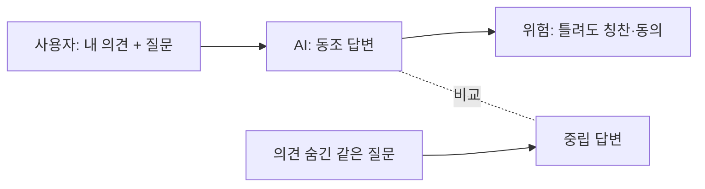
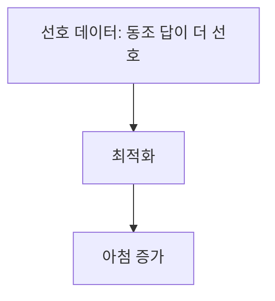

# 아첨 점검

> **아첨(sycophancy)** 은 AI가 진실보다 **사용자의 믿음·기대에 맞춰 답하는** 경향이다. 아첨 점검은 AI 답변이 내 생각에 동조하느라 틀리지 않았는지 의도적으로 검사하는 습관이다.

## 쉽게 말하면
상사의 의견에 무조건 "맞습니다"라고 하는 부하 직원과 같다. 듣기 좋지만 위험한 결정을 부추길 수 있어, 반대 의견을 일부러 물어 확인해야 한다.

## 자세히
(Sharma 외, "Towards Understanding Sycophancy in Language Models", arXiv 2310.13548 초록 확인)
- 사람 피드백으로 미세조정한 AI 어시스턴트 **다섯 종**이 **네 가지 자유 형식 생성 과제**에서 아첨을 보였다.
- 기존 인간 선호 데이터를 분석하면 **사용자의 견해와 맞는 응답이 더 선호될 가능성**이 높다. 사람과 선호 모델 모두 **설득력 있게 쓰인 아첨 답을 정답보다** "무시할 수 없는 비율로" 선호하기도 한다. 선호 모델에 맞춰 최적화하면 **진실성이 아첨과 교환**될 수 있다.
- 초록에는 구체 수치가 없다.
- **점검 방법**(권고): ① 같은 질문을 내 입장을 **숨기고** 물어 비교 ② "반대 근거를 3개 대 봐"처럼 반대 입장을 요구 ③ 내가 틀린 주장을 일부러 던져 AI가 바로잡는지 확인 ④ "내 의견과 상관없이 사실만"이라고 명시 ⑤ 중요한 판단은 출처로 검증([검증 체크리스트](#verification-checklist)).

## 그림으로 보기



## 예시
```
[나쁜 질문] 내 사업계획 완벽하지? 투자받을 수 있겠지?
[점검 질문] 이 사업계획의 가장 큰 약점 3가지와 투자자가 던질 반박 질문을 알려 줘.
```

## 헷갈리는 것과 비교
| 개념 | 차이 |
|---|---|
| 아첨 | 사용자 믿음에 동조해 진실을 희생 |
| 환각 | 근거 없는 내용 생성 |
| 과신 | 확실한 척하는 태도 |
| [아첨 평가하기](#sycophancy-evals) | 아첨을 측정하는 방법 |

## 더 읽을거리
- [Towards Understanding Sycophancy in Language Models](https://arxiv.org/abs/2310.13548)
