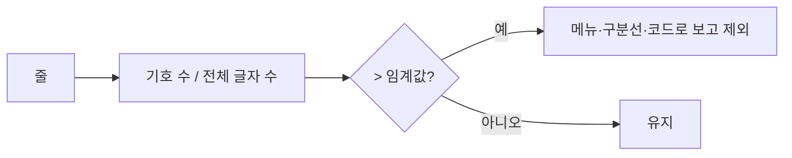
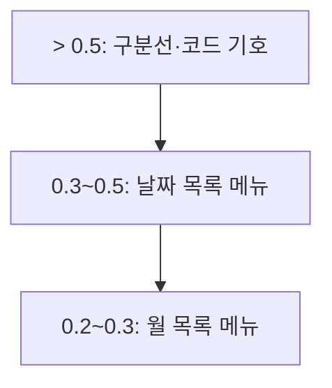

# 기호 비율 필터

> 줄(또는 문서)에서 **글자·숫자·공백이 아닌 기호가 차지하는 비율**을 계산해, 비율이 높으면 메뉴·구분선·코드 조각으로 보고 제거하는 필터다. 종결 부호·길이 같은 규칙이 놓치는 줄을 보완한다.

## 쉽게 말하면
"Home | About | Contact", "————————", "► 07/23 - 07/30 (1)"처럼 기호가 가득한 줄은 사람이 읽는 문장이 아니라 화면 장식이다. 글자 대비 기호 비율을 재면 이런 줄을 쉽게 가려낼 수 있다.

## 자세히
- 정의(내 구현): 줄의 문자 중 `글자·숫자·공백`이 아닌 문자의 비율 = 기호 비율. 문자는 유니코드 기준이라 한글·한자도 글자로 센다.
- 직접 실행(`CC-MAIN-2024-10` WET 앞 2MB의 영어 문서 210개, 줄 21,733개):
  | 기호 비율 기준 | 걸리는 줄 | 비율 |
  |---|---|---|
  | > 0.1 | 4,595 | 21.1% |
  | > 0.2 | 2,277 | 10.5% |
  | > 0.3 | 1,264 | 5.8% |
  | > 0.5 | 265 | 1.2% |
- 구간별 실제 줄(무작위 표본):
  - 0.5 초과: `****`, `}`, `———————————————` — 구분선·코드 기호.
  - 0.3~0.5: `► 07/23 - 07/30 (1)`, `► 11/01 - 11/08 (3)` — 블로그 보관함(아카이브) 메뉴.
  - 0.2~0.3: `► October (27)`, `2022/11 (21)`, `► June (6)` — 같은 보관함 메뉴.
- C4 줄 규칙과의 관계: 기호 비율 0.2 초과 줄 2,277개 중 **C4 줄 규칙(종결 부호 + 5단어)을 통과한 줄은 125개**뿐이라 대부분은 이미 C4가 제거한다. 하지만 통과한 줄에는 `// for (var i = 0; i < ds.Rows.length; i++) // { …`처럼 **코드 주석 조각**이 섞여 있었다. 즉 기호 필터는 **코드·구분선이 종결 부호로 끝나는 경우**를 잡는 보완책이다.
- 오탐 주의(제안): 수식, URL을 인용한 문장, 이모티콘이 많은 SNS 글, 한국어·일본어의 괄호·부호가 많은 문장은 기호 비율이 높아질 수 있다. 임계값(0.2~0.3)은 샘플로 조정하고 **최소 길이 조건**(예: 줄이 10자 이상)과 함께 쓴다. 문서 단위로는 평균 기호 비율을 쓴다.
- 한계: 임계값별 오탐 수는 사람이 판정하지 않아 측정하지 못했다(위 표는 걸리는 양일 뿐 정확도가 아님). 영어 문서 표본이며 언어에 따라 기호 사용 습관이 다르다.

## 그림으로 보기



## 예시
```python
def sym_ratio(s):
    return sum(1 for ch in s if not (ch.isalnum() or ch.isspace())) / max(len(s), 1)
drop = len(s) >= 10 and sym_ratio(s) > 0.3
```
- 교육: 같은 줄에 종결 부호 규칙과 기호 비율 규칙을 각각 적용해 누가 무엇을 잡는지 비교하는 실습.

## 헷갈리는 것과 비교
| 개념 | 차이 |
|---|---|
| 기호 비율 필터 | 기호가 많은 줄 제거 |
| 종결 부호 필터 | 문장 끝 부호 없는 줄 제거 |
| [메뉴 줄 탐지](#menu-line-detection) | 짧은 제목·메뉴를 다각도로 찾는 방법 |
| [C4 줄 필터](#c4-line-filters) | 종결 부호+길이 규칙 |

## 더 읽을거리
- [T5 논문 (arXiv 1910.10683)](https://arxiv.org/abs/1910.10683) — C4 휴리스틱(읽음).
- 직접 실행: 영어 21,733줄 기호 비율 분포.
