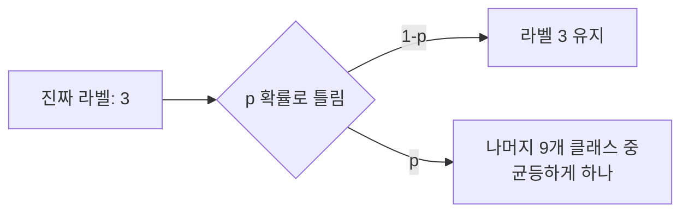
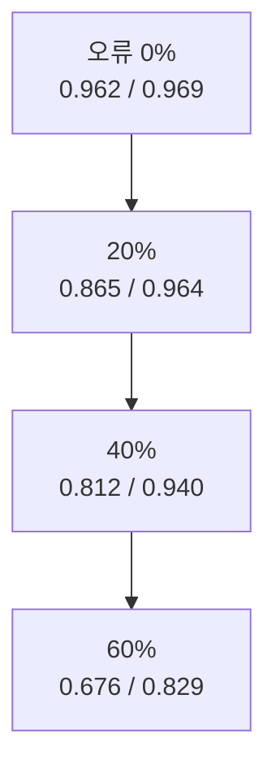

# 대칭 라벨 노이즈

> 대칭 라벨 노이즈는 정답 라벨이 일정한 확률로 틀리되, 틀릴 때 나머지 클래스 중 어느 쪽으로든 똑같은 확률로 바뀐다고 가정하는 가장 단순한 오라벨 모델이다. 실제 오라벨은 비슷한 클래스끼리 헷갈리는 경우가 많아 이 가정은 이상화에 가깝다.

## 쉽게 말하면
채점자가 피곤해서 정답을 10% 확률로 틀리게 적는데, 틀릴 때는 보기 중 아무거나 무작위로 적는 상황이다. 특정 보기를 더 자주 틀리게 적는 습관은 없다. 현실의 채점자는 "고양이"를 "개"로 틀리게 적기 쉽지 "자동차"로는 잘 안 적는데, 대칭 노이즈는 그 차이를 무시한다.

## 자세히
- **정의(해석)**: 클래스가 K개일 때 라벨이 확률 p로 틀리고, 틀린 라벨은 나머지 K−1개 클래스 중 균등하게 뽑는다. 클래스에 따라 오류 패턴이 달라지는 [클래스 조건부 노이즈](#class-conditional-noise)와 구분된다.
- **직접 해 본 실험(숫자 손글씨, 클래스 10개, 학습 라벨만 대칭 노이즈를 주고 깨끗한 시험 세트로 평가)**:

| 학습 라벨 오류율 | 로지스틱 회귀 정확도 | 랜덤 포레스트 정확도 |
| --- | --- | --- |
| 0 | 0.962 | 0.969 |
| 약 20% | 0.865 | 0.964 |
| 약 40% | 0.812 | 0.940 |
| 약 60% | 0.676 | 0.829 |

  같은 노이즈에서도 모델마다 영향이 크게 달랐다. 이 설정에서 랜덤 포레스트는 40% 오류율에서도 0.94를 유지했고 로지스틱 회귀는 0.81로 떨어졌다. 노이즈가 모든 클래스에 균등하게 퍼지면 정답 클래스가 여전히 가장 흔한 라벨이라 모델이 다수결로 복원하기 쉽기 때문이라고 해석한다(이 글에서 검증하지 않음). 오류율 60%는 10개 클래스에서 정답이 여전히 단일 오답 클래스(약 6.7%)보다 많은 40%라 정보가 남아 있다.
- **연구 동향(Song 외 서베이 초록, 열람)**: 노이즈 라벨은 심층 신경망의 일반화 성능을 크게 떨어뜨리며, 이 서베이는 견고한 학습 방법 62개를 5개 범주로 정리하고 노이즈율 추정과 공개 노이즈 데이터셋을 다룬다. 암기 효과 같은 세부는 초록에 없어 확인하지 못했다.
- **용도(해석)**: 이론 분석과 실험 시뮬레이션의 출발점. 실제 오라벨은 클래스 조건부([혼동 쌍 중심 라벨 가이드](#confusion-pair-guideline))나 샘플 의존적([특징 의존 노이즈](#feature-dependent-noise))인 경우가 많아, 대칭 노이즈에서 견고한 방법이 실제에서도 견고하다고 가정하면 안 된다.

## 그림으로 보기

## 예시
- 코드: `y_noisy[flip] = (y[flip] + rng.integers(1, K, flip.sum())) % K`로 K−1개 다른 클래스 중 하나를 균등하게 고른다.
- 교육 활용: 노이즈율을 바꿔 가며 모델 두 개를 비교해 "노이즈에 강한 모델"이 있다는 것을 체험한다.

## 헷갈리는 것과 비교
| 개념 | 차이 |
| --- | --- |
| 대칭 노이즈 | 틀린 라벨이 다른 클래스로 균등 |
| [클래스 조건부 노이즈](#class-conditional-noise) | 클래스마다 오류 패턴이 다름 |
| [특징 의존 노이즈](#feature-dependent-noise) | 어려운 샘플일수록 틀림 |
| [혼동 쌍 중심 라벨 가이드](#confusion-pair-guideline) | 자주 헷갈리는 쌍을 지침에 반영 |

## 더 읽을거리
- [Learning from Noisy Labels with Deep Neural Networks: A Survey (arXiv 2007.08199)](https://arxiv.org/abs/2007.08199) — 노이즈 라벨 학습 방법 개관
