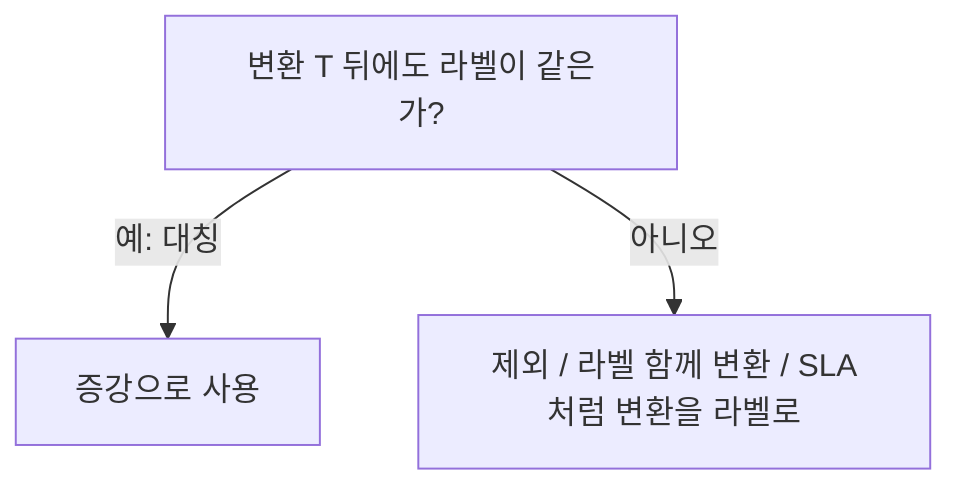

# 대칭성에 의존하는 증강

> 증강이 도움이 되려면 **데이터가 그 변환에 대해 실제로 대칭(변환해도 같은 라벨)**이어야 한다. 고양이 사진은 좌우 뒤집어도 고양이지만, 숫자·글자는 뒤집으면 다른 모양이 되어 라벨 보존이 깨진다.

## 쉽게 말하면
거울에 비친 개는 여전히 개지만, 거울에 비친 "2"는 숫자 2가 아니다. 거울 뒤집기는 "개 데이터"에는 공짜 데이터이고 "숫자 데이터"에는 틀린 데이터다.

## 자세히
- 직접 실행(2026-11-27, scikit-learn 1.9.1 `load_digits`: 8×8 손글씨 숫자 1,797장, 은닉층 64개 MLP, 층화 분할 5가지 시드, 시험 30%):
  | 학습 설정 | 시험 정확도 (평균 / 최소~최대) |
  |---|---|
  | 증강 없음 | **0.975** / 0.970~0.983 |
  | 좌우 뒤집기 추가(라벨 유지) | 0.962 / 0.954~0.970 |
  | 상하 뒤집기 추가(라벨 유지) | 0.960 / 0.952~0.972 |
  | (증강 없이 학습한 모델에 **좌우 뒤집은 시험 이미지**) | 0.418 / 0.393~0.461 |
- 읽는 법: 뒤집은 숫자를 같은 라벨로 학습하자 정확도가 **약 1.3%p 떨어졌다**(범위가 거의 겹치는 소규모 실험이라 방향성만 본다). 또 뒤집지 않고 학습한 모델은 뒤집은 숫자를 41.8%밖에 못 읽었다 — 뒤집힌 숫자는 "다른 분포"라는 뜻이다. 모델이 뒤집힌 모양까지 같은 숫자로 외우느라 원래 모양의 구분력이 떨어진다고 해석한다(추정).
- 일반 원칙: 증강 변환 T가 데이터에 대해 **라벨 불변(invariant)**인가를 묻는다. ① 자연 사진: 좌우 뒤집기·작은 회전·밝기 변화는 대체로 불변 ② 숫자·문자: 뒤집기·큰 회전은 불변 아님(6↔9, 2↔5처럼 헷갈림) ③ 위성·현미경: 방향 자체가 의미 없으면 90° 회전도 불변 ④ 의료 영상: 좌우가 진단일 수 있음([우심증과 증강](#dextrocardia-augmentation)).
- SLA 논문의 관점([결합 라벨 분포](#joint-label-distribution)): 회전을 같은 라벨의 증강으로 쓰면 불변성을 강요해 선형 분리가 어려워질 수 있어(논문의 MNIST 선형 분류기 예: 올바로 선 6·9는 0.2% 오류이나 회전하면 13%), 변환을 라벨로 구분하는 방식을 제안한다.
- 한계: 8×8 저해상도·MLP·소규모 실험이다. 큰 모델·실제 MNIST에서 크기는 다를 수 있다.

## 그림으로 보기



## 예시
```python
Xa = np.vstack([Xtr, Xtr.reshape(-1,8,8)[:,:,::-1].reshape(-1,64)])
ya = np.r_[ytr, ytr]            # 라벨 유지 → 정확도 0.975 → 0.962
```
- 교육: 같은 "좌우 뒤집기"가 개 사진에는 이득, 숫자에는 손해인 대비 실습.

## 헷갈리는 것과 비교
| 개념 | 차이 |
|---|---|
| 불변성(invariance) | 변환해도 라벨이 같음 |
| 등변성(equivariance) | 변환에 따라 출력도 같이 변함(예: 박스 좌표) |
| [허용 목록](#augmentation-allowlist) | 어떤 변환을 쓸지 정리한 목록 |

## 더 읽을거리
- [Self-supervised Label Augmentation via Input Transformations (arXiv 1910.05872)](https://arxiv.org/abs/1910.05872) — 2장 MNIST 선형 분류 예(읽음).
- 직접 실행: scikit-learn `load_digits` 뒤집기 실험.
