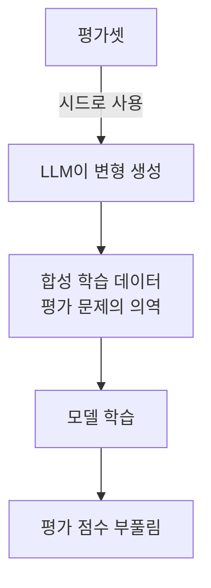
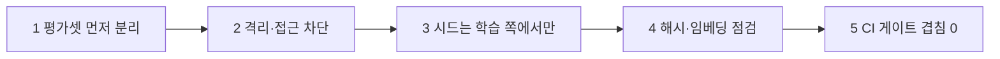

# 합성 데이터 분할 누수

> LLM이 만든 합성 학습 데이터가 **평가 데이터를 바꿔 쓴(paraphrase) 문장**을 담게 되는 누수다. 글자가 달라서 n-gram 검사를 통과하지만 내용은 같아서 점수가 부풀려진다.

## 쉽게 말하면
시험 문제를 보고 "이런 느낌의 연습 문제를 100개 만들어 줘"라고 시키면, 연습 문제가 시험 문제의 쌍둥이가 된다. 학생은 쌍둥이를 풀어 보고 시험을 잘 보지만, 실력이 늘었는지는 알 수 없다.

## 자세히
- **경로 1 — 시드가 평가셋에서 옴(Tianpan 블로그, 실무자 의견)**: 강한 모델에게 시드 프롬프트의 변형을 만들게 할 때, 시드가 평가셋에서 오는 경우가 많다. 평가셋이 "가장 깨끗한 중요한 프롬프트 모음"이기 때문. 결과 학습 데이터가 테스트 분포의 의역이 된다.
- **경로 2 — 실패 사례 분류(failure triage)**: 평가에서 틀린 사례와 비슷한 예제를 학습에 추가하면 가장 변별력 있는 평가 항목이 평가 능력을 잃는다.
- **경로 3 — 공유 RAG 말뭉치**: 평가 정답이 검색 말뭉치에 있고 검색 추적으로 모델을 증류하면 정답이 학습으로 흘러든다.
- **의역은 n-gram이 못 잡는다(arXiv 2311.04850 초록 확인)**: 의역·번역 변형이 학습에 남으면 13B 모델이 MMLU·GSM8K·HumanEval에서 GPT-4 수준 점수를 낼 수 있고, 표준 필터가 놓친다. 논문은 합성 데이터에서도 오염이 번질 수 있다고 지적하고, 검색 요약에는 CodeAlpaca의 12.8%가 HumanEval의 의역이라는 수치가 있다(원문 본문 미확인).
- **방지책(Tianpan 블로그)**
  1. **분할을 생성보다 먼저**: 평가 항목을 따로 떼어 두고, 그 다음에 시드를 고른다.
  2. **출처 해시**: 정규화한 평가 항목 해시로 정확 일치, 임베딩 유사도로 의역 일치 점검.
  3. **격리(quarantine)**: 평가셋에 학습 작업이 읽기 경로를 갖지 못하게 별도 접근 권한. 실패는 개별 사례가 아닌 집계 지표로 보고.
  4. **CI 게이트**: 학습 PR마다 겹침을 재계산해 0보다 크면 병합 차단.
  5. **순환**: 운영 트래픽에서 새 평가 항목을 주기적으로 추가하고 유출 의심 항목은 영구 폐기.
  6. **카나리 문자열**: 평가 문서에 고유 문자열을 넣고 모델이 재현하면 유출 신호.
- 주의: 위 수치·절차는 연구 초록과 개인 블로그에 기반한다. 임계값(유사도 등)은 도메인별 보정이 필요하다.

## 그림으로 보기

## 예시
- 사내 고객문의 평가셋 200개를 시드로 합성 대화 5,000개를 만들어 파인튜닝 → 평가 점수 급상승, 실제 문의에서는 변화 없음. 시드를 학습용 로그에서만 뽑도록 고치고 평가셋은 읽기 차단.
- 교육: "연습 문제를 만들 때 시험 문제를 보여 주지 않는다" 원칙.

## 헷갈리는 것과 비교
| 개념 | 차이 |
|---|---|
| 합성 데이터 누수 | 생성 과정에서 평가 의역이 학습에 들어감 |
| [벤치마크 오염](#benchmark-contamination) | 평가셋이 사전학습 데이터에 포함 |
| [의역 샘플 오염](#rephrased-sample-contamination) | 의역 변형이 필터를 통과 |
| [분할 후 누수 점검](#split-leakage-audit) | 사후 탐지 단계 |

## 더 읽을거리
- [When Your Test Set Leaks Into Fine-Tuning](https://tianpan.co/blog/2026-05-17-test-set-leaks-into-fine-tuning) — 누수 경로와 CI 게이트·격리(개인 블로그).
- [Rethinking Benchmark and Contamination ... Rephrased Samples](https://arxiv.org/abs/2311.04850) — 의역 오염과 decontaminator.
