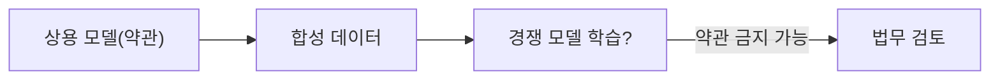
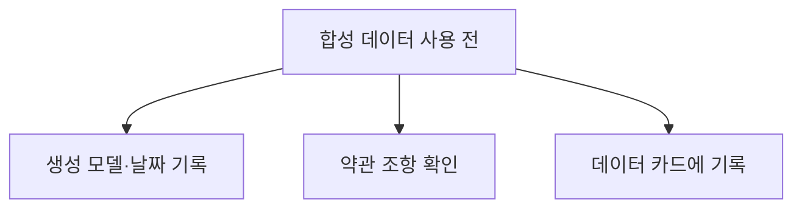

# 합성 데이터와 모델 약관

> 상용 AI 서비스의 이용약관은 서비스 출력물로 경쟁 모델을 학습하는 것을 제한하는 경우가 많다. 합성 데이터를 만들어 학습에 쓸 때는 데이터 라이선스뿐 아니라 생성 모델의 약관도 확인해야 한다. (교육용 요약, 법률 자문 아님.)

## 쉽게 말하면
유명 셰프의 레시피 해설서를 보고 따라 만든 책이라도 해설서의 이용 규정이 "경쟁 요리책 제작에 쓰지 말 것"이라면 문제가 된다. 합성 데이터의 "원료"는 그 모델이다.

## 자세히
(하위 에이전트가 WebFetch로 약관 페이지를 읽은 노트. 요약 도구 경유 인용이므로 **현재 약관 원문과 대조 필요**.)
- **OpenAI 이용약관**(openai.com/policies/row-terms-of-use, 2026-01-01 시행): "Use Output to develop models that compete with OpenAI"를 금지 사항으로 명시.
- **Anthropic 상업 약관 D.4항**(2025-06-17 시행): 고객이 서비스에 접근해 "경쟁 제품·서비스 구축, 경쟁 AI 모델 학습 포함"을 하지 못하게 한다.
- **미확인**: Anthropic 소비자 약관, Gemini 약관은 이번에 확인하지 못했다.
- **DPI 감사(Longpre 외 2023)**: 약관이 제3자(출력물을 내려받은 다른 사람)에게도 구속력이 있는지를 논의하고, 감사한 데이터셋의 약 **12%가 OpenAI로 주석**되었다고 보고. 비상업·학술 전용 데이터셋의 45.5%는 합성 데이터([모음집 풀어보기](#collection-unpacking)).
- **점검(제안)**: ① 생성에 쓴 모델과 날짜 기록 ② 해당 시점 약관의 경쟁 모델 학습 조항 ③ 모델·약관 버전이 바뀌면 재확인 ④ 오픈 가중치 모델은 자체 라이선스(예: 출력 사용 조건)를 따로 확인.

## 그림으로 보기

## 예시
- 사내 소형 모델 미세조정용 합성 대화를 만들기 전, 사용할 API 약관의 경쟁 모델 학습 조항 확인.
- 교육 활용: 약관 두 개를 비교해 허용·금지 목록 표 만들기.

## 헷갈리는 것과 비교
| 개념 | 차이 |
|---|---|
| 모델 약관 | 서비스 이용 계약(출력물 이용 제한 포함) |
| 데이터 라이선스 | 데이터 자체의 이용 조건 |
| [출처 단위 제한](#source-level-restrictions) | 원본 출처의 조건 |

## 더 읽을거리
- [OpenAI 이용약관](https://openai.com/policies/row-terms-of-use/) — 경쟁 모델 개발 금지 조항(요약으로 확인).
- [Anthropic 상업 약관](https://www.anthropic.com/legal/commercial-terms) — D.4항.
- [Data Provenance Initiative (arXiv 2310.16787)](https://arxiv.org/abs/2310.16787) — 합성 데이터 약관 논의.
