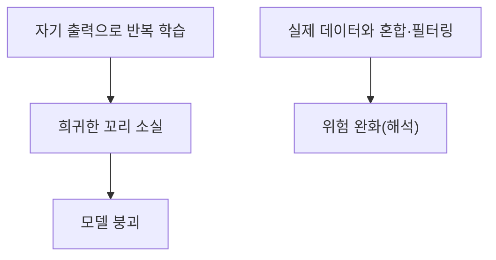

# 합성 데이터

> **모델이 만든 데이터로 다른(또는 같은) 모델을 학습**시키는 방법. 데이터 부족과 비용을 줄이지만, 잘못 쓰면 분포의 희귀한 부분이 사라지는 문제가 생긴다.

## 쉽게 말하면
교과서가 부족해서 선생님이 직접 문제집을 만들어 학생에게 주는 것이다. 좋은 문제집이면 효과가 크지만, 문제집만 반복해 공부하면 시야가 좁아진다.

## 자세히
- 긍정 사례: Phi-3 보고서(arXiv 2404.14219, 초록 읽음). **phi-3-mini**는 38억 파라미터, **3.3조 토큰**으로 학습했고 MMLU **69%**, MT-bench **8.38**로 Mixtral 8x7B·GPT-3.5급이라고 저자들이 주장하며 폰에 올릴 수 있을 만큼 작다. 학습 데이터는 phi-2 데이터의 확장판으로 **강하게 필터링한 공개 웹 데이터와 합성 데이터**의 결합이다. phi-3-small(7B)·medium(14B)은 4.8조 토큰으로 MMLU 약 75%·78%.
- 위험: Shumailov 외 *The Curse of Recursion*(arXiv 2305.17493, 초록 읽음)은 모델이 만든 콘텐츠로 학습하면 **모델 붕괴(model collapse)**라는 비가역적 결함이 생긴다고 보고했다. 원본 분포의 **희귀한 꼬리**가 세대를 거치며 사라지고, VAE·가우시안 혼합 모델·LLM에서 확인했다고 한다. 이 때문에 사람이 만든 상호작용 데이터의 가치가 높아질 것이라 주장한다.
- 해석(내 정리): 합성 데이터는 **필터링과 다양성 관리**를 거치고 실제 데이터와 섞을 때 유용하다. 출처 간 결론이 다르다기보다 조건이 다르다 — Phi-3은 강한 필터링과 고품질 설계, 붕괴 연구는 반복적으로 자기 출력만 학습하는 설정.
- 한계: Phi-3 합성 데이터의 구체적 생성 방법과 비율은 초록에 없다.

## 그림으로 보기

## 예시
- 특정 업무용 질문-답변을 큰 모델로 수천 개 만들어 작은 모델을 미세조정.
- 교육: 합성 데이터의 다양성을 직접 점검해 보는 실습(중복·편중 확인).

## 헷갈리는 것과 비교
| 개념 | 차이 |
|---|---|
| 합성 데이터 | 모델이 만든 학습 데이터 |
| [소프트 타깃](#soft-targets) | 교사의 확률 분포를 신호로 |
| 데이터 증강 | 기존 데이터를 변형해 늘림 |

## 더 읽을거리
- [Phi-3 Technical Report](https://arxiv.org/abs/2404.14219) — 작은 모델과 합성 데이터(초록 읽음).
- [The Curse of Recursion](https://arxiv.org/abs/2305.17493) — 모델 붕괴(초록 읽음).
