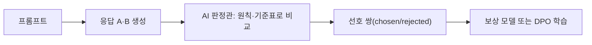
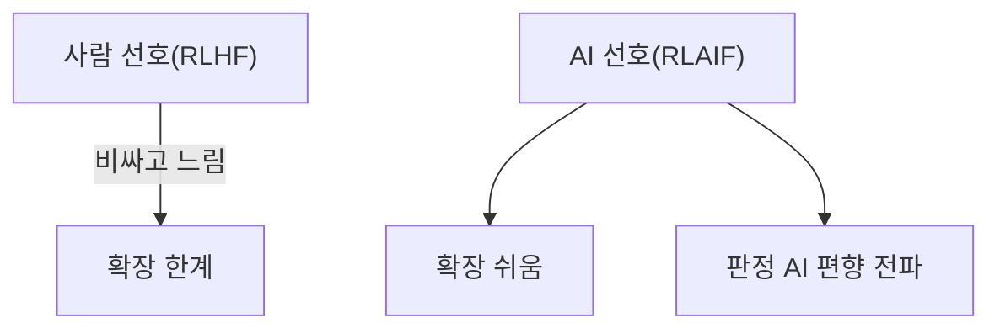

# 합성 선호 데이터

> 사람 대신 AI가 "두 답변 중 어느 쪽이 더 나은가"를 판정해 만든 선호 쌍 데이터다. 사람 라벨링 비용을 줄이고 규모를 키울 수 있지만, 판정 AI의 편향과 한계가 데이터에 그대로 들어간다.

## 쉽게 말하면
심사위원을 수천 명 구하기 어려우니, 심사 기준표를 받은 숙련된 AI 심사위원이 수십만 번의 "A와 B 중 어느 답이 낫나"를 대신 채점하게 하는 것이다. 빠르고 싸지만 AI 심사위원이 편애하는 스타일이 있다면 그 취향이 학습 결과에 남는다.

## 자세히
(arXiv 초록 3건을 직접 열어 확인.)
- **Constitutional AI(Anthropic, arXiv 2212.08073)**: 사람의 감독은 **짧은 원칙 목록**으로만 준다. 1단계(지도): 모델이 자기 응답을 비평·수정하고 수정본으로 미세조정. 2단계(강화학습): 모델이 두 응답 중 더 나은 쪽을 판정하고, 그 AI 판정으로 **선호 모델**을 학습해 보상으로 쓴다(저자들이 이를 **RLAIF**라 부름). 결과 비서는 해로운 요청에 단순 거부 대신 이유를 설명하며, 사고 연쇄(CoT)가 판정 품질과 투명성을 높일 수 있다고 보고.
- **RLAIF vs RLHF(Lee 등, arXiv 2309.00267, ICML 2024)**: 보상 모델을 사람이 아닌 기성 LLM이 만든 선호로 학습. **요약·도움 대화·무해 대화**에서 RLHF와 "비슷한 성능". AI 라벨러가 정책과 같은 크기이거나 초기 정책과 같은 체크포인트여도 지도 미세조정 기준선을 능가(자기 개선). 보상 모델 없이 RL 중 LLM에서 직접 보상을 받는 **d-RLAIF**가 일반 RLAIF보다 낫다고 보고.
- **UltraFeedback(Cui 등, arXiv 2310.01377)**: **GPT-4 피드백 100만 건 이상**, 대화 **25만 개**를 아우르는 대규모 AI 피드백 데이터셋. 규모와 다양성을 핵심으로 보고, 지시문·응답을 다양화하고 주석 편향을 줄이는 기법을 적용. LLaMA 기반 모델을 best-of-n과 강화학습으로 정렬해 채팅 벤치마크에서 좋은 성능을 보고했다(수치는 초록에 없음). 데이터·모델은 GitHub(thunlp/UltraFeedback)에 공개.
- **한계(제안)**
  - **판정 모델의 편향**: 긴 답변 선호, 자기 스타일 선호, 위치 편향.
  - **오류 전파**: 판정 AI가 틀리는 영역(전문 지식·최신 사실)에서는 틀린 선호가 학습된다.
  - **순환 위험**: 같은 계열 모델이 만든 데이터로 학습하면 다양성이 줄 수 있다.
  - **평가 오염**: 판정 AI가 쓰인 벤치마크와 학습 선호 데이터가 겹치면 점수가 부풀 수 있다.
- **운영 요령(제안)**: 사람이 라벨한 소규모 골든 세트로 AI 판정 정확도를 먼저 측정하고([LLM을 데이터 주석자로](#llm-as-data-annotator)), 위치 바꿔 두 번 판정해 일관성을 확인하며, 표본을 사람이 재검수한다. 레드팀 같은 위험 데이터는 사람 검토를 유지([레드팀 데이터](#red-teaming-data)).
- 쓰이는 단계: [RLHF](#rlhf)의 보상 모델 학습과 [DPO](#dpo) 같은 선호 학습의 입력.

## 그림으로 보기

## 예시
- 사내 요약 모델: 같은 문서에 대한 요약 A·B를 LLM이 "사실성·간결성" 기준으로 비교 → 선호 쌍 5만 건 → 사람 200건으로 일치도 검증 → 일치도 낮은 기준은 수정.
- 교육 활용: "AI가 AI를 가르칠 때 생기는 문제"를 토론하는 AI 윤리·품질 수업.

## 헷갈리는 것과 비교
| 개념 | 차이 |
|---|---|
| 합성 선호 데이터 | AI가 만든 선호 쌍 |
| 사람 선호 데이터 | 사람이 chosen/rejected 표시 |
| [합성 데이터](#synthetic-data) | AI가 새 데이터 자체를 생성(선호 판정과 다름) |
| Constitutional AI | 원칙 목록으로 AI 판정을 이끄는 구체적 방법 |

## 더 읽을거리
- [Constitutional AI: Harmlessness from AI Feedback (arXiv 2212.08073)](https://arxiv.org/abs/2212.08073) — 비평·수정과 RLAIF(초록 확인).
- [RLAIF vs. RLHF (arXiv 2309.00267)](https://arxiv.org/abs/2309.00267) — 비슷한 성능·d-RLAIF(초록 확인).
- [UltraFeedback (arXiv 2310.01377)](https://arxiv.org/abs/2310.01377) — GPT-4 피드백 100만 건(초록 확인).
