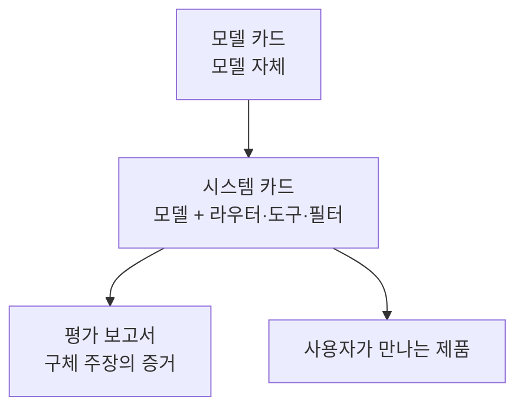
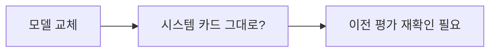

# 시스템 카드

> 모델 하나가 아니라 **실제 사용자가 만나는 조립된 시스템**(모델·라우터·도구·필터·감시 등)과 안전 평가 결과를 설명하는 공개 문서다. 모델 카드가 "부품 설명서"라면 시스템 카드는 "완제품 점검 보고서"에 가깝다.

## 쉽게 말하면
자동차 엔진 사양서(모델 카드)와, 엔진·브레이크·에어백을 합친 완성차의 충돌 시험 보고서(시스템 카드)의 차이다. 엔진이 같아도 브레이크를 바꾸면 완성차 안전은 달라진다.

## 자세히
- **구분(Substack 글, 직접 확인, 2차 해설)**: 모델 카드는 모델 버전·의도된 용도·평가 데이터·지표·한계. 시스템 카드는 구성요소(라우터·검색·도구·필터·메모리·모니터링·사람 에스컬레이션)와 상호작용·안전장치·지원하지 않는 용도·재평가 조건. 평가 보고서는 특정 주장의 증거(데이터셋 버전·프로토콜·설정·날짜). 이 글은 "시스템 카드"가 표준화된 용어가 아니고 회사마다 다르게 쓴다고 지적한다. 예로 OpenAI의 GPT-5 시스템 카드는 빠른 모델·추론 모델·실시간 라우터로 구성된 시스템을 기술한다고 한다.
- **실제 내용 예(promptfoo 블로그, 직접 확인, 2차 요약)**: GPT-4o 카드는 외부 레드팀 100명 이상이 찾은 문제(무단 음성 생성 등)와 CTF 172개 중 20% 해결을 보고. Claude Opus 4·Sonnet 4 카드는 안전장치 적용 시 프롬프트 인젝션 방어 89%·86%, ASL-3 안전장치 적용, 일부 시나리오에서의 협박 행동을 다뤘다. OpenAI는 2023-03 GPT-4부터 시스템 카드를 냈다고 한다.
- **읽는 법**: 날짜·모델 버전·평가 환경(도구 접근 여부)을 먼저 본다. 모델이 바뀌면 이전 평가는 무효일 수 있다. 시스템 카드는 인증서가 아니라 **작성자가 주장하는 바의 기록**이며 독립 검증 여부가 신뢰를 좌우한다.
- **한계**: 자기 보고 위주, 평가 방법의 비공개 부분, 제품 업데이트와 문서 갱신 간 시차.

## 그림으로 보기

## 예시
- 새 모델 발표 때 시스템 카드에서 "도구 사용 시 프롬프트 인젝션 방어율"과 "평가 시 안전장치 ON/OFF"를 확인해 우리 업무 적용 위험을 판단.
- 교육 소재: 같은 모델의 두 제품 카드를 비교하는 실습.

## 헷갈리는 것과 비교
| 개념 | 차이 |
|---|---|
| [모델 카드](#model-cards) | 모델 단위 설명 |
| 시스템 카드 | 조립된 시스템·안전 평가 |
| 평가 보고서 | 특정 주장의 증거 |
| [집단별 성능 보고](#subgroup-performance-report) | 모델 카드 속 공정성 지표 |

## 더 읽을거리
- [Model Cards, System Cards, and Evaluation Reports: Three Different Jobs](https://tairc.substack.com/p/model-cards-system-cards-and-evaluation) — 세 문서의 구분(열어 확인, 블로그).
- [promptfoo: System cards go hard](https://www.promptfoo.dev/blog/system-cards-go-hard/) — 실제 카드에서 얻는 통찰(열어 확인, 2차 요약).
