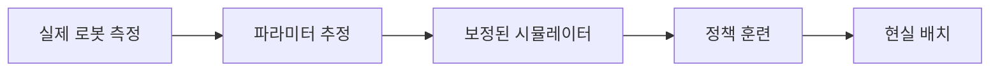
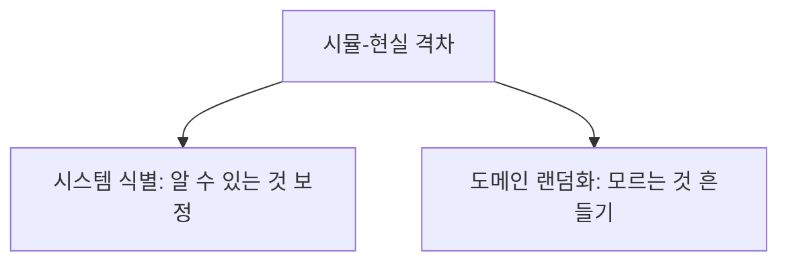

# 시스템 식별

> 실제 로봇을 측정해 **시뮬레이터의 물리 파라미터(질량·마찰·모터 특성 등)를 현실에 맞게 보정**하는 방법. 시뮬레이션-현실 격차(sim-to-real gap)를 줄이는 정공법이다.

## 쉽게 말하면
게임 속 자동차가 실제 차와 다르게 굴러간다면, 실제 차를 몰아 보고 게임의 타이어 마찰 값을 고쳐 가며 맞추는 일이다.

## 자세히
(검색 요약 기준.)
- 정의: 시뮬레이터 파라미터를 실제 로봇 행동 데이터에 맞춰 튜닝한다. 단점은 **시간이 많이 들고 오차가 생기기 쉽다**는 것.
- 한계: 좋은 식별 뒤에도 비강성, 기어 백래시, 마모, 유체 역학 같은 효과는 현재 시뮬레이터가 못 담는다.
- 짝 개념 **도메인 랜덤화**: 파라미터를 다양하게 바꿔 훈련해 강건하게 만든다. 하지만 어떤 파라미터를 얼마나 바꿀지 전문 지식이 필요하고, 과하면 학습이 어렵고 정책이 보수적·고분산이 될 수 있다.
- 결합 근거: 2026 연구(sim-to-sim 진자 실험이라 범위가 좁음)는 소수의 식별 롤아웃만으로 전이 격차 대부분을 줄이고, 실데이터가 있으면 넓힌 랜덤화보다 **추정 파라미터 주변에서 훈련**하는 편이 낫다고 했다. 결론: 잴 수 있는 것은 재고, 남은 불확실성에만 랜덤화.
- NVIDIA Isaac Lab 문서: 추정으로 모델을 개선하고 그 주변을 랜덤화하며, 임의의 극단이 아닌 **그럴듯한 범위**로 랜덤화하라고 권한다.
- 새 방법: 다리 로봇의 샘플링 기반 식별(SPI-Active, 보고 42~63% 개선), 미분 가능 시뮬레이션 식별.

## 그림으로 보기

## 예시
- 로봇 팔에 정해진 동작을 시켜 관절 토크 로그를 얻고, 시뮬레이터 마찰·댐핑 값을 맞춘다.
- 교육: "측정 가능한 것은 측정하고 나머지는 여유를 둔다"는 일반 원칙.

## 헷갈리는 것과 비교
| 개념 | 차이 |
|---|---|
| 시스템 식별 | 파라미터를 현실에 맞춤 |
| 도메인 랜덤화 | 파라미터를 다양화 |
| [모방 학습](#imitation-learning) | 시뮬 대신 시연 데이터로 학습 |

## 더 읽을거리
- [NVIDIA Isaac Lab: Simulation to Reality](https://docs.nvidia.com/learning/physical-ai/getting-started-with-isaac-lab/latest/robot-learning-fundamentals/08-simulation-to-reality.html) — 실무 가이드(검색 결과 확인).
- [Domain Randomization (arXiv 1703.06907)](https://arxiv.org/abs/1703.06907) — 원 논문 링크.
