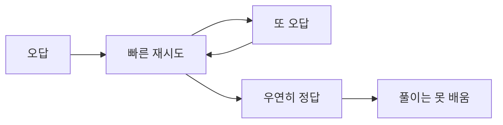

# 체계적 추측

> 풀이를 생각하는 대신 **답을 차례로 대입해 가며 맞는 것을 찾는** 행동이다. gaming the system의 한 유형(체계적 시행착오)이다.

## 쉽게 말하면
네 개 보기 중 정답을 모를 때 1번부터 차례로 눌러 보며 "맞았다" 소리가 나올 때까지 하는 것이다. 정답은 얻지만 풀이는 배우지 못한다.

## 자세히
(Baker 외 2004 논문과 Baker의 gaming 소개 페이지를 읽었다. 이 유형만의 **정량 수치는 두 자료에 따로 없다.**)
- **위치**: 논문은 gaming을 *도움 남용*과 *체계적 시행착오* 두 유형으로 나눴다. Baker 페이지는 Cognitive Tutor의 예로 체계적 추측과 같은 힌트를 반복 요청해 답이 나오게 하는 것을 든다.
- **탐지 단서(논문의 특징 중 일부)**: 한 단계에서 이미 오류가 있었는데 짧은 시간 안에 또 시도하는 "빠른 행동", 해당 기술에서 과거 오류가 많은 상태 등을 쓴다. 모델의 상세 계수는 논문 Table 1에 있다.
- **학습 영향**: 자주 gaming하는 학생은 비슷한 학생의 약 2/3만큼 배운다(상관). 다만 해롭지 않은 gaming도 있다.
- **설계 시사(논문)**: 단계적 도움을 늦게 여는 규칙이 gaming을 줄일 수 있으나 다른 학생에게는 불편과 비효율을 줄 수 있어, 먼저 *누가 해롭게 gaming하는지* 정확히 탐지하는 것이 중요하다고 본다.

## 그림으로 보기

## 예시
- 객관식 4지선다에서 15초 안에 보기 1→2→3 순으로 제출하는 로그는 의심 신호다(제안).
- 보완: 오답 직후 "이전 보기가 왜 틀렸을까?"를 한 줄 묻기(제안).

## 헷갈리는 것과 비교
| 개념 | 차이 |
|---|---|
| 체계적 추측 | 답을 바꿔 가며 대입 |
| 도움 남용 | 힌트를 연타해 답 보기 |
| [gaming the system](#gaming-the-system) | 둘을 포함하는 상위 개념 |

## 더 읽을거리
- [Baker et al. (2004)](https://www.cs.cmu.edu/~rsbaker/BCK2004MLFinal.pdf) — 유형 정의와 탐지 모델(직접 읽음).
- [Baker — Gaming the System](https://www.cs.cmu.edu/~rsbaker/gaming.html) — Cognitive Tutor 예시(직접 읽음).
