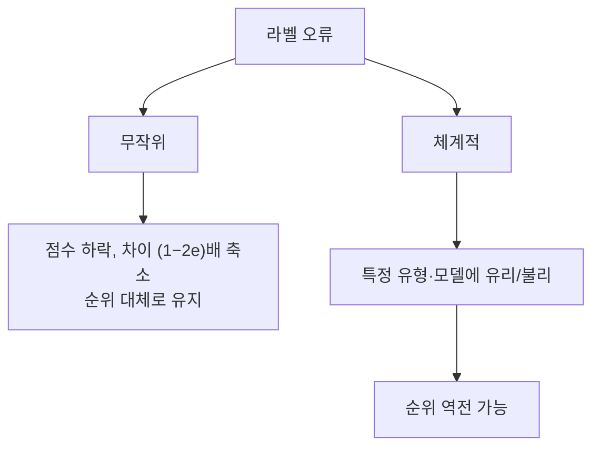

# 체계적 vs 무작위 라벨 오류

> **무작위 라벨 오류**는 아무 예시에서나 같은 확률로 생겨 점수를 균일하게 끌어내리지만 모델 순위는 대체로 유지한다. **체계적 라벨 오류**(특정 유형을 일관되게 잘못 붙임)는 특정 모델에 유리·불리하게 작용해 **순위를 뒤집을 수 있다.**

## 쉽게 말하면
채점자가 가끔 아무 답안에나 실수로 틀린 점수를 주면(무작위) 모든 학생이 비슷하게 손해를 본다. 그런데 채점자가 "특정 풀이 방식"만 항상 틀린 것으로 보면(체계적) 그 방식을 쓰는 학생만 계속 불이익을 받는다.

## 자세히
- **무작위 라벨 오류의 효과(직접 계산)**: 정확도 a인 모델이 평가용 라벨의 e 비율이 무작위로 뒤집힌 세트에서 측정되면 관측 정확도 = a(1−e) + (1−a)e(이진 분류 가정). 차이는 (1−2e)배로 줄 뿐 순위는 유지된다. 예: A 92%, B 91%, e=5% → 관측 A 87.8%, B 86.9%(차이 1.0%p → 0.9%p).
- **체계적 오류가 순위를 뒤집는 예(가상 수치)**: 평가 세트의 4%가 특정 유형이고 라벨러가 그 유형을 일관되게 틀리게 붙였다. 모델 A는 진실을 맞힌다(진짜 정확도 92%). 모델 B는 같은 라벨러가 만든 학습 데이터로 그 버릇을 배워 진짜 정확도는 91%이나 그 4%에서 라벨러와 같은 답을 낸다. 관측하면 A는 그 4%를 "틀림" → 88%, B는 "맞음" → 95%. 진실(A>B)과 관측(B>A)이 **정반대**가 된다.
- **더 큰 규모의 근거(Rolnick 외 2017, arXiv 1705.10694, 초록 확인)**: 심층 신경망은 정답 라벨이 오답 라벨에 압도돼도(MNIST에서 깨끗한 예시 1개당 무작위 라벨 100개를 섞어도 시험 정확도 90% 이상) 일반화할 수 있다. 다만 핵심 결과는 **무작위 라벨**이고, 혼동되는 클래스로 치우친 노이즈에 대한 결과는 초록에서 정성적으로만 언급된다. 즉 학습 세트의 무작위 노이즈에는 견고하지만 평가 세트의 체계적 편향은 별개 문제다.
- **구분 방법**
  1. 오류 사례를 모아 **범주별로** 본다: 특정 클래스·특정 출처·특정 라벨러에 몰리면 체계적.
  2. 라벨러 간 일치도(Cohen's κ)와 라벨러별 오류율 비교.
  3. 혼동 행렬에서 모델과 라벨의 **불일치가 한 방향**으로 쏠리는지 본다.
  4. 모델 간 비교 시 라벨 수정 전·후 순위가 바뀌는지 확인(민감도 분석).
- **수정 시 주의(Ng, MLY 16장 확인)**: 틀린 예시만 라벨을 고치고 맞힌 예시는 안 보면 평가에 편향이 생긴다 — 둘 다 점검하라. 제품 개발엔 허용되나 논문·편향 없는 측정에는 문제다.
- **대응**: 라벨 지침 명확화, 이중 라벨링+중재, 체계적 의심 유형의 재라벨, 순위가 걸린 결정은 라벨 수정 후 재평가.

## 그림으로 보기

## 예시
- 감성 분류 평가 세트에서 "반어법" 문장을 라벨러가 일관되게 긍정으로 붙였다면, 반어법을 학습한 최신 모델이 오히려 낮게 평가된다.
- 점검 코드: `confusion_matrix(label, pred)`에서 한 칸이 비정상적으로 크면 그 유형을 샘플링해 라벨을 직접 검수.

## 헷갈리는 것과 비교
| 구분 | 무작위 | 체계적 |
|---|---|---|
| 패턴 | 없음 | 유형·출처·라벨러에 편중 |
| 점수 영향 | 균일하게 하락 | 모델별 불균등 |
| 순위 | 대체로 유지 | 역전 가능 |
| 학습 세트에서 | 심층망이 상당히 견딤 | 그대로 학습될 위험 |

관련: [오류 중 라벨 오류 비중](#label-error-share-of-errors)

## 더 읽을거리
- [Deep Learning is Robust to Massive Label Noise (arXiv 1705.10694)](https://arxiv.org/abs/1705.10694) — 무작위 라벨 노이즈에 대한 견고함(초록 확인).
- [Andrew Ng, Machine Learning Yearning 16장](https://home-wordpress.deeplearning.ai/wp-content/uploads/2022/03/andrew-ng-machine-learning-yearning.pdf) — 맞힌 예시도 함께 점검하라는 주의(본문 확인).
