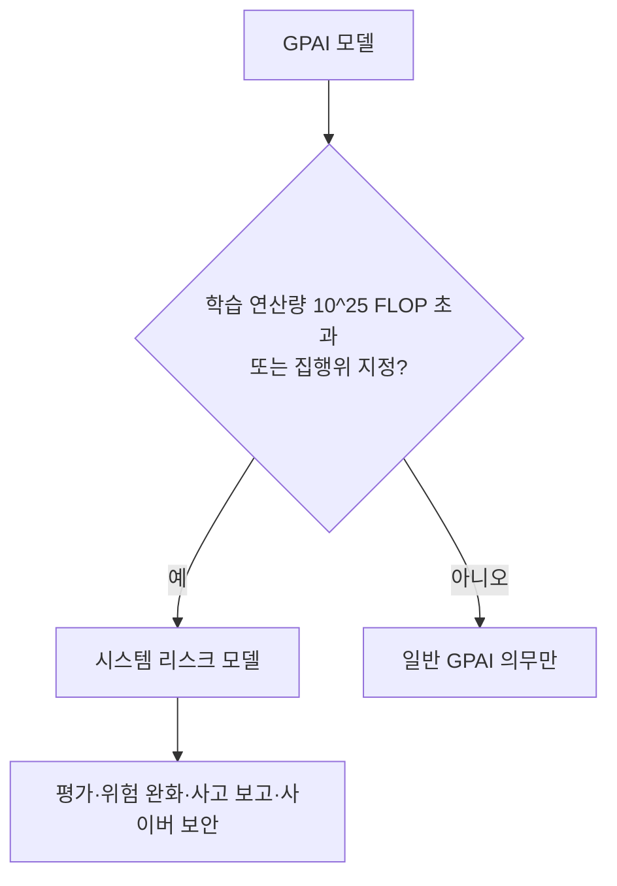
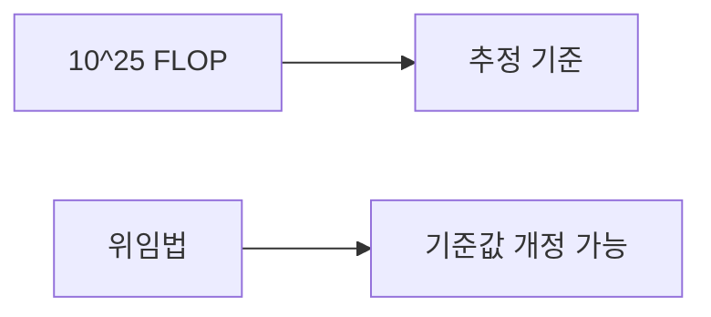

# 시스템 리스크 모델

> EU AI Act에서 "시스템 리스크가 있는 범용 AI(GPAI) 모델"로 분류되는 최상위 모델. 학습 연산량이 10^25 FLOP를 넘으면 높은 영향 능력이 있다고 추정하고, 제공자에게 평가·사고 보고 등 추가 의무를 지운다.

## 쉽게 말하면
일반 자동차와 대형 화물 트럭의 구분과 비슷하다. 트럭은 사고가 나면 영향이 크니 더 엄격한 검사·보고를 요구한다. 모델의 "크기"를 학습 연산량이라는 기준 숫자로 먼저 가늠한다.

## 자세히
출처는 artificialintelligenceact.eu의 51조·55조(열람). 법률 자문이 아니다.
- **분류 기준(51조)**: 다음 중 하나면 시스템 리스크가 있는 GPAI 모델이다. (a) 지표·벤치마크 같은 적절한 기술 도구와 방법으로 판단한 높은 영향 능력이 있음. (b) 집행위가 직권으로 또는 과학 패널의 자격 경보 후, 부속서 XIII의 기준에 따라 (a)와 동등한 능력·영향이 있다고 결정.
- **추정 규칙(51조 2항)**: 누적 학습 연산량이 10^25 부동소수점 연산(FLOP)을 넘으면 높은 영향 능력이 있다고 추정한다.
- **기준 변경(51조 3항)**: 집행위가 97조에 따른 위임법으로 1·2항의 기준값을 고치고 벤치마크·지표를 추가할 수 있다. 알고리즘 개선, 더 효율적인 하드웨어 등 기술 변화를 반영하기 위해서다.
- **추가 의무(55조)**: 53·54조 의무에 더해
  - (a) 최신 인정 방법으로 모델 평가, 문서화된 적대적 시험(adversarial testing)으로 대규모 위험 식별·완화
  - (b) EU 전반의 광범위한 위험을 평가·완화(개발·출시·사용에서 비롯되는 것 포함)
  - (c) 중대 사고와 시정 조치를 기록·문서화하고 AI Office(필요 시 국가 당국)에 지체 없이 통지
  - (d) 모델과 기반 인프라의 적절한 사이버 보안
- **준수 경로(55조 2항)**: 승인된 행동강령(56조)을 통해 준수를 보일 수 있고(조화 표준이 나오기 전까지), 행동강령도 표준도 따르지 않으면 집행위가 평가할 다른 적절한 수단을 보여야 한다. 조화 표준 준수는 해당 의무에 대한 적합 추정을 준다. 영업비밀 등은 78조에 따라 비밀로 다룬다.
- **주의**: 이 글은 법 조문 요약이며 특정 모델이 이 기준에 해당하는지는 다루지 않는다. 학습 연산량 공개 여부와 계산 방식은 사안별 확인이 필요하다.

## 그림으로 보기

## 예시
- 학습 연산량이 10^25 FLOP를 넘는 가상의 모델 제공자는 사고 발생 시 AI Office에 지체 없이 통지해야 한다.
- 교육 실습: 10^25 = 1 뒤에 0이 25개임을 설명하고, 왜 숫자 하나로 규제 대상을 가르는 방식의 장단점이 있는지 토론.

## 헷갈리는 것과 비교
| 개념 | 차이 |
|---|---|
| 시스템 리스크 모델 | 최상위 GPAI, 추가 의무 |
| 일반 GPAI 모델 | 53·54조 기본 의무 |
| 고위험 AI 시스템 | 용도 기반 분류, 별도 장 |
| [AI Board](#ai-board) | 자격 경보에 의견 제공 |

## 더 읽을거리
- [AI Act Article 51](https://artificialintelligenceact.eu/article/51/) — 분류(열람)
- [AI Act Article 55](https://artificialintelligenceact.eu/article/55/) — 추가 의무(열람)
