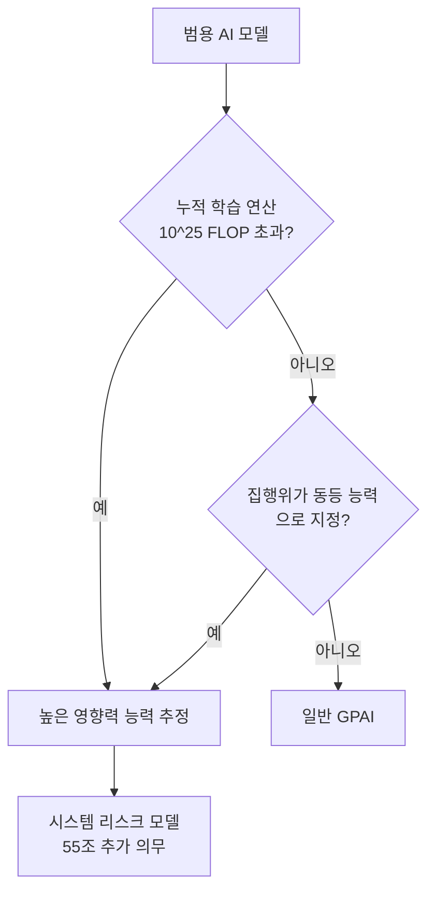

# 체계적 위험 10^25 FLOP 기준

> EU AI Act 51조: 누적 학습 연산량이 10^25 FLOP를 넘는 범용 AI 모델은 "높은 영향력 능력"이 있는 것으로 추정되어 시스템 리스크 모델로 분류된다. 추정이라 반박·추가 지정이 가능하다.

## 쉽게 말하면
자동차 배기량 기준처럼 "엔진이 이 정도 이상이면 대형차 규정을 적용한다"는 대략적인 기준선이다. 정확히는 능력이 아니라 학습에 쓴 계산량으로 능력을 추정한다.

## 자세히
출처: AI Act 51조(artificialintelligenceact.eu, 2026-11-15 확인).
- **두 경로**: ① 기술 도구·지표·벤치마크로 평가한 높은 영향력 능력 ② 집행위 결정(직권 또는 과학 패널의 질적 경보)으로 부속서 XIII 기준상 동등한 능력·영향이 있다고 지정.
- **연산량 추정**: 누적 학습 연산량 > 10^25 FLOP이면 높은 영향력 능력이 있다고 추정한다.
- **갱신**: 집행위가 97조 위임 행위로 임계값·벤치마크·지표를 바꿀 수 있다(알고리즘 개선, 하드웨어 효율 반영). 즉 숫자는 고정이 아니다.
- **시스템 리스크 정의**: 높은 영향력 능력에서 나오고, EU 시장에 상당한 영향을 주며(보건·안전·보안·기본권·사회), 가치사슬 전반으로 대규모 확산될 수 있는 위험.
- 분류되면 55조의 추가 의무(위험 평가·적대적 테스트·사고 보고·사이버보안)가 붙고, 오픈소스 면제도 적용되지 않는다([GPAI 의무](#eu-ai-act-gpai), [하류 제공자 정보 의무](#downstream-provider-info)).
- 절차(통지 등)는 52조 소관이며 이 글에서는 확인하지 않았다.

## 그림으로 보기

## 예시
- 대형 모델 제공사는 학습 총연산량을 기록·산정해 임계 초과 여부를 AI Office와 다룬다. 연산이 적어도 능력이 높으면 지정될 수 있다.
- 10^25 FLOP는 대략 "H100급 GPU 수천 장을 수개월" 규모(정확한 환산은 모델·효율에 따라 다름, 어림).

## 헷갈리는 것과 비교
| 개념 | 차이 |
|---|---|
| 10^25 FLOP | 연산량 기준 추정선 |
| 파라미터 수 | 모델 크기, 연산량과 다름 |
| 고위험 AI | 용도 기반 분류, 모델 크기 무관 |
| [AI Office](#ai-office) | 분류·집행 담당 |

## 더 읽을거리
- [AI Act Article 51](https://artificialintelligenceact.eu/article/51/) — 분류 기준 조문
