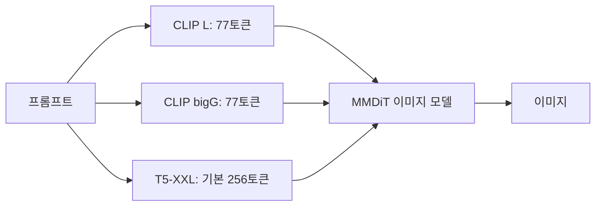

# T5 텍스트 인코더

> T5 텍스트 인코더는 Google의 T5 모델에서 인코더 부분만 떼어 쓰는 텍스트 이해 모듈이다. Stable Diffusion 3는 CLIP 2개에 T5-XXL을 더해 긴 프롬프트를 더 잘 읽는다.

## 쉽게 말하면
그림을 그리는 화가(이미지 모델)에게 주문서를 전달하는 비서가 있다고 하자. CLIP 비서는 짧은 메모(77토큰)만 받아 적는다. T5 비서는 몇 장짜리 긴 주문서도 읽고 요점을 화가에게 넘긴다. SD3는 비서를 셋 둬서 짧은 메모와 긴 설명을 모두 쓴다.

## 자세히
- Hugging Face diffusers 문서 기준 SD3 파이프라인은 텍스트 인코더 3개를 쓴다: `clip-vit-large-patch14`, `CLIP-ViT-bigG-14`, 그리고 `t5-v1_1-xxl`(T5-XXL, 약 47억 파라미터).
- T5 프롬프트의 기본 최대 길이는 256토큰이며 `max_sequence_length`로 조정(예: 512). 길수록 자원과 시간이 더 든다. CLIP 쪽은 여전히 77토큰에서 잘린다.
- `prompt`(CLIP)와 `prompt_3`(T5)에 서로 다른 글을 줄 수 있다. 짧은 요약은 CLIP에, 상세 묘사는 T5에 주는 식이다.
- 메모리: T5-XXL이 커서 24GB 미만 GPU에서는 부담이다. 문서는 ① T5를 빼면(`text_encoder_3=None`) 성능 손실은 작고 메모리가 크게 준다, ② bitsandbytes로 8비트 양자화해 쓸 수 있다고 안내한다.
- 인코더-디코더 모델인 T5에서 디코더 없이 인코더만 쓰기 때문에 "텍스트를 벡터 열로 바꾸는" 역할만 한다.

## 그림으로 보기


## 예시
```python
pipe(prompt="요약 문장", prompt_3="아주 긴 상세 묘사...", max_sequence_length=512)
```
VRAM이 부족하면 `text_encoder_3=None`으로 T5를 끄고 짧은 프롬프트 위주로 쓴다.

## 헷갈리는 것과 비교
| 개념 | 차이 |
| --- | --- |
| [CLIP 텍스트 인코더](#clip-text-encoder) | 이미지와 정렬되도록 학습, 77토큰 한계 |
| T5 인코더 | 순수 언어 이해 중심, 더 긴 입력 |
| [77토큰 한계](#clip-77-token-limit) | CLIP의 제약. T5 병용이 우회책 중 하나 |

## 더 읽을거리
- [Hugging Face: Stable Diffusion 3](https://huggingface.co/docs/diffusers/en/api/pipelines/stable_diffusion/stable_diffusion_3) — 인코더 구성, 긴 프롬프트, T5 제거·양자화
