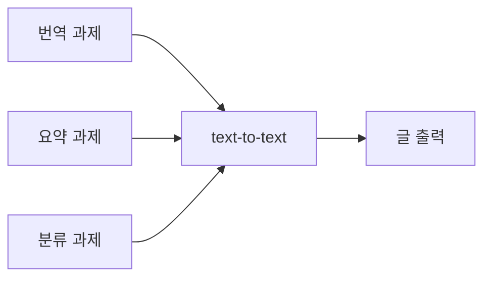
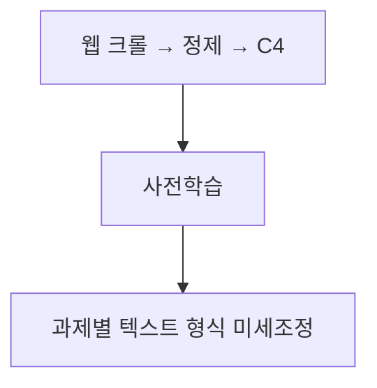

# T5

> **T5(Text-to-Text Transfer Transformer)** 는 번역·요약·분류·질의응답 등 **모든 텍스트 과제를 "글 입력 → 글 출력"** 형식으로 통일한 인코더-디코더 모델이다(Raffel 외, arXiv 1910.10683, 2019).

## 쉽게 말하면
과제마다 다른 답안지를 쓰지 않고, 무조건 "질문 글을 받고 답 글을 쓴다"로 통일한 시험이다. 분류도 "긍정"이라는 글을 출력하는 문제가 된다.

## 자세히
(논문 초록 확인)
- **통합 틀**: 모든 텍스트 기반 언어 문제를 **text-to-text** 형식으로 변환.
- **체계적 비교**: 사전학습 목표, 아키텍처, 비지도 데이터셋, 전이 방식 등을 수십 개 언어 이해 과제에서 비교.
- **데이터와 규모**: 이 통찰에 규모와 새 코퍼스 **C4(Colossal Clean Crawled Corpus)** 를 결합해 요약·질의응답·텍스트 분류 등 많은 벤치마크에서 최고 성능을 보고. 데이터셋·사전학습 모델·코드를 공개했다. 초록에 구체 점수는 없다.
- 구조적 위치: [인코더-디코더](#encoder-decoder-types) 유형의 대표. 접두어(예: "translate English to German:")로 과제를 지정하는 방식은 일반 지식이며 초록에는 없다.
- 후속(일반 지식): 오늘의 챗봇 LLM은 대부분 디코더 전용이나, T5식 "모든 것을 텍스트로" 관점은 지시 따르기 모델의 사고방식에 영향을 줬다.

## 그림으로 보기



## 예시
```
입력: summarize: <긴 기사 본문>
출력: <요약문>
```
- 분류도 `sentiment: 이 영화 최고였다` → `긍정`처럼 글로 출력.

## 헷갈리는 것과 비교
| 개념 | 차이 |
|---|---|
| T5 | 인코더-디코더, 모든 과제를 글→글 |
| BERT | 인코더 전용, 과제별 출력층 추가 |
| GPT류 | 디코더 전용 생성 |
| 지시 튜닝 | 자연어 지시로 따르게 학습 |

## 더 읽을거리
- [Exploring the Limits of Transfer Learning with a Unified Text-to-Text Transformer](https://arxiv.org/abs/1910.10683)
