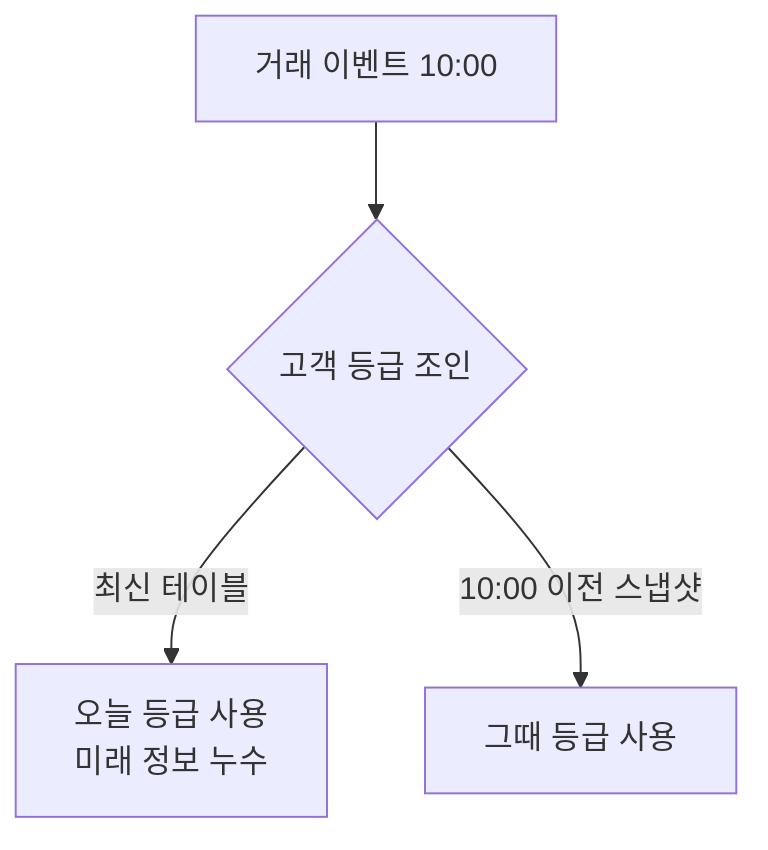
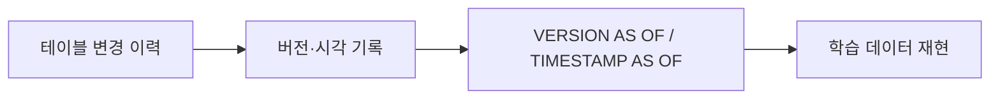

# 조인 테이블 스냅샷

> 학습·서빙 때 **계속 바뀌는 테이블(예: 사용자 등급, 재고)을 조인**하면, 시점마다 값이 달라져 학습 데이터가 서빙 때와 어긋난다. 이를 막으려고 테이블을 **그 시점 상태로 고정(스냅샷)**하거나, 이벤트 시각 이전 값만 붙이는 시점 기준(point-in-time) 조인을 쓴다.

## 쉽게 말하면
어제 거래의 고객 등급을 오늘 등급으로 붙이면 "그때는 일반 고객이었는데 지금은 VIP"인 정보가 과거에 새어 들어간다. 거래 당시의 등급표(스냅샷)를 찾아 붙여야 한다.

## 자세히
- **문제의 출처(Google Rules of Machine Learning 규칙 31, 직접 확인)**: "학습과 서빙에서 테이블을 조인하면 테이블 내용이 바뀔 수 있다." 서빙 때 특징을 로깅하면 피할 수 있고([서빙 특징 로깅](#log-serving-features)), **느리게 바뀌는 테이블의 스냅샷**은 도움이 되지만 완전히 해결하지는 못한다고 말한다.
- **시점 기준 조인(Feast 문서, 직접 확인)**: 각 엔티티 행의 이벤트 시각에서 **거슬러 올라가 마지막으로 있던 특징 값**을 붙인다. 최신 값을 그냥 조인하면 미래 정보가 학습에 새는 누수가 생긴다. TTL은 각 행의 시각 기준 최대 조회 범위이며 그 안에 값이 없으면 비운다. 문서는 백필·정정된 값이 기본적으로 새어 들 수 있어 `filter_by_created_timestamp` 옵션이 있다고 한다. 예(문서 설명 기반, 시각은 이 글이 구성): 특징 행이 08:00·10:00, TTL 2시간일 때 09:30 이벤트는 08:00 값, 11:30은 10:00 값, 06:00은 값 없음, 14:30은 10:00 값이 4.5시간 전이라 TTL 밖이라 값 없음.
- **스냅샷을 만드는 기술 예(Delta Lake 문서, 직접 확인)**: 타임 트래블로 **버전 번호나 타임스탬프로 과거 상태 조회**(`VERSION AS OF 123`, `TIMESTAMP AS OF '2018-10-18T22:15:12.013Z'`, DataFrame은 `versionAsOf`·`timestampAsOf` 옵션). 버전 번호는 `DESCRIBE HISTORY`로 확인. 기본 보관은 `delta.logRetentionDuration` 30일, 삭제 파일은 `delta.deletedFileRetentionDuration` 7일 후 `VACUUM`으로 제거 가능. 로그와 데이터 파일이 모두 남아 있어야 읽을 수 있다. 주의: 테이블 디렉터리를 복사하면 타임스탬프 조회가 깨질 수 있고(버전 조회는 영향 없음), 로그 정리로 보관 기간 안이라도 일부 버전이 접근 불가일 수 있으며, 30일 이상 보관하려면 설정을 늘려야 하고 저장 비용이 는다.
- **설계 선택(해석)**: ① 서빙 로깅이 가능하면 로그가 가장 정확 ② 불가하면 시점 기준 조인 ③ 느린 차원 테이블은 주기 스냅샷 ④ 스냅샷 보관 기간을 재현·감사 요구에 맞춘다.

## 그림으로 보기

## 예시
- 이탈 예측 모델의 학습 데이터를 만들 때 각 고객 행의 기준일 시점의 요금제를 시점 기준 조인으로 붙인다.
- 교육 소재: 같은 고객·같은 날짜에 최신 조인과 시점 조인 결과가 다른 표를 만들어 보여 준다.

## 헷갈리는 것과 비교
| 개념 | 차이 |
|---|---|
| 최신 값 조인 | 쉽지만 미래 정보 누수 |
| 시점 기준 조인 | 이벤트 시각 이전 값만 |
| 스냅샷 | 테이블 전체를 시점별로 고정 |
| [서빙 특징 로깅](#log-serving-features) | 서빙 입력 그대로 기록 |

## 더 읽을거리
- [Rules of Machine Learning (Google)](https://developers.google.com/machine-learning/guides/rules-of-ml) — 규칙 31(직접 확인).
- [Feast: Point-in-time joins](https://docs.feast.dev/getting-started/concepts/point-in-time-joins) — 시점 기준 조인·TTL(직접 확인).
- [Delta Lake: Time travel](https://docs.delta.io/latest/delta-batch.html) — 버전·보관 설정(직접 확인).
