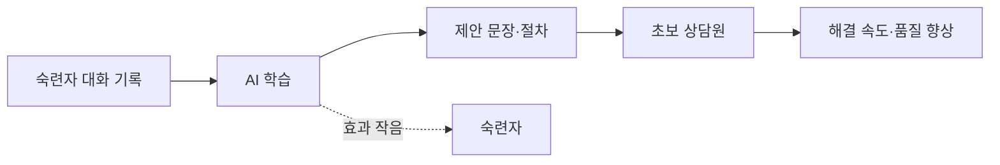

# 암묵지 전파 효과

> AI 어시스턴트가 숙련자의 말하지 못하는 노하우(암묵지)를 학습해 초보 직원에게 퍼뜨려, 초보와 숙련자 사이 성과 격차를 줄이는 현상.

## 쉽게 말하면
베테랑의 어깨너머 요령을 옆에서 속삭여 주는 코치가 생긴 것과 같다. 초보는 몇 달 걸릴 요령을 첫날부터 쓰고, 이미 잘하던 베테랑은 크게 달라지지 않는다.

## 자세히
- 대표 연구: Brynjolfsson·Li·Raymond, "Generative AI at Work"(NBER 31161, 2023). 한 대기업 상담센터의 상담원 5,179명, 생성형 AI 어시스턴트를 순차 도입.
- 결과: 시간당 해결 건수 평균 약 14%(논문 일부 표기 13.8%) 증가, **초보·저숙련은 34%**, 숙련자는 영향이 미미.
- 저자들의 해석(시사적 증거): AI가 능력 있는 상담원의 암묵지를 퍼뜨려 초보가 경험 곡선을 빨리 내려오게 한다. 한 해설은 "2개월차가 AI와 함께 6개월차처럼 일한다"고 표현.
- 부수 효과: 고객 감정 개선, 관리자 개입 요청 감소, 직원 유지율 향상.
- 한계: 한 회사·한 산업 연구라 비정형 지식 업무로 일반화하지 못한다. 숙련자 노하우가 데이터로 학습되는 구조라, 숙련자 기여에 대한 보상 문제도 논의된다(해설 수준).

## 그림으로 보기

## 예시
- 신입 상담원이 환불 문의에서 "먼저 주문 번호부터 확인 후 보상 옵션 제시" 같은 숙련자의 흐름을 제안받아 첫 주부터 응대.
- 도입 평가: 경력별로 해결 시간·수락률을 따로 본다([제안 수락률](#suggestion-acceptance-rate)).

## 헷갈리는 것과 비교
| 개념 | 차이 |
| --- | --- |
| 암묵지 | 말로 설명하기 어려운 노하우 |
| 형식지 | 문서화된 지식 |
| [에이전트 어시스트](#agent-assist) | 암묵지 전파가 일어나는 제품 형태 |
| [자동화 편향](#automation-bias) | 전파의 부작용: 무비판 수락 |

## 더 읽을거리
- [NBER: Generative AI at Work](https://www.nber.org/papers/w31161) — 원 논문 초록
- [arXiv 2304.11771](https://arxiv.org/pdf/2304.11771v1) — 논문 본문(v1, 검색 요약 확인)
