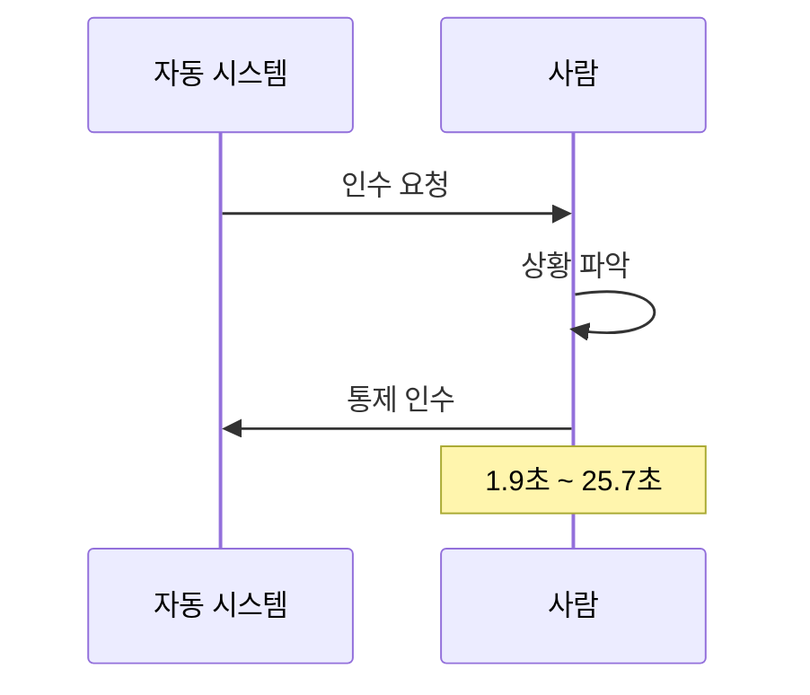
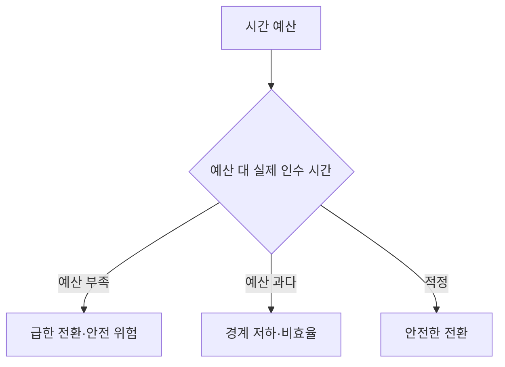

# 수동 인수 지연

> 자동 시스템이 실패하거나 한계에 닿았을 때 사람이 다시 통제권을 넘겨받기까지 걸리는 시간. 자율주행 연구에서 같은 조건에서도 반응 시간이 1.9초에서 25.7초까지 크게 퍼진다는 결과가 있다. 평균이 아니라 가장 느린 경우를 기준으로 설계해야 한다는 교훈을 준다.

## 쉽게 말하면
자동 운전 중에 스마트폰을 보던 운전자에게 "지금부터 직접 운전하세요"라고 알리면 고개를 들고 상황을 파악해 핸들을 잡기까지 시간이 걸린다. 어떤 사람은 2초, 어떤 사람은 25초나 걸릴 수 있다. AI 검수나 AI 에이전트의 "사람에게 넘기기"도 마찬가지다. 사람이 문제를 이해하고 개입하는 데 걸리는 시간은 의외로 길다.

## 자세히
출처: Eriksson & Stanton "Takeover Time in Highly Automated Vehicles: Noncritical Transitions to and From Manual Control", Human Factors 2017(사우샘프턴 대학 보도자료 ScienceDaily로 직접 읽음, 논문 본문은 열지 못함), 체계적 문헌 검토 arXiv 2507.22262 초록(직접 읽음).
- **연구 설계(보도 기준)**: 20~52세 26명이 시속 70마일(약 113km) 주행 시뮬레이션. 정상 고속도로 환경에서 30~45초 사이 무작위 간격으로 인수 요청. 비운전 보조 과제(스마트폰 같은 방해 활동)가 있을 때와 없을 때를 비교.
- **결과**: 비위급(non-critical) 상황에서 통제를 넘겨받는 데 **1.9~25.7초**가 걸렸다. 연구자들은 운전자 행동과 환경 조건의 차이로 설명. **보조 과제에 몰입해 있던 운전자는 더 늦게 반응**했고 이는 안전 위험으로 지적됐다.
- **핵심 메시지(보도자료)**: 평균·중앙값이 아니라 **반응 시간의 전체 분포**가 중요하다. 설계자는 분포의 느린 꼬리를 고려해야 한다. 또 7초 같은 짧은 여유 시간은 위급 상황 연구에서 나온 값인데, 비위급 상황에 그대로 쓰면 급핸들·급차선 변경·급제동 같은 스트레스 전환을 부를 수 있다.
- **체계적 검토(2025, arXiv 2507.22262)**: 인수 시간에 영향을 주는 요인을 분류하고 고정·적응형 **시간 예산(time budget)**, 인수 시간과 예산의 차이인 **"takeover buffer"**, 인수 성과 측정 분류를 제안. 예산이 너무 짧으면 안전·편안함이 위협받고 너무 길면 운전자의 경계와 전환 효율이 떨어진다는 상충을 서술. 연구 편수·수치는 초록에 없다.
- **AI 업무에 번역(이 글의 정리)**
  - AI가 "모르겠다/확신 낮음"을 알릴 때 사람은 맥락을 모른 채 갑자기 불려 온다. 요약과 근거를 함께 넘겨야 한다.
  - AI 에이전트가 실행 도중 승인을 요청하면 사람이 바로 응답하지 못할 수 있으므로 **타임아웃과 안전한 기본 동작**(보류, 롤백)이 필요하다.
  - 평균 응답 시간으로 SLA를 잡지 말고 느린 응답의 꼬리를 본다.
  - 사람이 평소 AI에 맡기고 다른 일을 할수록 인수가 느려진다([자동화 안주](#automation-complacency)).

## 그림으로 보기

## 예시
- AI 에이전트가 결제 직전에 사람 승인을 요청하는 설계: 승인이 5분 내 없으면 자동 취소(안전한 기본값)로 두고 승인 요청 화면에 핵심 근거 3줄을 함께 띄운다(제안).
- 콜센터의 AI 보조 중단 시 상담원이 수동 응대로 복귀하는 데 걸리는 시간을 모의 훈련으로 측정한다(제안, [AI 장애 대비 훈련](#ai-outage-drill)).

## 헷갈리는 것과 비교
| 개념 | 차이 |
|---|---|
| 수동 인수 시간 | 요청부터 실제 통제 회복까지 |
| 시간 예산 | 설계가 주는 여유 시간 |
| takeover buffer | 예산과 실제 인수 시간의 차 |
| [경계 저하](#vigilance-decrement) | 감시 성능이 떨어지는 원인 중 하나 |

## 더 읽을거리
- ['Takeover time' in driverless cars crucial to safety (ScienceDaily, 2017)](https://www.sciencedaily.com/releases/2017/01/170126081625.htm) — 연구 보도자료(직접 읽음)
- [Towards Safe and Comfortable Vehicle Control Transitions (arXiv 2507.22262)](https://arxiv.org/abs/2507.22262) — 체계적 검토 초록(직접 읽음)
