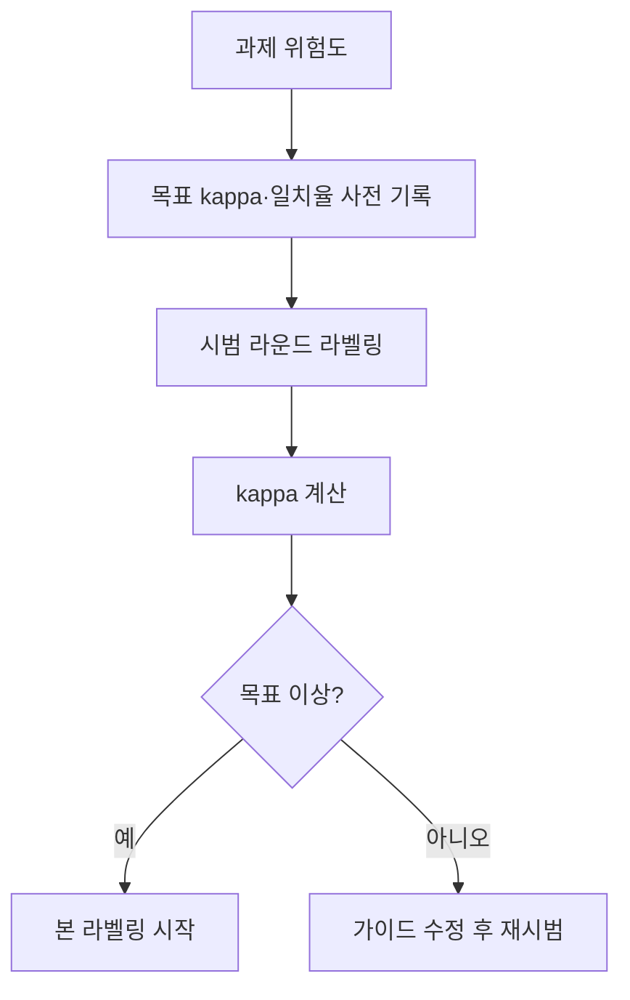
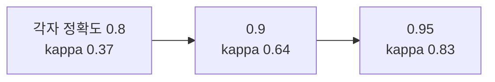

# 목표 일치도 정하기

> 라벨링 시범 라운드를 하기 **전에** "kappa 몇 이상이면 통과"라는 목표를 정해 두는 일이다. 목표가 없으면 나온 숫자를 보고 사후에 기준을 맞추게 된다. 목표는 경험칙이고 정답이 없으므로 근거와 함께 기록한다.

## 쉽게 말하면
시험 합격선을 채점 후에 정하면 합격자가 마음대로 정해진다. 시험 전에 "평균 70점 이상"을 정해 두는 것처럼, 라벨러 두 명이 얼마나 일치해야 통과인지를 미리 정한다.

## 자세히
- **kappa란(McHugh 2012, PMC3900052)**: 우연히 맞을 확률을 보정한 일치도. −1~1이며 0은 우연 수준, 1은 완전 일치.
- **해석표가 둘 있다**: Cohen(1960)은 0.41~0.60 보통, 0.61~0.80 상당(substantial), 0.81~1.00 거의 완벽. McHugh는 이것이 보건 연구에는 너무 관대하다며 더 엄격한 표를 제안한다: 0.40~0.59 약함(신뢰할 수 있는 데이터 15~35%), 0.60~0.79 보통(35~63%), 0.80~0.90 강함(64~81%), 0.90 초과 거의 완벽(82~100%). 그는 **0.60 미만이면 일치도가 부적절**하다고 본다. 어느 쪽이든 경험칙이며 과제 위험도에 따라 달라진다.
- **직접 시뮬레이션(scikit-learn `cohen_kappa_score`, 2,000개, 2명)**
  - 양성 10%인 불균형 데이터에서 서로 무관하게 무작위 라벨해도 **일치율 0.819, kappa 0.024**. 일치율만 보면 높아 보이지만 kappa는 우연 수준이다.
  - 균형 이진 데이터에서 라벨러 각자의 정확도에 따른 일치율/kappa: 0.6 → 0.528/0.057, 0.7 → 0.582/0.164, 0.8 → 0.686/0.373, 0.9 → 0.822/0.644, 0.95 → 0.915/0.830. **kappa 0.6을 넘으려면 각자 정확도가 약 0.9**여야 한다.
  - 파일럿 크기에 따른 kappa 흔들림(각자 정확도 0.85, 참 kappa 약 0.49, 시뮬레이션 400회): 30개 → 5~95% 범위 0.21~0.73, 50개 0.28~0.71, 100개 0.34~0.62, 200개 0.39~0.57, 500개 0.42~0.54. **시범 라운드가 작으면 kappa 하나로 합격 여부를 가리기 어렵다.**
- **목표 정하는 순서**
  1. 과제 위험도 결정(의료·법률은 높게, 탐색적 분류는 낮게).
  2. 목표를 kappa와 일치율 **둘 다**로 적는다(McHugh도 둘을 함께 보고하라고 권고).
  3. 파일럿 크기를 목표 구간의 폭을 보고 정한다(위 표 참고: 100~200개 이상 권장, 경험칙).
  4. 미달이면 라벨 가이드 개선 → 재시범 라운드.
  5. 클래스별 kappa도 본다(희귀 클래스에서 낮을 수 있음).
- **한계**: kappa는 클래스 불균형에 민감해 일치율이 높아도 낮게 나올 수 있다. 라벨러가 독립이라는 가정이 약하고 해석이 직접적이지 않다(McHugh).

## 그림으로 보기

## 예시
- 고객 문의 의도 분류(5클래스): "kappa ≥ 0.6, 일치율 ≥ 80%, 시범 150개, 클래스별 kappa ≥ 0.4"를 시범 전에 문서화.
- 교육: 라벨링 가이드 교육에서 "기준은 데이터를 보기 전에 정한다"는 원칙으로 설명.

## 헷갈리는 것과 비교
| 개념 | 차이 |
|---|---|
| 일치율 | 단순 비율, 우연 일치 포함 |
| Cohen's kappa | 우연 보정, 두 라벨러 |
| [평가자 간 일치도](#inter-annotator-agreement) | 상위 개념(여러 통계량) |
| 목표 일치도 | 사전에 정하는 합격선 |

## 더 읽을거리
- [McHugh 2012: Interrater reliability: the kappa statistic](https://pmc.ncbi.nlm.nih.gov/articles/PMC3900052/) — 해석표와 엄격한 기준 제안.
- [scikit-learn cohen_kappa_score](https://scikit-learn.org/stable/modules/generated/sklearn.metrics.cohen_kappa_score.html) — 계산 함수(미열람, 직접 사용 확인).
