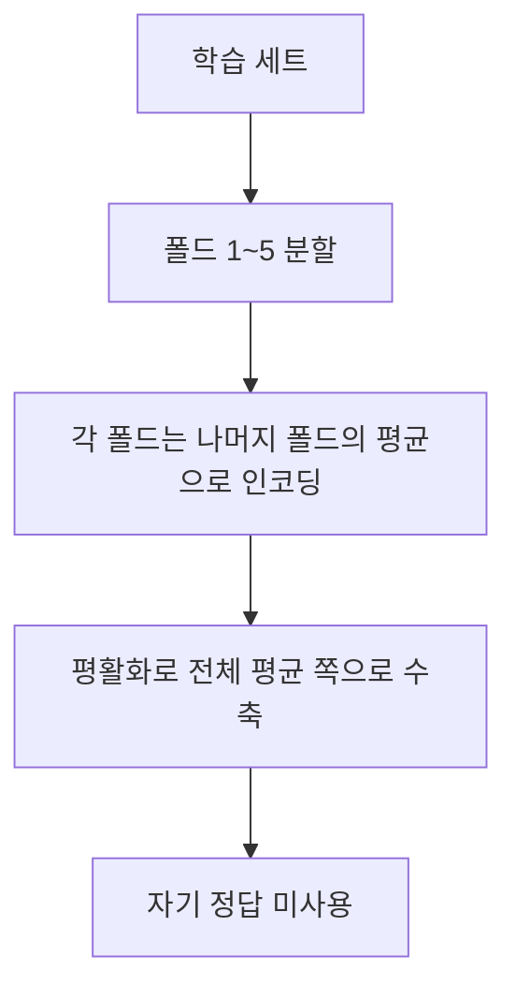

# 타깃 인코딩 누수

> 타깃 인코딩은 범주(우편번호·지역 등)를 그 범주의 정답 평균으로 바꾸는 방법인데, 학습 데이터의 정답으로 같은 학습 데이터를 인코딩하면 정답이 특성에 그대로 스며든다. 교차 적합(cross-fitting)과 평활화로 이 누수를 막는다.

## 쉽게 말하면
학생 번호를 "그 번호 학생의 기말 점수 평균"으로 바꿔서 기말 점수를 예측하라고 하면, 번호마다 학생이 한두 명뿐이라 정답을 베껴 쓴 것과 같다. 시험지를 보고 채점표를 만들고 같은 시험지를 채점한 격이다.

## 자세히
- **인코딩 공식(scikit-learn TargetEncoder 문서, 열람)**: 이진 분류에서 범주 i의 값 S_i = λ_i·(그 범주의 양성 비율) + (1−λ_i)·(전체 양성 비율), λ_i = n_i/(m + n_i). 범주의 표본 수가 적을수록 전체 평균 쪽으로 당겨 오는 수축(shrinkage)이다. `smooth`가 m이며 크면 전체 평균에 더 가중한다. `smooth="auto"`는 경험적 베이즈 추정(범주 내 분산 ÷ 전체 분산)을 쓴다.
- **교차 적합(같은 문서)**: `fit_transform(X, y)`는 `cv`개 폴드(기본 5)로 학습 데이터를 나눠 각 폴드를 나머지 폴드에서 배운 인코딩으로 변환한다. 학습 정답이 자기 자신의 인코딩에 새는 것을 막으며, 범주당 표본이 적은 고카디널리티 특성에서 특히 중요하다. `fit(X, y)`는 전체 학습 세트로 인코딩을 하나 학습하며 교차 적합이 없어 학습 데이터 변환에는 쓰지 말라고 한다. **`fit(X, y).transform(X)`는 `fit_transform(X, y)`와 같지 않다.** 시험 데이터는 `encoder.transform(X_test)`로 변환하고, 학습 때 못 본 범주는 전체 정답 평균으로 인코딩한다. 결측은 하나의 범주로 취급한다.
- **직접 해 본 실험(순수 파이썬, 시드 5)**: 표본 1,000개, 범주 500개(범주당 2개), 정답은 순수한 무작위 0/1이다. 정답과 인코딩값의 상관을 보면 같은 데이터로 범주 평균을 구한 단순 인코딩은 0.69, 5겹 교차 적합에 평활화(m=5)를 적용한 인코딩은 −0.05다. 정답이 노이즈이므로 상관은 0에 가까워야 정상이고, 단순 인코딩의 0.69는 순전히 누수다. 실제 모델 정확도를 잰 것이 아니라 인코딩값과 정답 사이의 상관만 본 실험이다.
- **누수를 눈치채는 법(해석)**: 학습 점수만 비정상적으로 높고 시험 점수가 크게 낮으면 의심한다. 가장 확실한 점검은 [무작위 라벨 점검](#random-label-sanity-check)이다.
- **전체 파이프라인에서(해석)**: 타깃 인코딩도 반드시 분할 후 학습 데이터로만 학습하고, 교차검증 안에서는 폴드마다 인코더를 다시 학습하도록 `Pipeline`에 넣는다.

## 그림으로 보기

## 예시
- 동 단위 우편번호 3,000개 범주가 있는 이탈 예측: `TargetEncoder(smooth="auto", cv=5).fit_transform(X_train, y_train)`로 학습 데이터를 변환하고 시험 데이터는 `transform`만 쓴다.
- 교육 활용: 정답이 무작위인 데이터에서 단순 인코딩의 상관이 높게 나오는 것을 직접 확인하는 실습.

## 헷갈리는 것과 비교
| 개념 | 차이 |
| --- | --- |
| [전처리 누수 파이프라인](#preprocessing-leakage-pipeline) | 상위 주제 |
| [스케일러 누수](#scaler-leakage) | 입력 통계의 누수. 타깃 인코딩은 정답 자체가 샘 |
| 원-핫 인코딩 | 정답을 쓰지 않아 누수 없음. 범주가 많으면 차원이 커짐 |

## 더 읽을거리
- [scikit-learn: Preprocessing — TargetEncoder](https://scikit-learn.org/stable/modules/preprocessing.html) — 수축·교차 적합·fit_transform 주의
