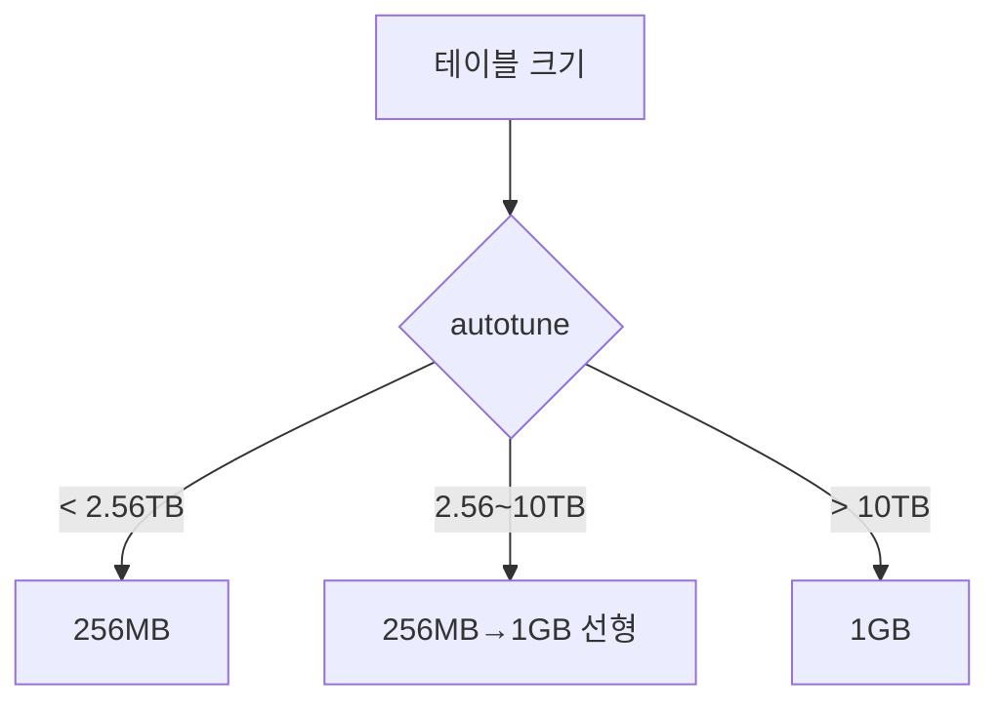
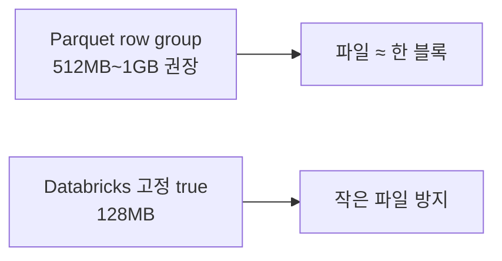

# 목표 파일 크기

> 데이터 파일을 **너무 작지도 너무 크지도 않은 크기**로 맞추는 기준이다. 도구마다 기본값이 다르고(128MB·256MB~1GB·512MB…), 같은 숫자를 서로 다른 기능에 섞어 쓰면 오해가 생긴다.

## 쉽게 말하면
이삿짐 상자가 너무 작으면 상자 수가 늘어 나르기 힘들고, 너무 크면 한 사람이 못 든다. 데이터 파일도 한 번에 읽는 효율과 병렬로 나눠 읽는 편의 사이에서 적당한 크기가 필요하다. 그런데 "적당한 크기"의 정답은 하나가 아니라 도구와 테이블 규모에 따라 다르다.

## 자세히
(Parquet 공식 설정 문서, Databricks의 파일 크기 조정 문서, Delta Lake 문서, Athena 최적화 문서를 직접 읽었다. 숫자들은 서로 **다른 대상**을 가리키므로 구분해 적는다.)
- **Parquet 파일 형식 문서의 권장**: **row group 512MB~1GB**, **데이터 페이지 8KB**. row group은 통째로 읽힐 수 있으므로 HDFS 블록 하나에 들어가야 하고, 예시 구성은 row group 1GB·HDFS 블록 1GB·파일당 블록 1개다. 문서는 파일 크기에 대한 직접 규칙은 없고 예시상 파일이 대략 1GB가 된다. 페이지는 작을수록 단일 행 조회 같은 세밀한 읽기에 유리하고, 클수록 헤더 오버헤드가 적다.
- **Athena 문서(앞서 읽음)**: Parquet row group 기본 128MB, ORC stripe 64MB이며 기본값보다 줄이는 것은 권장하지 않는다. 파일 크기 자체의 MB 수치는 제시하지 않는다.
- **Databricks 파일 크기 조정(직접 읽음)**
  - `delta.targetFileSize`(예: `100mb`)로 **수동 지정**. 기본값 없음. 지정하면 `OPTIMIZE`, liquid clustering, auto compaction, optimized write가 그 크기를 **best-effort**로 겨냥한다. Unity Catalog 관리형 테이블에서 SQL 웨어하우스 또는 Runtime 11.3 LTS 이상이면 `OPTIMIZE`만 이를 따른다.
  - **자동 조정(autotune)**: 지정하지 않으면 테이블 크기에 따라 정한다 — **2.56TB 미만 256MB**, 2.56~10TB는 256MB에서 1GB로 선형 증가, **10TB 초과 1GB**. 특정 목표를 지정한 테이블에는 적용되지 않는다. 목표가 커져도 `OPTIMIZE`는 기존의 작은 파일을 다시 쓰지 않아 일부 파일은 목표보다 작게 남는다.
  - Auto compaction과 Optimized Write는 `auto` 옵션이면 목표 크기를 조정하고 autotune을 따르며, `true`이면 **고정 128MB** 목표를 쓴다.
  - MERGE·UPDATE·DELETE에서는 auto compaction이 항상 켜지고 끌 수 없으며, 1TB 넘는 테이블은 `OPTIMIZE` 예약과 liquid clustering을 권한다. 쓰기 직전에 `coalesce(n)`/`repartition(n)`을 쓰지 말라는 주의도 있다.
- **Delta 오픈소스 문서(앞서 읽음)**: Auto compaction 기본 목표 128MB, Optimized Write의 `binSize` 기본 512MiB(출력 파일당 메모리상 목표). 같은 "크기"라도 디스크 크기와 메모리상 크기는 다르다.
- **정리(해석)**: 같은 128MB라도 Parquet row group(Athena 기본), Delta auto compaction 기본, Databricks `true` 옵션의 고정값으로 쓰임이 제각각이다. 자기 도구의 문서에서 "무엇의 크기인지"를 먼저 확인한다.

## 그림으로 보기



## 예시
```sql
ALTER TABLE events SET TBLPROPERTIES ('delta.targetFileSize' = '256mb');
```
- 교육 소재: 같은 "128MB"가 가리키는 대상이 다름을 표로 정리해 보기.

## 헷갈리는 것과 비교
| 숫자 | 가리키는 것 |
|---|---|
| 512MB~1GB | Parquet 권장 row group 크기 |
| 128MB | Athena 기본 row group, Delta auto compaction 기본, Databricks `true` 옵션 |
| 256MB~1GB | Databricks autotune 목표(테이블 크기별) |
| 512MiB | Delta Optimized Write의 `binSize` 기본 |
| [Delta OPTIMIZE](#delta-optimize-compaction) | 목표 크기를 겨냥해 파일을 합침 |

## 더 읽을거리
- [Parquet configurations](https://parquet.apache.org/docs/file-format/configurations/) — row group·페이지 크기 권장(직접 읽음).
- [Configure Delta Lake to control data file size (Databricks)](https://docs.databricks.com/aws/en/delta/tune-file-size) — targetFileSize·autotune(직접 읽음).
- [Optimizations (Delta Lake docs)](https://docs.delta.io/latest/optimizations-oss.html) — auto compaction 128MB·Optimized Write(직접 읽음).
