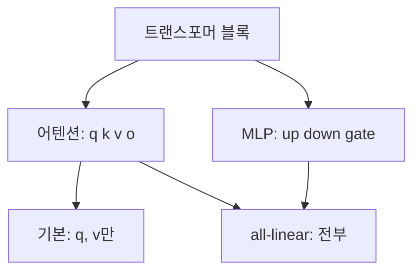

# LoRA 대상 모듈

> `target_modules`는 모델의 어느 층에 LoRA 어댑터를 붙일지 정하는 설정이다.

## 쉽게 말하면
건물 전체를 리모델링하지 않고 "거실과 주방 벽만" 골라 고치는 것과 같다. 어디를 고치느냐에 따라 효과와 비용이 달라진다.

## 자세히
HF PEFT 문서 기준:
- 기본은 주로 어텐션 블록(예: `query`, `value`).
- 리스트: `["q_proj","v_proj"]` — 이름이 정확히 같거나 해당 문자열로 끝나는 모듈.
- 문자열: 정규식으로 해석.
- `"all-linear"`: 모든 선형/Conv1D 모듈(PreTrainedModel은 출력층 제외). 아키텍처마다 이름이 달라도 편하다. QLoRA식으로 모든 선형층에 붙이면 전체 파인튜닝 성능에 맞출 수 있다고 문서가 설명.
- `[]`: 아무 모듈도 안 붙임(`target_parameters`만 쓸 때, 예: MoE 전문가 파라미터).
- 층별로 다른 랭크: `rank_pattern`, `alpha_pattern`.
- 많이 붙일수록 학습 파라미터·메모리가 늘어난다. `model.print_trainable_parameters()`로 확인.

## 그림으로 보기


## 예시
```python
LoraConfig(r=16, lora_alpha=16, target_modules=["q_proj","v_proj"])   # 가볍게
LoraConfig(r=16, lora_alpha=32, target_modules="all-linear")           # 성능 우선
```

## 헷갈리는 것과 비교
| 설정 | 차이 |
|---|---|
| q,v만 | 파라미터 적음 |
| all-linear | 용량 큼, 성능 근접 |
| rank r | 용량 크기, 붙일 위치와 별개 |
| [QLoRA](#qlora) | all-linear와 자주 함께 쓰임 |

## 더 읽을거리
- [HF PEFT LoRA 가이드](https://huggingface.co/docs/peft/developer_guides/lora) — target_modules, rank_pattern.
