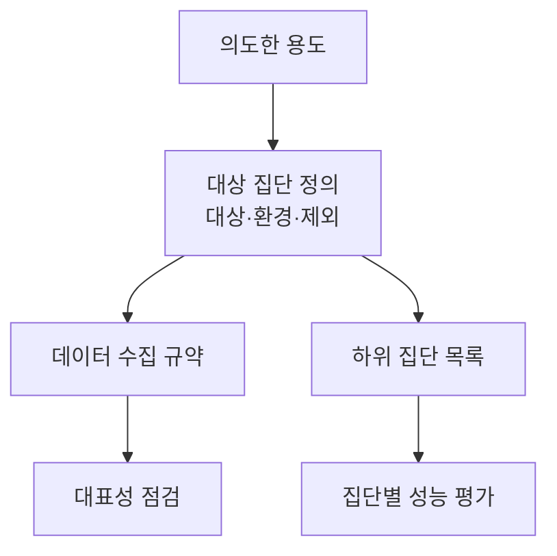
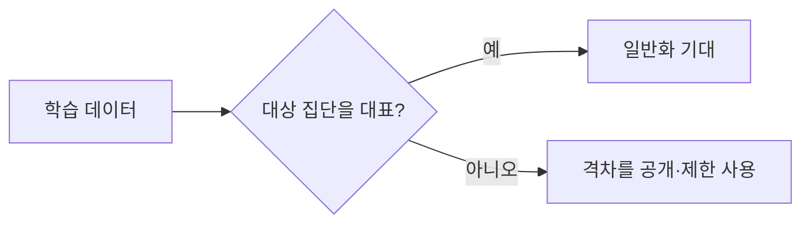

# 대상 집단 정의

> AI 시스템을 **누구에게, 어떤 상황에서 쓸지**를 먼저 정하는 일이다. 이 정의가 있어야 데이터가 "대표성이 있는지", 어느 하위 집단을 따로 평가할지, 어디까지 쓰면 안 되는지를 판단할 수 있다.

## 쉽게 말하면
신발을 만들기 전에 "누가 신을지"를 정해야 한다. 성인용인지 아동용인지 모르면 치수 표를 만들 수 없고, 표본으로 누구를 재야 할지도 모른다. 모델도 "이 모델의 사용 대상은 누구인가"가 없으면 어떤 데이터를 모아야 대표성이 있는지 말할 수 없다.

## 자세히
(영국 정부 사이트에 게시된 FDA·Health Canada·MHRA의 "의료기기 개발을 위한 우수 기계학습 실무(GMLP) 지침 원칙"을 직접 읽었다. 의료기기 분야의 비구속 지침이며 다른 분야에 그대로 적용되는 규정이 아니다. 아래 일반화는 이 지도의 해석이다.)
- **10개 지침 원칙(2021년 10월 공동 발표, 검색 요약 확인)** 중 대상 집단과 직결되는 것:
  - **원칙 3**: "임상 연구 참가자와 데이터셋이 **의도한 환자 집단을 대표**한다." 데이터 수집 규약은 의도한 환자 집단의 관련 특성이 임상 연구·학습·시험 데이터셋의 **충분한 크기의 표본**에 충분히 표현되도록 해야 한다(영국 사이트 직접 인용). 검색 요약은 연령·성별·인종·민족과 사용 맥락·측정 입력을 예로 든다.
  - **원칙 4**: 학습 데이터셋과 시험 데이터셋은 서로 적절히 독립이 되도록 선정·유지한다.
  - **원칙 6**: 모델 설계는 이용 가능한 데이터에 맞춰지고 기기의 **의도한 용도**를 반영한다.
  - **원칙 8**: 통계적으로 건전한 시험 계획으로 학습 데이터와 독립적인 임상적으로 의미 있는 성능 정보를 만든다(영국 사이트: 임상적으로 관련된 조건에서의 성능 입증). 검색 요약에는 시험 때 고려할 요소로 의도한 환자 집단, 중요한 하위 집단, 임상 환경, 인간-AI 팀의 사용, 교란 요인이 열거된다.
  - **원칙 7**: 모델 단독 성능이 아니라 **인간-AI 팀의 성능**에 초점.
- **의도한 집단의 정의는 어디서 오나**: 검색 결과에는 "의도한 환자 집단"의 공식 정의가 없고 기기의 의도한 용도·적응증에 따라 사례별로 정해진다고 요약됐다. 즉 대상 집단 정의는 **제품 목적·라벨링 문서에서 먼저 나온다**.
- **정의에 담을 항목(일반 원칙)**: ① 사용자·대상(연령, 지역, 언어, 질환 등) ② 사용 환경(기기·장소·시점) ③ **제외 대상**(사용하면 안 되는 사람·상황) ④ 하위 집단 목록(따로 성능을 볼 집단) ⑤ 모집단 통계의 출처(인구 통계·고객 분포).
- **데이터 격차 공개(검색 요약)**: FDA의 기계학습 기기 투명성 지침은 학습·임상 데이터에서 대표성이 낮은 집단 같은 알려진 데이터 격차를 기술하라고 권한다고 소개된다(원문 직접 확인 못 함).
- **연결**: 대상 집단이 정해져야 [사후 층화 가중](#post-stratification-weights)의 목표 비율도, [교차 조합 커버리지](#intersectional-coverage)의 칸 목록도 정해진다.

## 그림으로 보기

## 예시
- 피부 병변 분류 앱: 대상=성인, 모든 피부색, 스마트폰 촬영, 제외=소아·점막 병변. 피부색별 성능을 따로 보고한다(예시).
- 교육 소재: 사내 챗봇의 "사용 대상과 쓰지 말아야 할 질문 유형"을 한 장으로 정의해 보기.

## 헷갈리는 것과 비교
| 개념 | 차이 |
|---|---|
| 대상 집단 정의 | 누구에게 쓸지를 정하는 출발점 |
| [데이터 대표성](#data-representativeness) | 데이터가 그 집단을 닮았는지 |
| 모집단(통계) | 통계적 추론 대상 전체 집합 |
| 사용 제외 조건 | 대상 집단 밖을 명시하는 것 |

## 더 읽을거리
- [Good machine learning practice for medical device development: guiding principles (GOV.UK)](https://www.gov.uk/government/publications/good-machine-learning-practice-for-medical-device-development-guiding-principles/good-machine-learning-practice-for-medical-device-development-guiding-principles) — 10원칙 목록과 원칙 3·4(직접 읽음).
