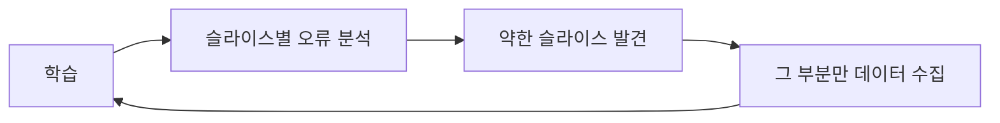
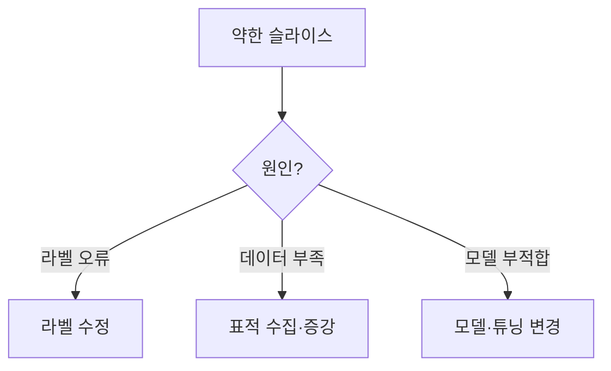

# 표적 데이터 수집

> 데이터를 무작정 더 모으는 대신, 오류 분석으로 모델이 약한 하위 집단(슬라이스)을 찾아내고 **그 부분에만** 데이터를 보태는 방식이다. 같은 수집 비용으로 약점을 집중 보완한다.

## 쉽게 말하면
수학 시험에서 평균 80점이라도 "도형" 단원만 40점이라면 모든 단원 문제집을 사지 않고 도형 문제집을 산다. 틀린 문제를 단원별로 나눠 보고 약한 곳에만 연습량을 늘리는 공부법이다.

## 자세히
(MIT 데이터 중심 AI 강의 노트를 직접 열어 확인했고, 슬라이스 정의 등은 검색 결과 요약이다.)
- **슬라이스**: 센서·인구 집단·지역·야간 이미지처럼 공통 특성을 가진 데이터 부분집합. 평균 점수는 소수 집단의 실패를 가린다. 강의는 얼굴 인식에서 어두운 피부의 여성에 대한 오류율이 밝은 피부의 남성보다 훨씬 높았던 사례를 든다. 슬라이스 정보를 지워도 상관된 특징이 대리 변수로 남으므로 슬라이스별 손실을 직접 평가해야 한다.
- **슬라이스를 모를 때**: 검증 예제를 손실 크기로 정렬해 높은 것만 군집화해 공통 주제를 찾는다. Domino 같은 슬라이스 탐색 방법은 라벨·손실 인지 군집을 쓴다.
- **오류의 원인부터 가른다(강의 목록)**: ① 라벨 오류 → 고친다 ② 예측 불가·클래스 밖 예제 → 제거하거나 "기타" 클래스 ③ 이상치 → 비슷한 데이터 수집·증강·가중치 상향, 배포 후엔 분포 밖 탐지 ④ 모델 유형 부적합 → 데이터가 아니라 모델·하이퍼파라미터 ⑤ 같은 특징에 상충 라벨 → 특징 추가. 데이터를 더 모으는 것은 이 중 일부에 대한 해법일 뿐이다.
- **약한 슬라이스 개선책(강의)**: 더 유연한 모델, 해당 집단 가중치 상향·오버샘플링(다른 곳 손실 가능), **해당 집단 데이터 추가 수집**, 그 집단용 특징 설계. 추가 수집의 효과는 하위표본으로 재학습해 보고 외삽해 추정할 수 있다.
- **Ng의 순환(Openlayer 블로그가 전한 2차 설명)**: 학습 → 오류 분석으로 모델이 못하는 데이터 유형 파악 → 증강·수집 또는 모호한 라벨 정의 명확화. Ng 본인 글은 확인하지 못했다.
- **주의**: 슬라이스가 너무 잘게 쪼개지면 표본이 작아 노이즈가 된다(일반적 주의). 새로 모은 데이터가 시험 세트와 겹치지 않게 한다.

## 그림으로 보기

## 예시
- 상담 분류기가 전체 90%인데 "영문 혼용 문의"만 62% → 해당 슬라이스 문의 300건을 추가 수집·라벨링 후 재학습해 슬라이스 점수를 다시 본다.
- 야간 CCTV 이미지에서만 검출이 약하면 야간 이미지를 의도적으로 더 확보한다.

## 헷갈리는 것과 비교
| 개념 | 차이 |
|---|---|
| 표적 데이터 수집 | 약한 곳에만 추가 |
| 전면 데이터 확대 | 모든 곳에 더 모으기 |
| [데이터 증강](#data-augmentation) | 새로 안 모으고 변형으로 확장 |
| [데이터 슬라이싱](#data-slicing) | 약한 하위 집단을 찾는 평가 |

## 더 읽을거리
- [MIT Data-Centric AI: 데이터 중심 평가](https://dcai.csail.mit.edu/2024/data-centric-evaluation) — 슬라이스 오류 분석과 추가 데이터 판단(직접 열어 확인).
- [Voxel51: Data slice](https://voxel51.com/glossary/data-slice) — 슬라이스 정의(검색 결과 기준, 본문 미열람).
