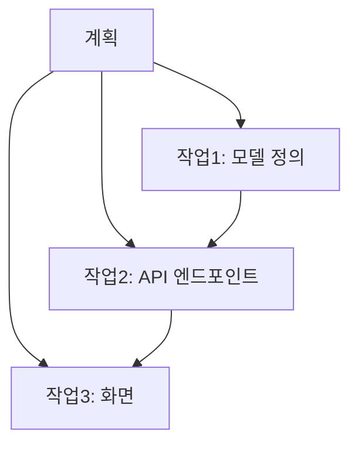
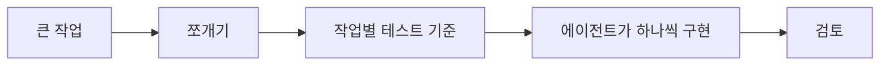

# 작업 분해

> **작업 분해**는 큰 구현 계획을 **독립적으로 테스트할 수 있는 작은 작업 단위**로 쪼개는 일이다. spec-kit에서는 `/speckit-tasks` 단계가 이를 맡는다.

## 쉽게 말하면
이사를 "집 옮기기" 한 줄로 두면 막막하지만, "박스 포장→가구 해체→트럭 적재"로 나누면 각각 끝났는지 확인할 수 있다. AI 에이전트에게도 한 번에 한 조각씩 시켜야 결과를 검토하기 쉽다.

## 자세히
- spec-kit 순서: 명세(specify) → 계획(plan) → **작업(tasks)** → 구현(implement) → 점검(converge). tasks는 계획을 작업 목록으로 쪼갠다(README 확인).
- 좋은 작업 단위의 기준(일반 지식·권장): 하나의 결과물, 완료 조건이 검증 가능, 다른 작업과 의존성이 명확, 에이전트 한 번의 컨텍스트에 들어갈 크기.
- 왜 중요한가: 에이전트는 큰 덩어리를 받으면 놓치는 부분이 생긴다. 작은 작업은 테스트와 리뷰가 쉽고, 실패 시 범위가 좁다.
- 의존성이 없는 작업은 병렬로 맡길 수 있다(일반 지식). 앞선 글의 멀티에이전트 연구 시스템도 상세한 위임 지시가 필수라고 한다([작업자 컨텍스트 격리](#worker-context-isolation)).
- spec-kit이 작업 파일의 정확한 형식을 어떻게 정하는지는 이 글에서 확인하지 않았다.

## 그림으로 보기

## 예시
- "회원가입 기능" → ① 사용자 테이블 ② 가입 API(중복 이메일 오류 테스트) ③ 가입 폼 ④ 이메일 인증. 각 작업마다 통과해야 할 테스트를 적는다.

## 헷갈리는 것과 비교
| 개념 | 차이 |
|---|---|
| 작업 분해 | 구현 단위로 쪼개기 |
| 계획(plan) | 기술 접근·구조 결정 |
| 명세(specify) | 무엇을·왜 만들지 |
| [specify CLI](#specify-cli) | 이 절차를 에이전트에 설치하는 도구 |

## 더 읽을거리
- [github/spec-kit](https://github.com/github/spec-kit) — SDD 단계와 명령.
