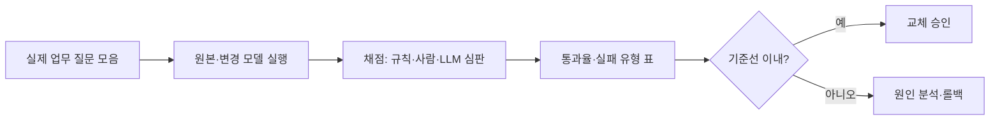

# 과제 단위 평가

> 과제 단위 평가(task-level eval)는 PPL 같은 일반 지표 대신, 내가 실제로 쓸 업무 질문·작업으로 모델을 직접 비교하는 방법이다.

## 쉽게 말하면
신입 면접에서 필기 점수만 보지 않고 실제 업무 샘플을 시켜 보는 것과 같다. 양자화나 모델 교체 뒤 PPL이 비슷해도, 내 업무의 중요한 한 가지(예: 표 추출, 한국어 존댓말)만 망가졌을 수 있다. 그래서 내 일을 그대로 시험지로 만든다.

## 자세히
- **언제 필요한가**: 모델 교체, [양자화](#gptq-awq), 프롬프트·시스템 변경, 파인튜닝 직후. PPL은 전체 평균 예측력만 보여 줘서 특정 능력 저하를 놓칠 수 있다(일반론).
- **만드는 순서**
  1. 실제 업무에서 질문·입력 20~50개를 모은다(쉬운 것, 까다로운 것, 실패한 적 있는 것 섞기).
  2. 각 항목에 기대 답이나 채점 기준을 적는다(정답 일치, 필수 포함 항목, 금지 사항).
  3. 두 모델(원본·변경본)에 같은 설정으로 실행한다. 온도는 낮게 고정하고 필요하면 여러 번 돌린다.
  4. 채점: 규칙(정규식·JSON 유효성)으로 가능한 건 자동, 나머지는 사람 또는 LLM 심판. LLM 심판은 편향이 있으니 일부는 사람이 점검한다.
  5. 통과율·실패 유형을 표로 정리하고 기준선을 정한다(예: 원본 대비 -3%p 이내).
- 표본이 적으면 우연이 크다. 차이가 작으면 결론을 유보한다.

## 그림으로 보기

## 예시
- 고객 문의 분류 모델을 4비트로 줄인 뒤: 지난달 실제 문의 40건을 돌려 분류 정확도 92%→90%면 허용, 긴 문의 3건이 무한 반복하면 별도 문제로 기록.
- 프롬프트: "다음 문의를 [환불, 배송, 기타] 중 하나로 분류하고 JSON으로만 답해."

## 헷갈리는 것과 비교
| 개념 | 차이 |
| --- | --- |
| [퍼플렉시티](#perplexity) | 일반 언어 예측력, 업무와 무관할 수 있음 |
| 공개 벤치마크 | 남의 문제, 내 업무와 다를 수 있고 오염 우려 |
| 과제 단위 평가 | 내 문제 그대로, 규모는 작지만 가장 관련성 높음 |

## 더 읽을거리
- [Hugging Face: Perplexity of fixed-length models](https://huggingface.co/docs/transformers/perplexity) — PPL이 무엇을 재는지 이해하는 기준점
- [Hugging Face: Quantization overview](https://huggingface.co/docs/transformers/quantization/overview) — 방식 선택 후 비교 대상 정하기
