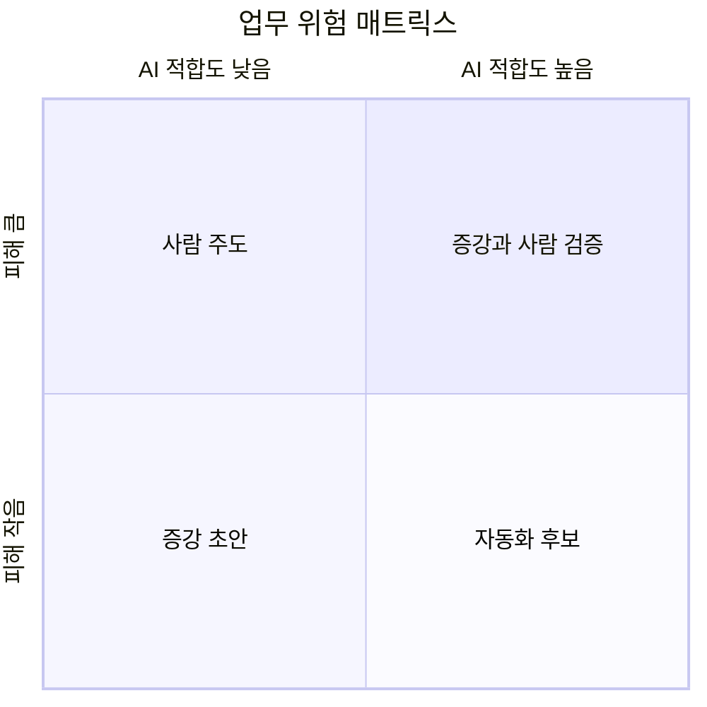
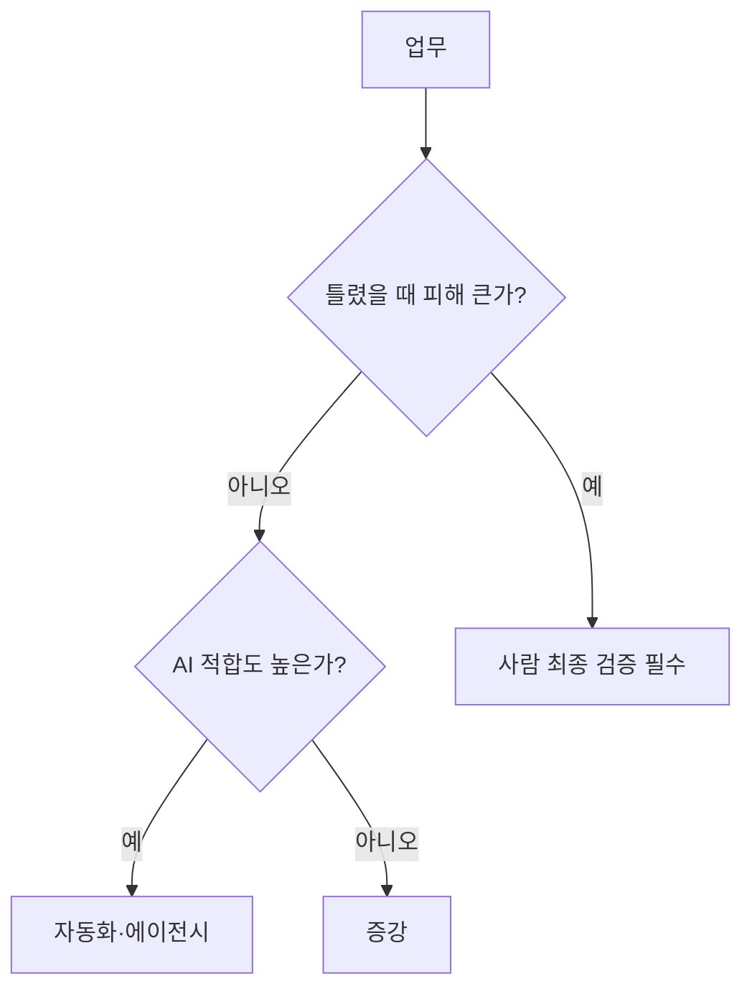

# 업무 위험 매트릭스

> 업무를 **피해가 얼마나 큰가**와 **AI가 얼마나 잘 맞는가** 두 축으로 나눠 AI에 맡길지, 함께 할지, 사람이 할지를 정하는 표. (이 글의 표는 내가 출처들을 엮어 만든 제안이며 공식 프레임워크가 아니다.)

## 쉽게 말하면
택배를 보낼 때 물건 가치(피해 크기)와 운송 방식의 신뢰도(적합도)를 같이 보고 일반 택배·등기·직접 전달을 고르는 것과 같다.

## 자세히
- 재료 1 — 위임의 틀: AI Fluency는 위임(Delegation)을 "무엇을 사람이, 무엇을 AI가 하고 어떻게 나눌지" 정하는 역량으로 정의한다(Anthropic 용어 요약, 열람 2026-11-28). 모드는 자동화·증강·에이전시([협업 모드](#collaboration-modes)).
- 재료 2 — 위험의 정의: NIST AI RMF는 위험을 **피해 크기와 발생 가능성의 함수**로 본다([AI 위험 대장](#ai-risk-register), 검색 요약).
- 표(내 제안): 
  | | AI 적합도 높음(정답 검증 쉬움·반복) | AI 적합도 낮음(모호·최신성·판단 중심) |
  |---|---|---|
  | **피해 작음** | 자동화·에이전시 후보 | 증강(AI는 초안·아이디어) |
  | **피해 큼** | 증강+사람 최종 검증 | 사람 주도, AI는 보조 조사 |
- 사용법: ① 업무를 나열 ② 틀렸을 때 피해(금전·법적·평판·안전)를 1~3점 ③ 정답 검증 용이성·반복성·최신 정보 필요성으로 적합도 1~3점 ④ 칸에 배치 ⑤ 피해가 큰 칸은 [검증 체크리스트](#verification-checklist)를 필수로.
- 한계: 점수는 주관적이며 업종·규제마다 기준이 다르다. 정량 근거는 이 글의 출처에 없다.

## 그림으로 보기

## 예시
- 회의록 정리(피해 작음·적합 높음) → 자동화. 계약서 위험 조항 검토(피해 큼) → 증강+변호사 최종 검토.
- 교육: 수강생이 자기 업무 10개를 표에 배치하는 워크숍.

## 헷갈리는 것과 비교
| 개념 | 차이 |
|---|---|
| 업무 위험 매트릭스 | 위임 여부 결정용 2축 표 |
| [AI 위험 대장](#ai-risk-register) | 식별된 위험을 기록·추적 |
| [협업 모드](#collaboration-modes) | 위임 후 일하는 방식 |

## 더 읽을거리
- [AI Fluency 용어 요약(Anthropic PDF)](https://www-cdn.anthropic.com/4396730ed190e691a3712cf2fd6bfe35509deca2.pdf) — 위임 정의(읽음).
- [NIST AI RMF 지식베이스](https://airc.nist.gov/AI_RMF_Knowledge_Base) — 위험 정의(검색 결과 확인).
