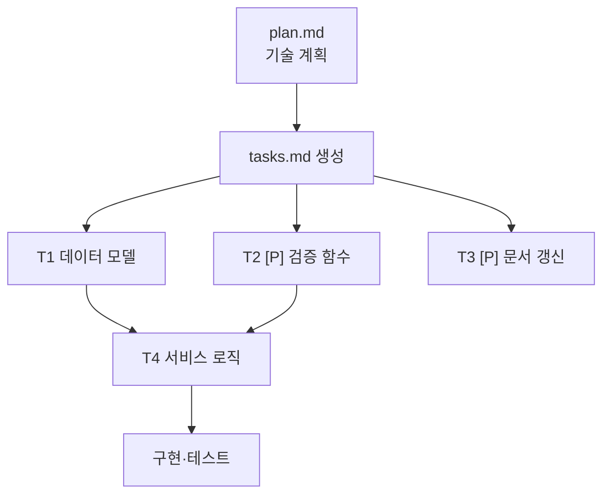

# 작업 분해

> 승인된 계획을 AI가 **한 번에 끝내고 확인할 수 있는 작은 작업 목록**으로 쪼개는 일. 스펙 주도 개발(SDD)에서 `계획 → 작업 → 구현` 사이의 단계이며, 작업마다 완료 기준이 있어야 한다.

## 쉽게 말하면
이사 계획을 "이사하기" 한 줄로 두지 않고 "상자 20개 포장, 가구 해체, 트럭 예약…"으로 나눈다. 나누면 누가 무엇을 언제 끝냈는지 보이고, 서로 무관한 일은 동시에 시킬 수 있다.

## 자세히
- **GitHub Spec Kit의 `tasks` 단계**(spec-kit 저장소 `spec-driven.md` 기준): `plan.md`(필수)와 있으면 `data-model.md`·`contracts/`·`research.md`를 읽어 계약·엔티티·시나리오를 **구체적인 작업**으로 바꾸고, 서로 독립적인 작업에는 **`[P]`(병렬 가능) 표시**를 붙여 안전한 병렬 묶음을 정리해 `tasks.md`로 쓴다. 이 목록은 작업을 실행하는 에이전트가 읽는다.
- **좋은 작업의 성질**(실무 원칙, 이 문서의 정리):
  1. **작다**: AI가 한 번의 대화·컨텍스트 안에서 끝낼 수 있는 크기.
  2. **독립적으로 검증 가능**: "이 테스트가 통과하면 끝"처럼 완료 조건이 명확.
  3. **의존 순서가 드러난다**: 데이터 모델 → 서비스 → 화면 순서처럼.
  4. **병렬 가능한 것은 표시**: 서로 다른 파일을 건드리는 작업은 동시에 서브에이전트에 맡길 수 있다.
  5. **파일 경로·함수 이름까지 구체적**: 모호한 작업("로그인 만들기")보다 "`auth/login.py`의 `verify_password` 구현+테스트".
- **작업이 너무 크면**: AI가 중간에 방향을 잃거나 컨텍스트가 길어져 품질이 떨어진다. 너무 작으면 전달 비용만 늘어난다.
- 한계: Spec Kit 문서는 형식만 설명하며, "적정 크기"에 대한 수치 기준은 제시하지 않는다(팀 경험으로 조정).

## 그림으로 보기


## 예시
```markdown
- [ ] T001 users 테이블 마이그레이션 `db/migrations/001_users.sql`
- [ ] T002 [P] 비밀번호 검증 함수 + 단위 테스트 `auth/password.py`
- [ ] T003 [P] README에 로그인 API 설명 추가
- [ ] T004 로그인 엔드포인트 `api/login.py` (T001, T002 이후)
```
- 비개발자 교육: "AI에게 '앱 만들어 줘' 대신 체크리스트 10줄을 먼저 만들게 하고, 한 줄씩 완료 확인하며 진행한다."

## 헷갈리는 것과 비교
| 개념 | 차이 |
|---|---|
| 작업 분해 | 계획을 실행 가능한 작은 단위로 쪼개기 |
| [SDD](#sdd) | 명세 중심 개발 방법 전체 |
| [GitHub Spec Kit](#spec-kit) | SDD를 돕는 도구, `tasks` 명령 제공 |
| [서브에이전트](#subagents) | 병렬 작업을 맡길 실행 주체 |

## 더 읽을거리
- [GitHub Spec Kit: spec-driven.md](https://github.com/github/spec-kit/blob/main/spec-driven.md) — 명세 중심 철학과 tasks 단계.
- [GitHub Spec Kit](https://github.com/github/spec-kit) — 명령 흐름(constitution→specify→plan→tasks→implement).
