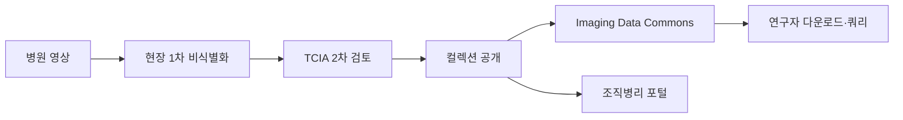
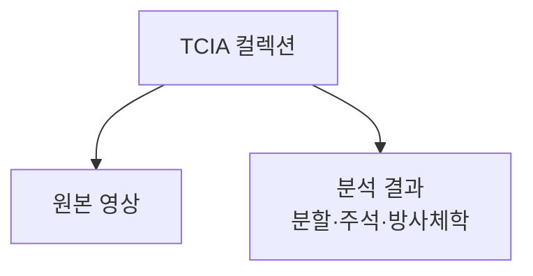

# TCIA

> The Cancer Imaging Archive(암 영상 아카이브). 미국 NCI 지원으로 2010년부터 비식별화한 암 관련 의료 영상(CT·MR·PET·유방촬영·초음파·병리 슬라이드 등)을 공개해 온 저장소. 대부분 CC BY 라이선스로 로그인 없이 받을 수 있고, 일부는 제한 접근이다.

## 쉽게 말하면
암 영상 AI 연구자가 쓰는 "공개 사진 도서관"이다. 병원이 환자 영상에서 이름·번호 같은 개인정보를 지워 올리면 TCIA가 한 번 더 검사해 공개한다. 폐암 CT, 뇌종양 MRI, 유방 촬영 같은 컬렉션이 주제별로 쌓여 있어서 연구자는 "처음부터 병원과 협상하지 않아도" 시작할 수 있다.

## 자세히
출처: TCIA 소개 페이지와 컬렉션 목록 페이지(둘 다 직접 읽음, 2026-11-17 열람).
- **운영**: NCI의 Cancer Imaging Program(CIP)이 자금 지원, Frederick National Laboratory for Cancer Research(FNLCR)가 관리, 아칸소 의대(UAMS)가 주로 데이터 큐레이션·공개를 맡는다. 2010년부터 공개 중.
- **규모**: 컬렉션 목록 표에 **239개 컬렉션**. 암 종류는 교모세포종·유방·폐·전립선·두경부·흑색종·대장·백혈병·다발골수종 등. 일부는 비암·건강인·팬텀 데이터. 영상 종류는 CT·MR·PET·유방촬영(MG)·초음파·전체 슬라이드 영상, 방사선치료(RT) 객체와 분할(SEG) 등.
- **컬렉션 예(피험자 수)**: NLST 26,254, Breast-Cancer-Screening-DBT 5,060, RADCURE 3,346, Yale-Brain-Mets-Longitudinal 1,430, CT COLONOGRAPHY 825, LDCT-and-Projection-data 299, Healthy-Total-Body-CTs 30.
- **비식별화**: 제공 기관이 현장에서 1차 비식별화를 하고 확인한 뒤, TCIA가 2차 검토한다. 스크립트는 DICOM PS3.15 Attribute Confidentiality Profile(부록 E)을 따른다.
- **라이선스**: 기본은 CC BY 4.0(저작자 표시). 드물게 NIH 제한 접근. 컬렉션 표의 접근 열은 Public/Limited가 있고 비어 있는 행도 많아 컬렉션별 확인이 필요하다.
- **접근 경로**: 공개 데이터는 로그인 없이 **Imaging Data Commons(IDC)** 와 TCIA 조직병리 포털에서. IDC는 NCI Cancer Research Data Commons의 일부로 포털, 웹 뷰어, DICOM 메타데이터 SQL 인터페이스, 자연어 인터페이스를 제공한다. 제한 접근 데이터는 General Commons·CTDC에서.
- **분석 결과(analysis results)**: 기존 컬렉션에서 파생된 주석·라벨·분할·방사체학·병리체학 특징 데이터셋. 모델 학습 라벨로 바로 쓸 수 있다.
- **인용**: TCIA 데이터를 쓴 논문은 데이터 사용 정책과 인용 지침을 따라야 한다(세부 내용은 페이지에 없음).
- **주의(이 글의 정리)**: 암 영상 중심이라 일반 응급 영상(예: [MIMIC-CXR](#mimic-cxr))과 성격이 다르다. 컬렉션마다 스캐너·프로토콜·병원이 달라 외부 검증이 필요하다.

## 그림으로 보기

## 예시
- 폐암 선별 CT(NLST)로 결절 탐지 모델을 학습하고 다른 컬렉션으로 외부 검증한다.
- 방사선치료 계획 연구에서 RT 객체와 분할이 포함된 컬렉션(예: RADCURE)을 활용.

## 헷갈리는 것과 비교
| 개념 | 차이 |
|---|---|
| TCIA | 암 영상 공개 아카이브 |
| [MIMIC-CXR](#mimic-cxr) | 응급실 흉부 X선+판독문, 자격 심사 필요 |
| Imaging Data Commons | TCIA DICOM 데이터의 주 접근 플랫폼 |
| [의료 영상 데이터셋](#medical-imaging-datasets) | 상위 개념 |

## 더 읽을거리
- [About TCIA](https://www.cancerimagingarchive.net/about-the-cancer-imaging-archive-tcia/) — 운영·비식별화·접근(직접 읽음)
- [TCIA Browse Collections](https://www.cancerimagingarchive.net/browse-collections/) — 컬렉션 239개 목록(직접 읽음)
