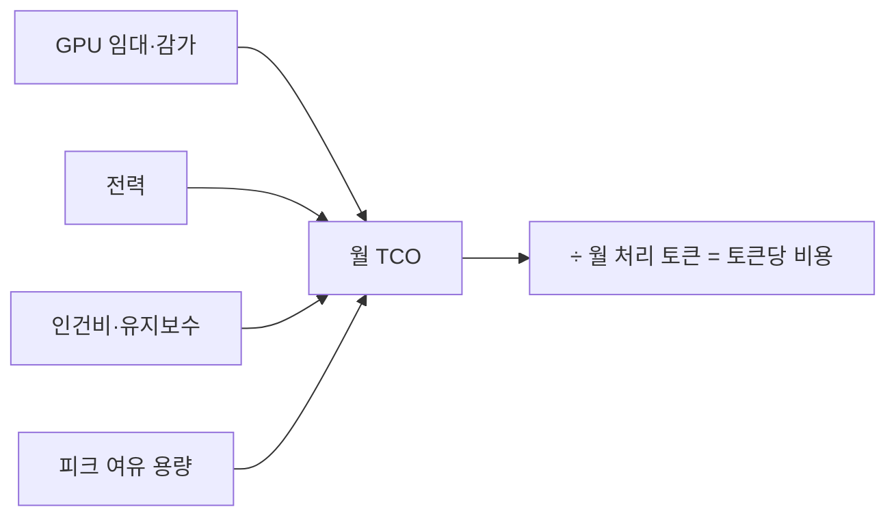
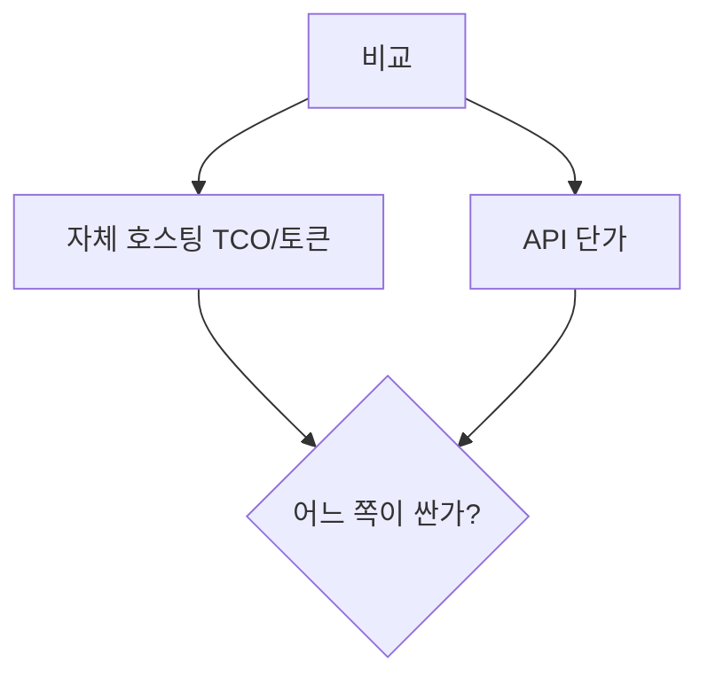

# 총소유비용 계산

> GPU·API 요금만이 아니라 **전력, 인력, 유휴, 장애 대응까지 넣은 실제 비용(TCO)**을 계산하는 방법. 자체 호스팅 vs API 결정을 정직하게 만든다.

## 쉽게 말하면
자동차 값만 보지 않고 보험·주유·주차·정비까지 합쳐 "1km당 비용"을 구하는 일이다.

## 자세히
(출처: OpenRouter 블로그, 이 글은 API 중개 업체의 글이라 자체 호스팅에 불리하게 기울 수 있고 나는 해당 글의 표를 읽었으나 다른 독립 출처로 교차 확인하지 않았다. 검색 요약에서는 실제 비용이 GPU 가격의 3~5배라는 가이드도 있었다.)
- 포함할 항목: ① GPU 임대료 또는 감가상각 ② 전력(소유 GPU: 3090 250W 기준 약 $0.05/시간이라는 예) ③ **유휴 시간**(임대료는 바쁘든 놀든 청구) ④ 엔지니어링·유지보수 시간 ⑤ **피크 대비 여유 용량** ⑥ 속도 때문에 생기는 품질·사용성 비용(3090은 사용자당 초당 약 15토큰).
- OpenRouter 글이 제외한 것: 엔지니어링·유지보수 시간, 피크 여유 용량 → 그래서 글의 손익분기 수치는 **하한**이다.
- 계산식(내 정리):
  `월 TCO = 임대료(또는 감가+전력) + 인건비 + 여유 용량 비용 + 기타`, `토큰당 비용 = 월 TCO ÷ 월 처리 토큰`. 이를 [비용 추산표](#cost-estimation-sheet)의 API 비용과 같은 단위로 비교한다.
- 비교 주의: [같은 급 모델](#same-class-comparison)끼리, 같은 품질 기준에서 비교한다.
- 한계: 인건비·여유 용량의 구체 수치는 이 출처에 없어 조직마다 직접 채워야 한다.

## 그림으로 보기

## 예시
- 월 임대료 $365 + 유지보수 8시간×인건비 + 여유 용량을 더해 토큰당 비용을 구하고, 같은 모델 API 단가와 비교.
- 교육: 우리 회사 시간당 인건비로 직접 호스팅의 숨은 비용을 계산.

## 헷갈리는 것과 비교
| 개념 | 차이 |
|---|---|
| TCO | 숨은 비용까지 포함한 총비용 |
| [비용 추산표](#cost-estimation-sheet) | API 사용료 중심 계산 |
| [GPU 활용률](#gpu-utilization) | TCO의 핵심 변수 |

## 더 읽을거리
- [Self-Hosted LLM vs API (OpenRouter)](https://openrouter.ai/blog/insights/self-hosted-llm-vs-api/) — 손익분기와 제외 항목(읽음, 이해관계 유의).
