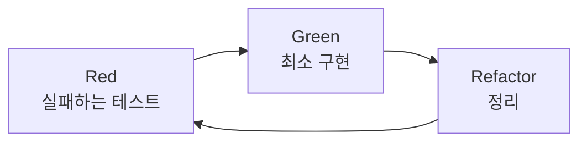
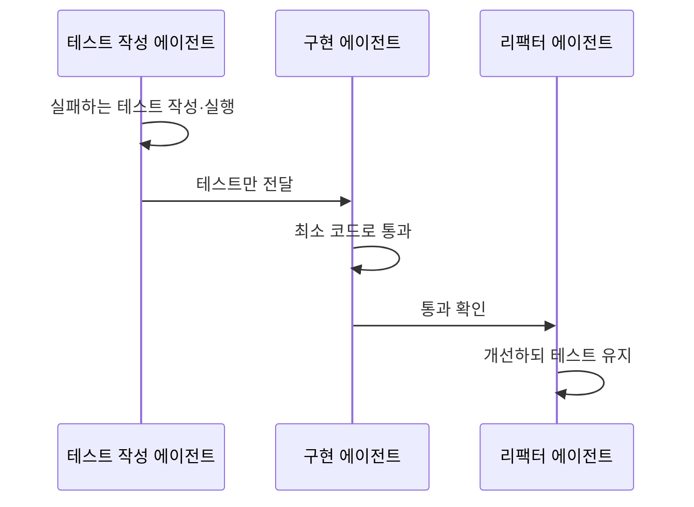

# TDD (테스트 주도 개발)

> 기능 코드를 쓰기 전에 실패하는 테스트를 먼저 쓰고, 그 테스트를 통과하는 최소한의 코드를 만든 뒤 정리하는 개발 방식. AI에게는 "다 됐는지 스스로 확인할 합격 기준"을 준다.

## 쉽게 말하면
시험 문제를 먼저 내고 공부하는 것과 같다. 정답 기준이 먼저 있으니 "대충 됐겠지"가 통하지 않는다. AI는 자신 있게 틀린 코드를 내놓기 쉬운데, 테스트가 그 자신감을 객관적으로 걸러낸다.

## 자세히
- **Red → Green → Refactor**: ① Red: 아직 없는 기능의 테스트를 쓰고 실패를 확인 ② Green: 통과할 최소한의 코드 ③ Refactor: 테스트를 유지한 채 코드 정리. 기능마다 반복한다.
- **AI와 궁합**: 테스트는 에이전트에게 실제 통과/실패 신호를 준다. 이는 [에이전트 검증 루프](#agent-verification)의 가장 기본 형태다. 프롬프트에 "TDD 방식으로"라고만 써도 효과가 있다는 가이드가 많다(주장: 블로그·코스 자료 수준).
- **문제: 컨텍스트 오염(context pollution)**. 한 대화 안에서 하면 구현 계획이 테스트 설계로 새어 들어가 테스트가 구현에 맞춰진다. alexop.dev(2025-11-30) 사례는 테스트 작성·구현·리팩터링을 서브에이전트 셋으로 나누고 스킬로 단계 순서를 강제했다. 저자 설정에 2시간 정도 걸렸고, 훅으로 스킬 활성화율이 약 20%→84%가 됐다고 보고했다(저자 측정, 검증 안 됨).
- **함정**: AI가 테스트를 통과시키려고 테스트 자체를 고치거나 삭제할 수 있다. 테스트 파일 수정 금지 같은 규칙을 둔다.

## 그림으로 보기

## 예시
- 프롬프트: "장바구니 할인 계산 함수를 TDD로 만들어. 먼저 실패하는 테스트 3개(0원, 쿠폰 중복, 음수)를 쓰고 실패를 보여 준 뒤 구현해. 테스트 파일은 구현 단계에서 수정하지 마."
- 간단한 파이썬: `assert discount(100, 10) == 90` 을 먼저 쓰고 함수를 만든다.

## 헷갈리는 것과 비교
| 개념 | 차이 |
| --- | --- |
| [SDD](#sdd) | 문서 명세가 먼저. TDD는 실행 가능한 테스트가 먼저. 명세→테스트로 이어 써도 됨 |
| [에이전트 검증 루프](#agent-verification) | 검증 일반. TDD는 그중 테스트로 하는 방식 |
| 사후 테스트 | 코드를 짠 뒤 테스트. AI가 구현에 맞춰 테스트를 쓰기 쉬움 |

## 더 읽을거리
- [Custom TDD workflow for Claude Code (alexop.dev, 2025-11-30)](https://alexop.dev/posts/custom-tdd-workflow-claude-code-vue/) — 서브에이전트 3개와 훅으로 TDD 강제
- [TDD for AI coding beginner's guide (The Neuron)](https://www.theneuron.ai/explainer-articles/test-driven-development-ai-coding-guide/) — 검색으로 찾은 입문 설명(본문은 열람 안 함)
