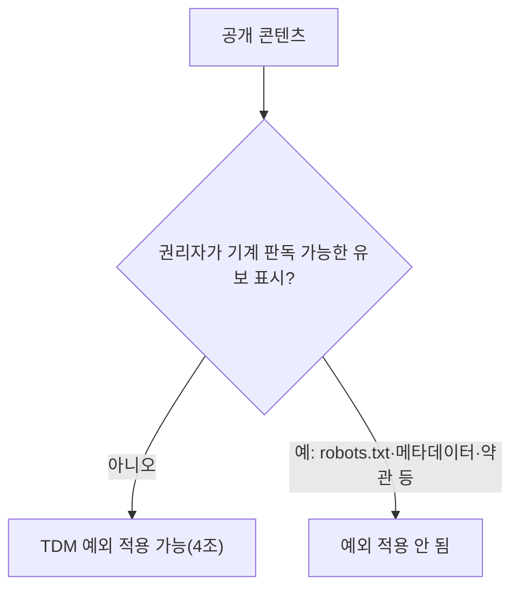
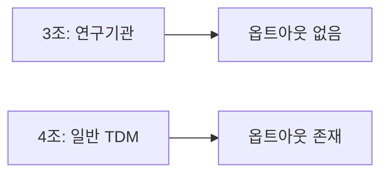

# 옵트아웃 신호 종류

> EU 저작권 지침의 텍스트·데이터 마이닝(TDM) 예외는 권리자가 "기계가 읽을 수 있는 방식 등 적절한 방법"으로 유보를 표시하면 적용되지 않는다. 그 유보 신호가 어떤 형태인지가 쟁점이다. (교육용 요약, 법률 자문 아님.)

## 쉽게 말하면
"이 정원은 개방됩니다. 단, 출입 금지 표지를 세우면 들어오지 마세요"라는 규칙에서 표지판의 모양(robots.txt, 메타데이터, 약관)이 무엇이어야 하는지를 다투는 것이다.

## 자세히
(EUR-Lex의 DSM 지침 조문을 하위 에이전트가 읽은 노트 기준. GPAI 행동강령은 법무법인 요약(검색 결과)이라 원문 미확인.)
- **DSM 지침 4조(3)**: TDM 예외는 권리가 **"명시적으로 유보되지 않은" 경우**에만 적용된다. 온라인 공개 콘텐츠의 유보는 "기계가 읽을 수 있는 수단 등 적절한 방식"으로 해야 한다. 전문(Recital) 18은 메타데이터와 웹사이트 **약관**을 예로 든다.
- **3조(연구기관)**: 별도 예외이며 옵트아웃이 없다.
- **신호의 종류(제안·예시)**: robots.txt(크롤러 규칙), 메타 태그·HTTP 헤더, 사이트 약관, 별도 표준 제안(TDM 유보 프로토콜 등). 어떤 신호가 법적으로 충분한지는 해석과 판례가 진행 중이다.
- **GPAI 행동강령(2025-07-10, 검색 요약)**: 서명 기업이 robots.txt 등 기계가 읽을 수 있는 유보를 존중하겠다고 약속한다는 보도. 원문은 확인하지 못했다.
- **연결**: 약관과 robots.txt가 어긋나는 현실([약관 vs robots.txt](#tos-vs-robots-txt))이 이 문구의 해석을 어렵게 만든다.

## 그림으로 보기

## 예시
- 크롤링 전 robots.txt·메타 태그·약관·HTTP 헤더를 모두 점검하는 체크리스트.
- 교육 활용: 같은 사이트의 여러 신호가 충돌할 때 어떻게 해석할지 토론.

## 헷갈리는 것과 비교
| 개념 | 차이 |
|---|---|
| TDM 예외 4조 | 일반 TDM, 옵트아웃 가능 |
| TDM 예외 3조 | 연구기관, 옵트아웃 없음 |
| 미국 공정 이용 | 별개 법리 |

## 더 읽을거리
- [EU DSM 지침 2019/790 (EUR-Lex)](https://eur-lex.europa.eu/eli/dir/2019/790/oj) — 3·4조, 전문 18.
