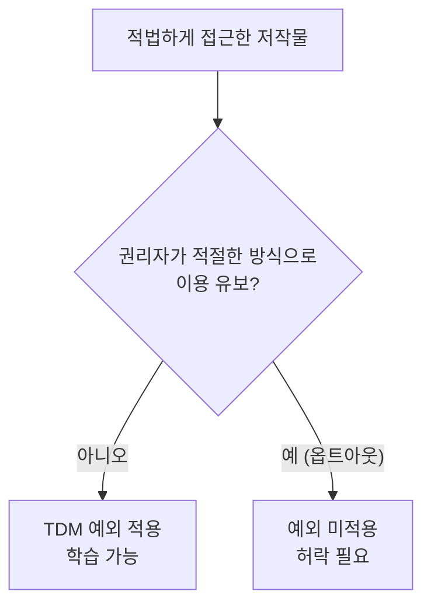
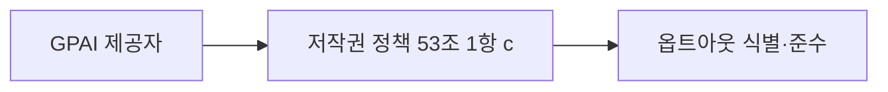

# TDM 옵트아웃

> EU 저작권 지침(2019/790) 4조가 AI 학습 등 텍스트·데이터 마이닝(TDM)을 허용하되, 권리자가 "적절한 방식으로" 이용을 유보(옵트아웃)하면 그 예외가 적용되지 않게 하는 제도. 웹 콘텐츠는 기계 판독 가능한 방식이 적절한 방식의 예로 든다.

## 쉽게 말하면
길가에 열매가 달린 나무는 따 먹어도 되지만, 주인이 "이 나무는 따지 마시오" 팻말을 달아 두면 안 되는 것과 비슷하다. 팻말을 기계가 읽을 수 있어야 하느냐가 쟁점이다.

## 자세히
출처는 EUR-Lex의 지침 2019/790 본문(4조·2조 2항 직접 열람, 3조·재서문 일부 열람). 법률 자문이 아니다.
- **TDM 정의(2조 2항)**: 패턴·추세·상관관계 같은 정보를 생성하려고 디지털 형태의 텍스트와 데이터를 분석하는 "모든 자동화된 분석 기법".
- **4조 1항**: 적법하게 접근 가능한 저작물의 복제와 추출에 대한 TDM 예외·제한을 둔다. 데이터베이스·컴퓨터 프로그램 지침 등의 권리를 포함한다.
- **4조 2항**: 1항에 따라 만든 복제본은 TDM에 필요한 기간 동안 보관할 수 있다.
- **4조 3항(옵트아웃)**: 권리자가 "적절한 방식으로" 이용을 유보하지 않은 경우에만 예외가 적용된다. 온라인에 공개된 콘텐츠에는 기계 판독 가능한 수단이 적절한 방식의 예로 제시된다. 재서문 18은 웹사이트의 메타데이터와 이용약관을 예로 든다.
- **연구기관 예외(3조, 재서문 11~12)**: 연구기관·문화유산 기관에는 별도의 강제적 TDM 예외가 있고, 비영리 또는 공익 임무로 활동하며 상업적 통제가 큰 기관은 제외된다.
- **AI Act와의 연결(53조 1항 c, 열람)**: 범용 AI 모델 제공자는 저작권 정책을 채택해, 필요하면 최신 기술을 사용해 지침 4조 3항의 권리 유보를 식별하고 준수해야 한다. 또한 학습 콘텐츠의 충분히 상세한 요약(d)을 AI Office 템플릿에 따라 공개해야 한다([저작권 정책](#copyright-policy-gpai)).
- **열린 질문**: "적절한 방식"이 구체적으로 어떤 기계 판독 표준(robots.txt, 메타데이터 등)을 뜻하는지는 이번에 확인한 조문에 나열돼 있지 않다. 법원 판단이나 행동강령의 해석은 별도 확인이 필요하다.

## 그림으로 보기

## 예시
- 웹사이트가 기계 판독 가능한 방식으로 학습 이용을 유보하면, 크롤러를 운영하는 AI 제공자는 그 사이트를 학습에서 제외해야 한다(조문 구조에 따른 설명 예, 개별 사건의 적법성은 별도).
- 교육 실습: 자기 회사 웹사이트의 이용약관과 메타데이터에 AI 학습 유보 의사를 어떻게 표시할 수 있는지 토론.

## 헷갈리는 것과 비교
| 개념 | 차이 |
|---|---|
| 3조 TDM(연구) | 연구기관·문화유산 기관의 강제 예외, 유보 불가 |
| 4조 TDM(일반) | 누구나 가능, 권리자가 유보하면 불가 |
| 옵트아웃 | 권리자의 이용 유보 표시 |
| [GPAI 저작권 정책](#copyright-policy-gpai) | 제공자가 옵트아웃을 준수하는 정책 |

## 더 읽을거리
- [Directive (EU) 2019/790 (EUR-Lex)](https://eur-lex.europa.eu/legal-content/EN/TXT/?uri=CELEX:32019L0790) — 2조·3조·4조(열람)
- [AI Act Article 53](https://artificialintelligenceact.eu/article/53/) — 저작권 정책과 학습 요약(열람)
