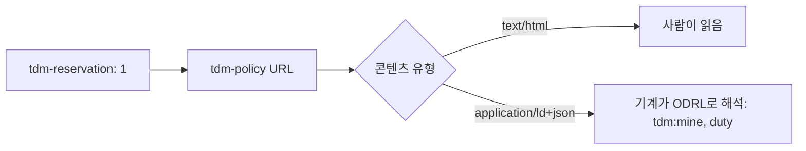
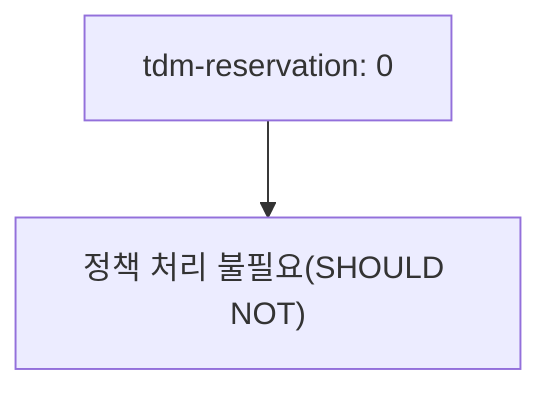

# TDM 정책 문서

> `tdm-policy`는 **권리자가 "마이닝을 하려면 어떻게 허가받는가"를 설명한 문서의 주소(URL)**다. 사람이 읽는 HTML이거나, 기계가 읽는 JSON·JSON-LD(ODRL 기반)일 수 있다.

## 쉽게 말하면
"이 서가는 복사 금지"라는 안내판(예약)에 "허가를 받으려면 이 창구에 문의하세요"라는 창구 안내문(정책)을 연결해 둔 것이다. 안내판이 "금지"일 때만 창구 안내문이 의미가 있다.

## 자세히
- 출처: W3C TDMRep Final Report(2024-05-10) §5.2·§7(2026-11-27 열람).
- **형식**: 정책 URL의 콘텐츠 유형이 `text/html`이면 사람이 읽는 문서, `application/json` 또는 `application/ld+json`이면 **기계가 읽는 정책**으로 본다. 에이전트가 정책에 접근하지 못하거나 파싱하지 못해도 프로토콜 오류가 아니며, "어떻게 허가받을 수 있는지 모르는 상태"로 취급한다.
- **기계가 읽는 정책의 구조**(ODRL 프로파일, JSON-LD): `@context`는 두 값(`odrl.jsonld`, `tdmrep.jsonld`) 배열, `@type`은 `"Offer"`, `profile`은 `http://www.w3.org/ns/tdmrep`, 식별자 `uid`가 필요하다. `assigner`는 권리자 정보(vCard 속성 `fn`·`hasEmail`·`hasURL` 등)이고, `permission` 배열이 필수이며 `obligation`·`prohibition`은 넣지 않는 것이 좋다.
- **permission 안의 요소**: `action`은 `tdm:mine`(유일한 필수 행동), 선택으로 `target`(대상 컬렉션 URI), `duty`(`obtainConsent` = 먼저 권리자에게 연락, `compensate` = 금전 보상), 목적 `constraint`(`tdm:research`·`tdm:non-research`, 명세가 실험적이라고 표시).
- 최소 예(명세 Example 14 축약):
  ```json
  {"@context": ["http://www.w3.org/ns/odrl.jsonld","http://www.w3.org/ns/tdmrep.jsonld"],
   "@type": "Offer", "profile": "http://www.w3.org/ns/tdmrep",
   "uid": "https://provider.com/policies/1",
   "permission": [{"action": "tdm:mine"}]}
  ```
- **사용 규칙**: `tdm-reservation`이 **1**(유보)일 때만 정책을 사용하고, 0이면 정책을 처리하지 않아야 한다(SHOULD NOT). 권리가 유보되고 정책이 있으면 에이전트는 허가받는 방법을 알아내는 데 정책을 쓸 수 있다. `target`이 있으면 발행자에게 보내는 메시지에 활용한다.
- 주의: 명세 안의 ODRL 버전 표기가 본문(2.2)과 참고문헌(1.1)에서 달랐고, 일부 예제(9·12·19)에 JSON 문법 오류(쉼표 누락·후행 쉼표)가 있다고 열람 요약이 전한다. 복사할 때 검증이 필요하다.
- 한계: 정책은 의사 표시 문서일 뿐 허가 자체나 법적 효력을 보장하지 않으며, 실제 협상·계약은 별도다(이 문서는 법률 자문이 아님).

## 그림으로 보기



## 예시
- 출판사 정책: `permission: [{action: tdm:mine, duty: [{action: obtainConsent}]}]` — 마이닝 전에 동의를 구하라.
- 교육: "예약(금지)"과 "허가 방법(정책)"을 분리한 설계를 보여 주는 사례.

## 헷갈리는 것과 비교
| 개념 | 차이 |
|---|---|
| `tdm-reservation` | 권리를 유보했는지(1/0) |
| `tdm-policy` | 허가 방법을 설명한 문서 URL |
| 라이선스 문서 | 사용 조건 전반(정책은 TDM에 한정된 프로파일) |

## 더 읽을거리
- [W3C TDMRep Final Report](https://www.w3.org/community/reports/tdmrep/CG-FINAL-tdmrep-20240510/) — §5.2, §7(읽음).
- [tdmrep.json 파일](#tdmrep-json-file) — 정책 URL을 가리키는 규칙 파일.
