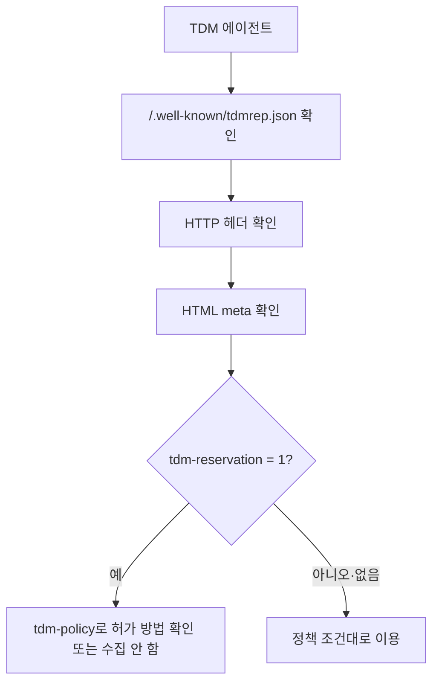
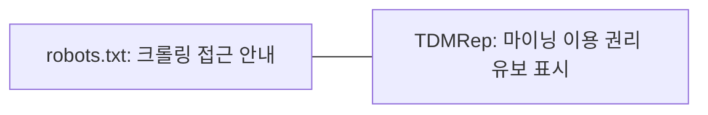

# TDM Reservation Protocol

> 웹 콘텐츠 권리자가 **"텍스트·데이터 마이닝(TDM, AI 학습 포함)에 쓰는 것은 권리를 유보한다"**는 의사를 기계가 읽을 수 있게 표시하는 W3C 커뮤니티 그룹의 규약(TDMRep)이다. robots.txt가 "크롤링 접근"을 다룬다면 TDMRep은 "수집 후 마이닝 이용 권리"의 유보를 알린다.

## 쉽게 말하면
책 판권 면에 "이 책의 내용을 기계 학습에 이용하려면 따로 허락받으세요"라고 적어 두는 것이다. 문을 잠그는 게 아니라, 방문자가 알아볼 수 있는 공식 표지판이다.

## 자세히
(W3C TDMRep 최종 보고서 2024-05-10판 본문을 직접 읽음. 규약 편집자는 EDRLab 소속으로 표기)
- 두 속성: **`tdm-reservation`**(불리언) — 1이면 TDM 권리가 유보됨(정책이 있으면 허가를 얻는 방법을 알려 줌), 0이면 유보하지 않음. **`tdm-policy`** — 권리자가 정한 정책의 URL. `tdm-reservation`이 0일 때 policy가 있어도 오류는 아니며 에이전트는 처리하지 않는 것이 좋다(SHOULD NOT). 정책 문서가 사람용이면 `text/html`, 기계용이면 `application/json` 또는 `application/ld+json`. 정책을 못 읽어도 프로토콜 오류는 아니고, 이용 조건을 알 수 없다고 간주한다.
- 선언 방법 여러 가지:
  1. **서버의 TDM 파일** `/.well-known/tdmrep.json`(MUST 이 위치): JSON **배열** 안에 규칙 객체. 객체마다 `location`(경로 패턴), `tdm-reservation`, `tdm-policy`. 전체 유보 예: `[ { "location": "/", "tdm-reservation": 1 } ]` (대괄호 필수).
  2. **HTTP 응답 헤더** `tdm-reservation: 1`(GET/HEAD 응답). 문서는 이를 현재 **권장되는 방식**이라고 서술한다.
  3. **HTML `<meta name="tdm-reservation" content="1">`**과 `<meta name="tdm-policy" content="URL">`.
  4. EPUB·PDF 메타데이터.
- **우선순위**: 권리자는 한 가지 방식만 쓰는 것이 좋고(SHOULD), 여러 방식이 겹치면 에이전트는 정해진 처리 순서를 따른다. 에이전트는 스크랩 시작 전 서버의 TDM 파일을 확인(MUST)하고 캐시해 둔다.
- 한계(제안): 이 규약은 법적 효력을 만드는 것이 아니라 **의사 표시 방식**이다. 수집 주체가 읽고 따라야 효과가 있으며, 이미 수집된 데이터에는 소급되지 않는다([옵트아웃의 한계](#opt-out-limits-existing-data)). 어떤 AI 회사가 이를 따르는지는 이 글에서 확인하지 않았다.

## 그림으로 보기



## 예시
```json
[ { "location": "/", "tdm-reservation": 1,
    "tdm-policy": "https://example.com/policies/tdm.json" } ]
```
- 출판사가 기사 전체에 유보를 선언하고 라이선스 문의 정책 페이지를 알림.
- 교육: "접근 통제와 이용 권리 표시는 다른 층위"라는 저작권 논의 소재.

## 헷갈리는 것과 비교
| 개념 | 차이 |
|---|---|
| [robots.txt](#robots-txt-basics) | 크롤링 허용 경로, 접근 단계 |
| TDMRep | 마이닝 이용 권리 유보, 이용 단계 |
| 라이선스 | 법적 계약, TDMRep은 표시·안내 |
| noai 메타 등 비표준 신호 | 표준·합의 수준이 다름 |

## 더 읽을거리
- [TDM Reservation Protocol (W3C 커뮤니티 그룹 최종 보고서)](https://www.w3.org/2022/tdmrep/) — 속성·tdmrep.json·헤더·meta·처리 우선순위(본문 읽음).
