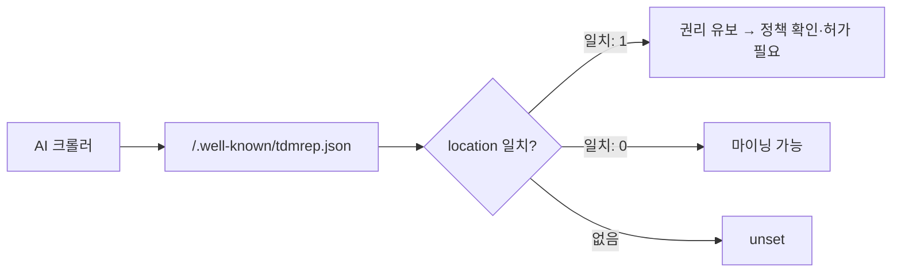
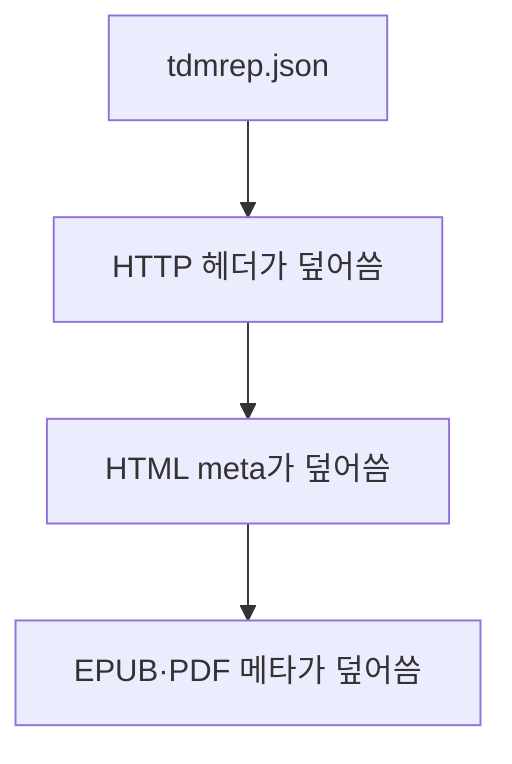

# tdmrep.json 파일

> `/.well-known/tdmrep.json`은 **사이트 전체에 대해 "이 경로의 콘텐츠는 텍스트·데이터 마이닝(TDM) 권리를 유보한다/안 한다"를 JSON 규칙 배열로 선언하는 파일**이다. W3C TDM 예약 프로토콜(TDMRep)의 세 가지 방법 중 하나다.

## 쉽게 말하면
도서관 입구에 붙이는 "이 서가의 책은 복사 금지, 저 서가는 자유" 안내판을 사이트 전체에 한 장으로 붙이는 것이다. 서가(경로)마다 규칙을 줄 수 있다.

## 자세히
- 출처: W3C Community Group Final Report *TDM Reservation Protocol (TDMRep)*, 2024-05-10 판(2026-11-27 열람).
- 표현 방법 세 가지: ① **HTTP 헤더** `tdm-reservation`(+선택 `tdm-policy`) — 현재 권장되는 방식 ② **HTML meta** 요소 ③ **사이트 전체 파일 `tdmrep.json`**(`/.well-known` 디렉터리에 위치해야 함(MUST)). 권리자는 한 가지 방법만 쓰길 권장(SHOULD).
- 파일 구조: **규칙 객체의 배열**이며 각 규칙은 세 속성을 받는다 — `location`(파일 집합의 경로 패턴, 필수), `tdm-reservation`(예약 값, 필수), `tdm-policy`(정책 URL, 선택).
  ```json
  [
    {"location": "/articles/", "tdm-reservation": 1,
     "tdm-policy": "https://provider.com/policies/policy.json"},
    {"location": "/images/*.jpg", "tdm-reservation": 0}
  ]
  ```
- `tdm-reservation` 값: **1** = 권리 유보(에이전트는 정책 링크를 보고 허가 방법을 알아낼 수 있음), **0** = 권리 비유보(권리자에게 연락 없이 마이닝 가능), 그 밖의 값은 프로토콜 오류로 보고 "미설정(unset)"으로 취급.
- 경로 일치: 대소문자 구분이 권장(SHOULD), `*`는 0개 이상의 임의 문자, `$`는 패턴의 끝. "가장 구체적인 일치를 써야 한다(MUST)"로 적혀 있고 열람한 요약은 이를 **순서상 첫 일치**로 정의했다고 전한다(robots의 "가장 긴 일치"와 다르다는 점 주의, [가장 긴 일치 규칙](#robots-longest-match)). 일치하는 규칙이 없으면 `unset`.
- 우선순위: 에이전트는 ① `tdmrep.json` ② HTTP 헤더 ③ HTML meta ④ EPUB·PDF 메타데이터 순으로 확인하고, 뒤의 출처가 앞의 값을 덮어쓴다. 값의 **부재는 기존 값을 초기화하지 않는다**.
- 직접 구현해 본 평가(내가 만든 간이 코드, 위 JSON 예시, `*`→임의 문자열·접두 일치 방식으로 해석): `/articles/2026/a.html` → 1 + 정책 URL, `/images/cat.jpg` → 0, `/images/cat.png` → unset, `/about` → unset, `/Articles/x` → unset(대소문자 구분). 구현 해석(접두 일치 여부)은 명세 세부와 다를 수 있어 실제 도구와 비교가 필요하다.
- 한계: 이것은 **선언 프로토콜**이라 법적 강제력은 국가·사안별 판단이 필요하고(이 문서는 법률 자문이 아님), 크롤러가 지키는지는 별개 문제다.

## 그림으로 보기



## 예시
- 뉴스 사이트: `/articles/`는 1(유보) + 라이선스 안내 URL, `/images/*.jpg`는 0.
- 교육: robots.txt(접근 허용 여부)와 TDMRep(마이닝 권리 유보)이 다른 층의 신호임을 설명([옵트아웃 신호 지형](#opt-out-signal-landscape)).

## 헷갈리는 것과 비교
| 개념 | 차이 |
|---|---|
| tdmrep.json | 사이트 전체 규칙 파일 |
| `tdm-reservation` HTTP 헤더 | 응답마다 선언(권장 방식) |
| robots.txt | 크롤러 접근 허용 여부 |

## 더 읽을거리
- [W3C TDMRep Final Report (2024-05-10)](https://www.w3.org/community/reports/tdmrep/CG-FINAL-tdmrep-20240510/) — 사양 전문(읽음).
