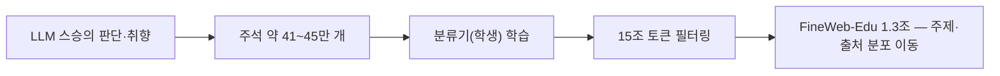
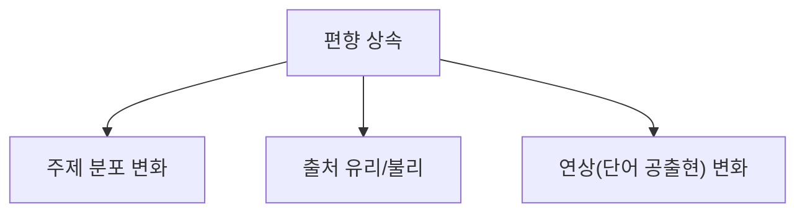

# 스승 편향 상속

> LLM이 만든 점수(주석)로 작은 분류기를 학습시키면 **LLM 스승의 판단 편향이 분류기에 그대로 전이되고, 분류기가 데이터를 거르는 순간 그 편향이 학습 데이터 전체로 퍼진다.** 편향을 알아내려면 분류기가 무엇을 늘리고 줄이는지 결과 데이터를 분석해야 한다.

## 쉽게 말하면
심사위원 한 명이 점수를 매긴 답안 40만 장으로 채점 로봇을 만들면, 로봇은 그 심사위원의 취향까지 배운다. 이 로봇이 이후 수십억 문서를 채점해 합격선을 정하면 그 취향이 데이터 전체의 모양을 바꾼다.

## 자세히
- 구조: FineWeb-Edu는 ① 대형 LLM(Llama-3)이 가산식 프롬프트로 문서 약 41~45만 개를 채점 → ② 이 점수로 임베딩 위의 작은 회귀 분류기를 학습 → ③ 분류기가 15조 토큰 전체를 채점해 3점 이상만 남긴다([루브릭을 프롬프트로](#rubric-to-prompt), [선형 프로브](#linear-probe)). 스승(LLM)의 편향 → 학생(분류기) → 최종 데이터 순으로 전이된다.
- 관찰된 이동(FineWeb 논문 4~5장, 읽음; 원인이 LLM 스승 때문인지 분류기 구조 때문인지는 논문이 분리하지 않음):
  - 주제: `Education, Learning, Teaching`·`History, Culture, Politics`는 늘고 `Business, Finance, Law`·`Entertainment, Film, Theater`·`Places, Travel, Real Estate`는 줄었다([특화와 일반 성능 균형](#specialization-vs-general)).
  - 출처: Wikipedia·학술 콘텐츠 쪽 퍼플렉서티가 낮아져 그쪽 유형이 유리해졌다.
  - 성별·종교 연상(부록 G 요약): FineWeb은 `man`, `christian` 같은 **지배적 규범을 반영하는 단어가 상대적으로 많고**, 종교 단어와 친밀 관계 표현의 연상이 가장 치우쳤으며(`christian dating`, `jewish singles`), FineWeb-Edu는 친밀 관련 연상이 줄고 역사·건강 같은 교육 주제(`man`–`king`, `woman`–`pregnancy`)에 가까워졌다. 즉 **편향이 사라지는 것이 아니라 다른 모양으로 바뀐다.**
- 분류기 자체의 한계: 고득점 클래스(5점)는 재현율이 0.01, 4점은 0.35로 낮아(모델 카드, 홀드아웃 46,867개) **희귀한 고득점 문서를 거의 못 알아본다**([희귀 클래스 재현율](#rare-class-recall)). 스승이 높게 준 문서를 학생이 낮게 보면서 학생의 한계가 스승의 기준을 변형한다.
- 점검 방법(제안): ① 분류기 점수별 문서 표본을 **사람이 읽어** 스승 의도와 맞는지 확인 ② 필터 전후 **주제·출처·인구통계 단어 분포**를 비교 ③ 스승 프롬프트를 바꿔 일부를 재채점해 결과가 얼마나 바뀌는지([LLM 채점 일관성](#llm-score-consistency)) ④ 여러 스승(모델·프롬프트)의 평균을 쓰거나 사람 보정 표본을 섞음 ⑤ 필터링 결과를 데이터시트·계보에 기록([데이터 계보 기록](#data-lineage-record)).
- 한계: 논문은 편향 지표를 "강하지 않다"고 서술하며 이 문서는 그 서술을 요약했다. 어떤 편향이 모델 행동에 얼마나 영향을 주는지는 별도 연구가 필요하다.

## 그림으로 보기

## 예시
- 사내 문서 품질 분류기를 LLM 점수로 학습했더니 영업·법무 문서 비율이 줄어든 사례를 점검 항목으로 사용.
- 교육: "자동 필터는 중립적이지 않다 — 누가(무엇이) 기준을 만들었는가"를 묻는 토론.

## 헷갈리는 것과 비교
| 개념 | 차이 |
|---|---|
| 스승 편향 상속 | 주석자(LLM)의 편향이 분류기·데이터로 전이 |
| 데이터 편향 | 원본 웹 데이터에 있던 편향 |
| 선택 편향 | 필터 기준 때문에 특정 표본만 남음 |

## 더 읽을거리
- [FineWeb 논문 (arXiv 2406.17557)](https://arxiv.org/abs/2406.17557) — 4.1·4.2절, 5장 편향 분석(읽음).
- [fineweb-edu-classifier 모델 카드](https://huggingface.co/HuggingFaceFW/fineweb-edu-classifier) — 분류기 지표(읽음).
