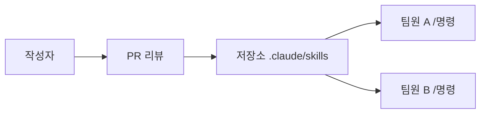
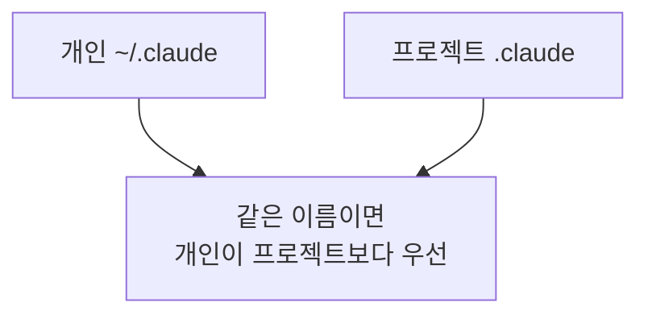

# 팀 프롬프트 라이브러리

> 팀이 자주 쓰는 지시문을 저장소나 서버에 한 곳에 모아 두고 `/명령어`로 누구나 같은 방식으로 불러 쓰게 하는 운영 방식이다.

## 쉽게 말하면
식당 주방에 레시피 카드 상자를 두는 것과 같다. 요리사마다 제 방식으로 만들면 맛이 들쭉날쭉하니, 검증된 카드를 한 상자에 두고 번호만 부르면 같은 조리법이 나오게 한다.

## 자세히
- **Claude Code**(문서 code.claude.com/docs/en/slash-commands 기준): 커스텀 명령과 스킬은 하나의 체계로 합쳐졌다. `.claude/commands/deploy.md`와 `.claude/skills/deploy/SKILL.md`는 둘 다 `/deploy`를 만든다. 신규 작업에는 스킬을 권장한다.
- **저장 위치와 범위**: 개인 `~/.claude/skills/<name>/SKILL.md`(내 모든 프로젝트), 프로젝트 `.claude/skills/<name>/SKILL.md`(그 저장소), 플러그인(`/플러그인명:스킬명`).
- **팀 공유**: 프로젝트 위치에 넣고 git에 커밋하면 저장소를 받은 모두가 쓴다. 더 넓게는 플러그인이나 관리형 설정으로 조직 전체에 배포한다.
- **인자**: `$ARGUMENTS`(입력 전체), `$0 $1`(위치 인자). 예: `/fix-issue 123`.
- **부작용 있는 명령**(배포 등)은 `disable-model-invocation: true`로 사람만 실행하게 한다.
- **보안 주의**: 저장소에 커밋된 스킬이 `allowed-tools`로 도구 권한을 줄 수 있으므로 신뢰하지 않는 저장소에서는 검토한다.
- **MCP 쪽**: 서버가 프롬프트를 노출하면 슬래시 명령으로 보일 수 있다([슬래시 명령 UI](#slash-command-ui), [MCP 프롬프트 보안](#mcp-prompt-security)). 운영 팁: 이름 규칙, 소유자, 버전, 리뷰(PR) 절차를 정한다.

## 그림으로 보기

## 예시
`.claude/skills/pr-summary/SKILL.md`에 "변경 내용을 3줄로 요약하고 위험을 나열하라"를 적어 커밋. 팀원 모두 `/pr-summary`로 같은 형식의 요약을 받는다. 교육 현장 예: 강사들이 공통 "수업 후기 정리" 명령을 공유.

## 헷갈리는 것과 비교
| 개념 | 차이 |
|---|---|
| 개인 프롬프트 메모 | 나만 씀. 품질 편차 |
| 팀 프롬프트 라이브러리 | 버전·리뷰·공유 |
| [스킬 vs CLAUDE.md](#skills-vs-claude-md) | CLAUDE.md는 항상 로드, 스킬은 필요할 때 |

## 더 읽을거리
- [Claude Code Slash commands](https://code.claude.com/docs/en/slash-commands) — 위치·인자·팀 공유
- [MCP Prompts 명세](https://modelcontextprotocol.io/specification/2025-06-18/server/prompts) — 서버가 프롬프트를 노출하는 방식
